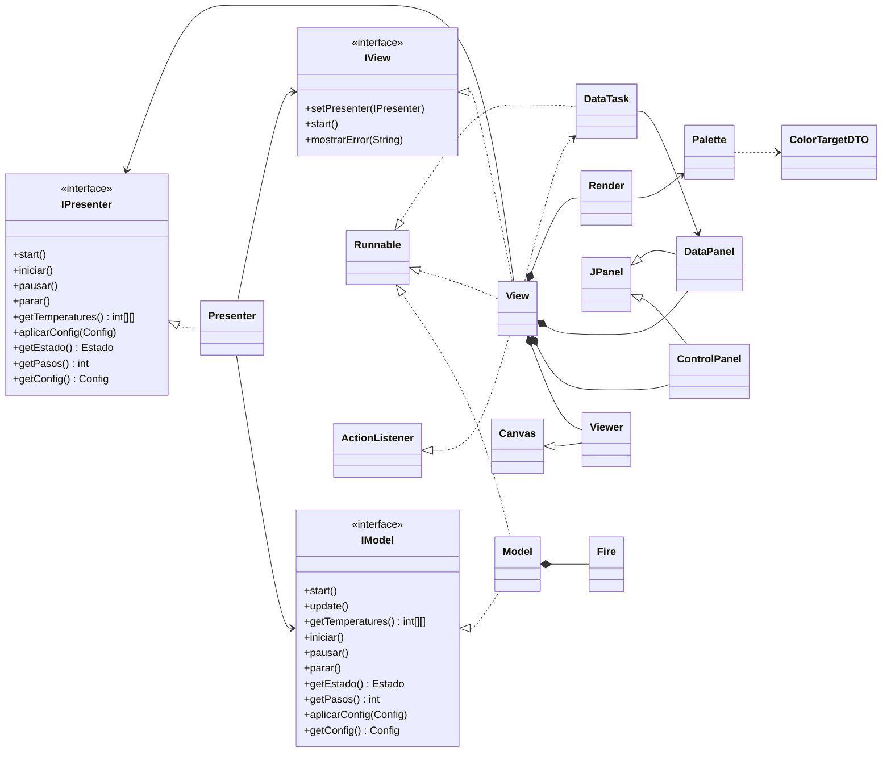
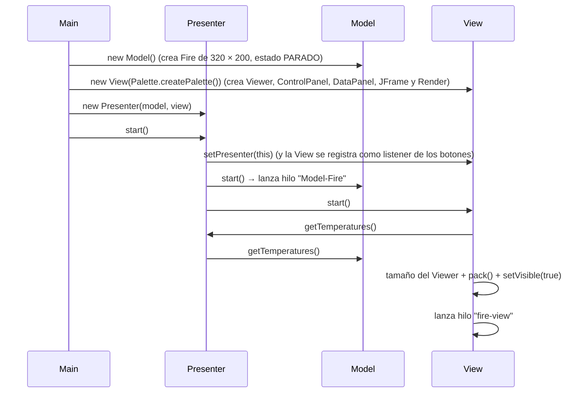
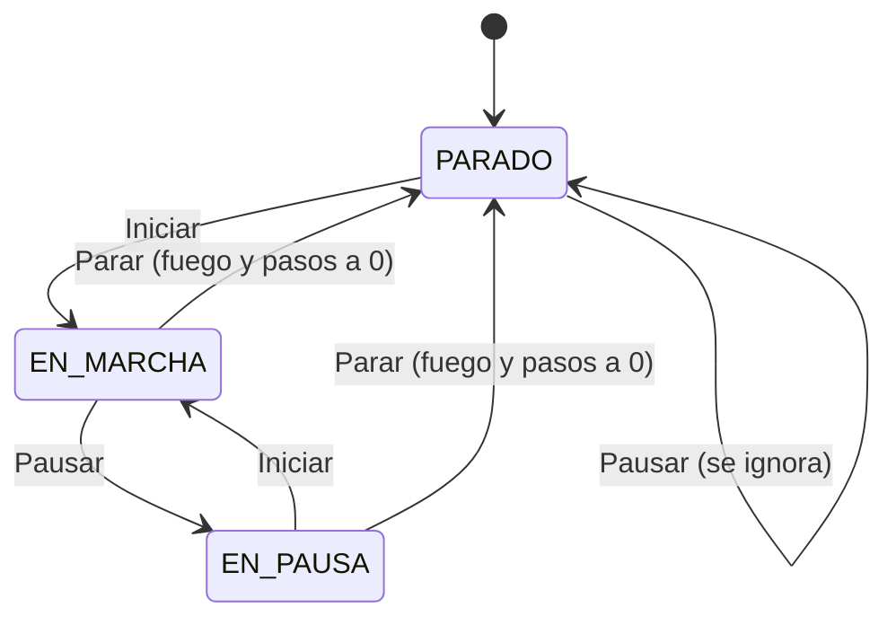
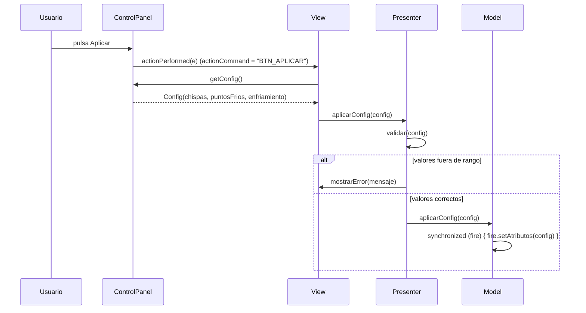

# Fuego — Animación de fuego en Java (Swing + MVP)

Programa que simula y dibuja en tiempo real un efecto de **fuego procedural** (el clásico "fire effect" de la demoscene) con una matriz de 320 × 200 celdas. Está estructurado siguiendo el patrón **Modelo–Vista–Presentador (MVP)** y usa **dos hilos** propios: uno que calcula el fuego y otro que lo pinta.

La ventana tiene el fuego a la derecha y, a la izquierda, un **panel de control** para iniciar, pausar, parar y cambiar los parámetros del fuego, y un **panel de datos** con el estado, los pasos, los FPS y los valores actuales.

---

## Índice

1. [Requisitos y ejecución](#requisitos-y-ejecución)
2. [Uso](#uso)
3. [Estructura del proyecto](#estructura-del-proyecto)
4. [Arquitectura MVP](#arquitectura-mvp)
5. [Flujo de arranque](#flujo-de-arranque)
6. [Estados de la animación](#estados-de-la-animación)
7. [Flujo de un botón](#flujo-de-un-botón)
8. [El algoritmo del fuego](#el-algoritmo-del-fuego)
9. [La paleta de colores](#la-paleta-de-colores)
10. [Hilos y sincronización](#hilos-y-sincronización)
11. [Referencia de clases](#referencia-de-clases)
12. [Parámetros](#parámetros)
13. [Posibles mejoras](#posibles-mejoras)

---

## Requisitos y ejecución

- **JDK 25** o superior. `Main.java` usa un *main de instancia* en una clase implícita (`void main() { ... }`, JEP 512), que no compila en versiones anteriores.
- Solo usa la librería estándar (`javax.swing`, `java.awt`).

Desde IntelliJ IDEA basta con ejecutar `Main.java`. Desde la terminal:

```bash
javac -encoding UTF-8 -d out src/Main.java src/config/*.java src/model/*.java src/view/*.java src/presenter/*.java
java -cp out Main
```

Se abre una ventana titulada **"Fire Animation"**. Al cerrarla termina el programa.

---

## Uso

La animación arranca **parada**: el fuego está apagado hasta que se pulsa Iniciar.

```
┌──────────────────────────┬──────────────────────────────────────┐
│ Panel de Control         │                                      │
│ [▶ Iniciar][⏸ Pausar][⏹ Parar]                                  │
│ Chispas (%)   ──●──────  │                                      │
│ Puntos fríos  ──●──────  │               FUEGO                  │
│ Enfriamiento  ●────────  │              (Viewer)                │
│        [Aplicar]         │                                      │
├──────────────────────────┤                                      │
│ Panel de Datos           │                                      │
│ Estado:        EN_MARCHA │                                      │
│ Pasos:         1234      │                                      │
│ FPS:           58        │                                      │
│ Chispas:       40%       │                                      │
│ Puntos fríos:  30        │                                      │
│ Enfriamiento:  1         │                                      │
└──────────────────────────┴──────────────────────────────────────┘
```

| Control | Qué hace |
|---------|----------|
| **▶ Iniciar** | Pone la simulación en marcha (o la reanuda si estaba en pausa). |
| **⏸ Pausar** | Congela el fuego tal como está. Si está parado no hace nada. |
| **⏹ Parar** | Detiene la simulación, apaga el fuego (todas las temperaturas a 0) y pone los pasos a 0. |
| **Deslizadores** | Eligen chispas (0–100 %), puntos fríos (0–100 %) y enfriamiento (0–10). |
| **Aplicar** | Envía los valores de los deslizadores al modelo. Hasta que no se pulsa, el fuego sigue con los anteriores. |

El panel de datos se refresca solo, a la vez que el fuego.

---

## Estructura del proyecto

```
src/
├── Main.java                 Punto de entrada: crea Modelo, Vista y Presentador y los inyecta
├── config/                   Tipos compartidos por las tres capas
│   ├── Estado.java           enum EN_MARCHA, EN_PAUSA, PARADO
│   └── Config.java           record (chispas, puntosFrios, enfriamiento) + límites MIN/MAX
├── model/                    Solo estado y números
│   ├── IModel.java           Interfaz del modelo
│   ├── Model.java            Modelo: estado, pasos y bucle de simulación en su propio hilo
│   └── Fire.java             Matriz de temperaturas, parámetros y algoritmo del fuego
├── presenter/
│   ├── IPresenter.java       Interfaz del presentador
│   └── Presenter.java        Une Modelo y Vista y valida la configuración
└── view/                     Todo lo visual
    ├── IView.java            Interfaz de la vista
    ├── View.java             Ventana (JFrame), layout, botones y hilo de refresco
    ├── ControlPanel.java     Botones Iniciar/Pausar/Parar, deslizadores y Aplicar
    ├── DataPanel.java        Etiquetas con estado, pasos, FPS y valores actuales
    ├── DataTask.java         Tarea (Runnable) que actualiza el DataPanel desde el EDT
    ├── Viewer.java           Canvas con doble buffer donde se pinta la imagen
    ├── Render.java           Convierte temperaturas en una imagen ARGB
    ├── Palette.java          Tabla temperatura → color (256 entradas)
    └── ColorTargetDTO.java   Punto de control de la paleta (temperatura + ARGB)
```

---

## Arquitectura MVP



| Capa | Responsabilidad |
|------|-----------------|
| **Modelo** (`model`) | Simula el fuego (`Fire`), guarda el estado (en marcha, en pausa o parado) y cuenta los pasos. Da **copias** de sus datos. Solo guarda números: no sabe nada de colores, imágenes ni Swing. |
| **Presentador** (`presenter`) | Arranca el modelo y la vista y hace de intermediario. Recibe las órdenes de la vista (iniciar, pausar, parar, aplicar), **valida** la configuración y se la pasa al modelo, o le pide a la vista que muestre un error. |
| **Vista** (`view`) | Monta la ventana con sus paneles, convierte las temperaturas en imagen (`Render` + `Palette`), la repinta periódicamente en el `Viewer` y refresca el `DataPanel`. Cuando se pulsa un botón avisa al presentador. No sabe nada del modelo. |
| **Config** (`config`) | `Estado` y `Config` son tipos de datos que usan las tres capas para hablar entre ellas. No tienen lógica. |

La vista y el modelo **nunca se comunican directamente**: todo pasa por el presentador y por interfaces, lo que permite cambiar una capa sin tocar las demás.

`Main` crea las piezas y se las inyecta: la `Palette` se crea en `Main` y se pasa a la `View`, que con ella crea su `Render`. Ninguna clase crea sus propias dependencias.

---

## Flujo de arranque



1. `Main` crea el modelo, la vista (con su paleta) y el presentador, y llama a `presenter.start()`.
2. `Presenter.start()` registra el presentador en la vista, arranca el hilo del modelo y luego la vista.
3. `View.setPresenter()` guarda el presentador y llama a `controlPanel.setActionListener(this)`, para que la propia `View` escuche los cuatro botones.
4. `View.start()` pide las primeras temperaturas para saber el tamaño del canvas (`temperatures[0].length` × `temperatures.length`), ajusta la ventana con `pack()`, la muestra y arranca su propio hilo de refresco.

El hilo del modelo arranca desde el principio, pero mientras el estado sea `PARADO` no calcula nada.

---

## Estados de la animación



El hilo del modelo **no se detiene nunca**: en cada vuelta mira el estado y solo llama a `update()` (y suma un paso) si está `EN_MARCHA`. Así pausar y reanudar es solo cambiar un valor, sin crear ni parar hilos.

---

## Flujo de un botón

Ejemplo con **Aplicar**:



Cada botón tiene un `actionCommand` (constantes `INICIAR`, `PAUSAR`, `PARAR` y `APLICAR` de `View`). La `View` implementa `ActionListener` y en `actionPerformed` usa un `switch` sobre el comando para llamar al método correspondiente del presentador. No se usan lambdas.

Los deslizadores ya no dejan elegir valores fuera de rango, pero el presentador **valida igualmente**: es la capa que decide qué es correcto, y así seguiría funcionando si la vista cambiara (por ejemplo, a campos de texto).

---

## El algoritmo del fuego

El fuego se representa como una matriz `temperatures[height][width]` de enteros entre **0** (frío) y **255** (máximo calor). En cada paso del modelo (`Model.update()`) se ejecutan tres fases:

### 1. Generación de chispas — `sparksGeneration()`
En la **última fila** (la base del fuego), cada celda tiene una probabilidad de `sparksPercentage` % (40 % por defecto) de ponerse a 255.

### 2. Generación de puntos fríos — `coolPointsGeneration()`
En esa misma fila, cada celda tiene una probabilidad de `coolPontsPercentage` % (30 % por defecto) de ponerse a 0. Al mezclar chispas y puntos fríos la base queda irregular, y por eso las llamas tienen formas distintas.

### 3. Propagación hacia arriba — `updateFlames()`
Para cada celda que no esté en la última fila, su nueva temperatura es la media de ella misma y de las tres celdas que tiene debajo, menos un enfriamiento aleatorio entre 0 y `cooling`:

```
            [ actual ]                fila y
[ left ]   [ center ]   [ right ]     fila y+1
```

```java
nueva = max(0, (actual + left + center + right) / 4 - random(0..cooling))
```

- En los bordes laterales se reutiliza la celda del borde (`Math.max(x-1, 0)` y `Math.min(x+1, width-1)`) para no salirse del array.
- Al restar un valor aleatorio, el calor se pierde poco a poco al subir, así que las llamas se apagan con la altura. Cuanto mayor es `cooling`, **más bajas** son las llamas.
- Como se toma la media de las celdas vecinas, el calor también se reparte hacia los lados y las llamas se ven suaves.

`restartTemperatures()` pone todas las celdas a 0. Lo usa `Model.parar()` para apagar el fuego.

---

## La paleta de colores

`Palette` (en la vista) precalcula un array de **256 colores ARGB**, uno por temperatura, interpolando linealmente entre varios **puntos de control** (`ColorTargetDTO`):

| Temperatura | Alpha | R | G | B | Color |
|------------:|------:|----:|----:|----:|-------|
| 0   | 0   | 0   | 0   | 0   | Transparente (se ve el fondo blanco del `Viewer`) |
| 20  | 255 | 224 | 58  | 0   | Rojo anaranjado |
| 80  | 255 | 255 | 208 | 32  | Amarillo |
| 255 | 255 | 255 | 255 | 255 | Blanco |

Entre cada par de puntos consecutivos `from → to`, para cada temperatura `t`:

```
ratio = (t - from.temperatura) / (to.temperatura - from.temperatura)   // 0..1
canal = round(from.canal + (to.canal - from.canal) * ratio)
```

Así, en cada fotograma `Render` solo tiene que consultar `colors[temperatura]`, sin hacer cálculos de color.

Para cambiar el aspecto del fuego (por ejemplo, un fuego azul) basta con modificar los puntos de `Palette.createPalette()`. El primer punto debe estar en la temperatura 0 y el último en la 255 para cubrir todo el array.

---

## Hilos y sincronización

El programa usa tres hilos:

| Hilo | Dónde se crea | Qué hace | Frecuencia |
|------|---------------|----------|------------|
| **`Model-Fire`** | `Model.start()` | Si está `EN_MARCHA`: `update()` y `pasos++`. Después, `sleep(33 ms)` | ≈ 30 vueltas/s |
| **`fire-view`** | `View.start()` | Pinta el fuego en el `Viewer`, cuenta los FPS y manda un `DataTask` al EDT. Después, `sleep(16 ms)` | ≈ 60 vueltas/s |
| **EDT** (Swing) | Swing | Ejecuta los botones (`actionPerformed`), `Viewer.paint()` y los `DataTask` | Cuando hay eventos |

Los dos hilos propios son **daemon**, así que no impiden que la JVM termine al cerrar la ventana.

Cómo se evita que un hilo lea datos a medio escribir:

- **`synchronized (fire)` en `Model`**
  - `fire` es el cerrojo común. Lo toman `update()` (modifica las temperaturas), `getTemperatures()` (las copia), `parar()` (las pone a 0), `aplicarConfig()` (cambia los parámetros) y `getConfig()` (los lee).
  - Así la vista nunca recibe un fuego a medio actualizar, y un Aplicar no puede cambiar los parámetros a mitad de un paso.
  - En `getConfig()` los tres valores se leen dentro del mismo bloque, así que el `Config` devuelto nunca mezcla valores viejos y nuevos.
- **`volatile` en `Model.estado` y `Model.pasos`**
  - Los escribe un hilo (el EDT al pulsar un botón, o `Model-Fire` al sumar pasos) y los leen otros.
  - `volatile` asegura que cada hilo vea siempre el último valor.
- **La copia ("foto") de las temperaturas**
  - `getTemperatures()` copia la matriz **fila a fila** (`original[i].clone()`). Clonar solo la matriz copiaría el array de filas, pero las filas seguirían siendo las mismas que modifica el modelo.
  - La vista trabaja con su copia y el modelo sigue con la original sin molestarse.
- **Una imagen nueva en cada fotograma**
  - `Render.getImage()` crea una `BufferedImage` nueva cada vez y solo la rellena el hilo `fire-view`.
  - El `Viewer` la recibe ya terminada y nadie vuelve a escribir en ella, así que no hace falta bloquearla.
- **`volatile` en `Viewer.image`**
  - `setImage()` lo escribe el hilo `fire-view` y `paint()` lo lee el EDT.
- **`DataTask` + `SwingUtilities.invokeLater`**
  - Los componentes de Swing (como los `JLabel` del `DataPanel`) solo se deben tocar desde el EDT.
  - Por eso `fire-view` no llama a `dataPanel.actualizar(...)` directamente: crea un `DataTask` con los datos de ese momento y se lo pasa a `invokeLater`, que lo ejecuta en el EDT.
  - `DataTask` guarda los datos en atributos `final`, así que el EDT ve exactamente los valores que había cuando se creó la tarea.

`Viewer` pinta con **doble buffer** (dibuja en una imagen en memoria y la vuelca de una vez) y sobrescribe `update(Graphics)` para llamar directamente a `paint()`. Así AWT no borra el fondo antes de cada repintado y se evita el parpadeo.

### Cálculo de los FPS

Se cuentan en el hilo `fire-view`, con tres variables locales de `run()`:

| Variable | Qué guarda |
|----------|------------|
| `contadorFrames` | Frames pintados en el segundo **actual**. Sube 1 en cada vuelta. |
| `inicioSegundo` | Cuándo empezó el segundo actual (`System.currentTimeMillis()`). |
| `fps` | Frames del segundo **anterior**, ya terminado. Es lo que se enseña. Empieza en 0. |

Cuando han pasado 1000 ms o más desde `inicioSegundo`, `fps` toma el valor del contador, el contador vuelve a 0 e `inicioSegundo` pasa a ser la hora actual. Así el número del panel solo cambia una vez por segundo. Sale algo menos de 60, porque a los 16 ms de `sleep` se suma lo que tarda cada vuelta en pintar.

---

## Referencia de clases

### `Main`
Punto de entrada. Crea `Model()`, `View(Palette.createPalette())` y `Presenter(model, view)`, y llama a `presenter.start()`. No usa lambdas.

### Paquete `config`

#### `Estado`
`enum` con `EN_MARCHA`, `EN_PAUSA` y `PARADO`.

#### `Config`
`record Config(int chispas, int puntosFrios, int enfriamiento)`: los tres parámetros del fuego juntos. Tiene las constantes de los límites:

| Constantes | Rango |
|------------|-------|
| `CHISPAS_MIN`, `CHISPAS_MAX` | 0–100 |
| `PUNTO_FRIO_MIN`, `PUNTO_FRIO_MAX` | 0–100 |
| `ENFRIAMIENTO_MIN`, `ENFRIAMIENTO_MAX` | 0–10 |

Las usan los deslizadores del `ControlPanel` y la validación del `Presenter`, así los límites están escritos en un solo sitio.

### Paquete `model`

#### `IModel`
| Método | Descripción |
|--------|-------------|
| `void start()` | Lanza el hilo de la simulación. |
| `void update()` | Avanza un paso la simulación. |
| `int[][] getTemperatures()` | Devuelve una copia de la matriz de temperaturas. |
| `void iniciar()` / `void pausar()` | Cambian el estado a `EN_MARCHA` / `EN_PAUSA`. |
| `void parar()` | Estado `PARADO`, temperaturas y pasos a 0. |
| `Estado getEstado()` | Estado actual. |
| `int getPasos()` | Pasos simulados desde el último Parar. |
| `void aplicarConfig(Config)` | Cambia los parámetros del fuego. |
| `Config getConfig()` | Parámetros actuales del fuego. |

#### `Model` (implementa `IModel`, `Runnable`)
- Crea un `Fire` de **320 × 200** y empieza en estado `PARADO`.
- `start()` lanza el hilo daemon `Model-Fire`.
- `run()` es un bucle infinito: si el estado es `EN_MARCHA` llama a `update()` y suma un paso, y siempre duerme `frameMS = 33` ms. Termina si el hilo se interrumpe.
- `update()` ejecuta chispas → puntos fríos → propagación, todo dentro de `synchronized (fire)`.
- `getTemperatures()` copia la matriz fila a fila dentro de `synchronized (fire)`.
- `aplicarConfig()` y `getConfig()` usan también `synchronized (fire)`.

#### `Fire`
Guarda la matriz de temperaturas y los parámetros, e implementa el algoritmo.

| Miembro | Descripción |
|---------|-------------|
| `sparksPercentage` (40) | Probabilidad (%) de chispa en cada celda de la base. |
| `coolPontsPercentage` (30) | Probabilidad (%) de punto frío en cada celda de la base. |
| `cooling` (1) | Enfriamiento aleatorio máximo por paso (se resta `0..cooling`). |
| `sparksGeneration()` | Pone chispas (255) en la última fila. |
| `coolPointsGeneration()` | Pone puntos fríos (0) en la última fila. |
| `updateFlames()` | Propaga el calor hacia arriba (ver algoritmo). |
| `restartTemperatures()` | Pone todas las temperaturas a 0. |
| `setAtributos(Config)` | Cambia los tres parámetros. |
| `getSparksPercentage()`, `getCoolPontsPercentage()`, `getCooling()` | Getters de los parámetros. |
| `getTemperatures()`, `getWidth()`, `getHeight()` | Getters de la matriz. |

### Paquete `presenter`

#### `IPresenter`
| Método | Descripción |
|--------|-------------|
| `void start()` | Arranca la aplicación. |
| `void iniciar()` / `void pausar()` / `void parar()` | Órdenes de los botones. |
| `int[][] getTemperatures()` | Pasa las temperaturas del modelo a la vista. |
| `void aplicarConfig(Config)` | Valida y aplica la configuración. |
| `Estado getEstado()`, `int getPasos()`, `Config getConfig()` | Datos para el `DataPanel`. |

#### `Presenter` (implementa `IPresenter`)
- `start()`: `view.setPresenter(this)` → `model.start()` → `view.start()`.
- `pausar()`: si el modelo está `PARADO` no hace nada; si no, `model.pausar()`.
- `aplicarConfig(config)`: llama a `validar(config)`. Si devuelve un mensaje, `view.mostrarError(mensaje)`; si devuelve `null`, `model.aplicarConfig(config)`.
- `validar(Config)` (privado): comprueba cada valor contra las constantes de `Config` y devuelve el mensaje del primer error, o `null` si todo es correcto.
- El resto de métodos delegan en el modelo.

### Paquete `view`

#### `IView`
| Método | Descripción |
|--------|-------------|
| `void setPresenter(IPresenter)` | Inyecta el presentador. |
| `void start()` | Muestra la ventana y arranca el refresco. |
| `void mostrarError(String)` | Muestra un mensaje de error (`JOptionPane`). |

#### `View` (implementa `IView`, `Runnable`, `ActionListener`)
- Recibe la `Palette` en el constructor y crea con ella su `Render`.
- Crea un `JFrame` ("Fire Animation", `EXIT_ON_CLOSE`) con un `GridBagLayout` de dos columnas:

  | Componente | `gridx` | `gridy` | `gridheight` | Se estira |
  |------------|:-------:|:-------:|:------------:|-----------|
  | `ControlPanel` | 0 | 0 | 1 | Solo a lo ancho, pegado arriba |
  | `DataPanel` | 0 | 1 | 1 | Ocupa lo que sobra abajo |
  | `Viewer` | 1 | 0 | 2 | En las dos direcciones, ocupa todo el alto |

- Constantes `INICIAR`, `PAUSAR`, `PARAR` y `APLICAR` con los `actionCommand` de los botones.
- `setPresenter()` guarda el presentador y se registra como listener del `ControlPanel`.
- `start()` usa las primeras temperaturas para dimensionar el canvas, muestra la ventana y lanza el hilo `fire-view`.
- `run()`, en cada vuelta: pinta el fuego en el `Viewer`, cuenta los FPS, manda un `DataTask` con `invokeLater` y duerme `FRAME_MS = 16` ms.
- `actionPerformed()` llama al presentador según el `actionCommand`.

#### `ControlPanel` (extiende `JPanel`)
- Borde con título "Panel de Control" y `GridBagLayout`. Un contador `fila` indica dónde va la siguiente fila.
- `addBotones()` añade un subpanel con ▶ Iniciar, ⏸ Pausar y ⏹ Parar.
- `addFila(texto, componente)` añade una fila con una etiqueta y un deslizador (`JSlider` con los límites de `Config`).
- El botón Aplicar va en su propia fila.
- `setActionListener(listener)` pone el `actionCommand` a cada botón y registra el listener en los cuatro.
- `getConfig()` devuelve un `Config` con los valores de los deslizadores.

#### `DataPanel` (extiende `JPanel`)
- Borde con título "Panel de Datos". Igual que el `ControlPanel`, usa un contador `fila` y `addFila(texto, componente)`.
- Cada fila tiene el nombre fijo a la izquierda y un `JLabel` con el valor a la derecha (`estadoLabel`, `pasosLabel`, `fpsLabel`, `chispasLabel`, `puntosFriosLabel`, `enfriamientoLabel`).
- `actualizar(Estado, int pasos, int fps, Config)` cambia el texto de las etiquetas de valor. Solo se debe llamar desde el EDT.

#### `DataTask` (implementa `Runnable`)
- Recibe en el constructor el `DataPanel` y los datos (estado, pasos, FPS y `Config`) y los guarda en atributos `final`.
- `run()` llama a `dataPanel.actualizar(...)`. Se ejecuta en el EDT a través de `SwingUtilities.invokeLater`.

#### `Viewer` (extiende `Canvas`)
- `setImage(BufferedImage)` guarda la imagen (campo `volatile`) y llama a `repaint()`.
- `paint(Graphics)` no hace nada si aún no hay imagen o el canvas mide 0. Si no, pinta con doble buffer: fondo blanco, fuego escalado al tamaño del canvas y volcado del buffer a pantalla.
- `update(Graphics)` llama directamente a `paint()` para evitar el parpadeo.

#### `Render`
- Recibe la `Palette` en el constructor.
- `getImage(int[][] temperatures)` crea una `BufferedImage` `TYPE_INT_ARGB` nueva del tamaño de la matriz y pone cada píxel a `palette.color(temperatura)`.

#### `Palette`
- `Palette(List<ColorTargetDTO> targets)` construye la tabla de 256 colores interpolando entre los puntos de control.
- `int color(int temperatura)` devuelve el color ARGB empaquetado en un `int`.
- `static Palette createPalette()` crea la paleta por defecto (transparente → rojo → amarillo → blanco).
- `mix(v1, v2, ratio)` hace la interpolación lineal de un canal.

#### `ColorTargetDTO`
Objeto inmutable con `temperatura`, `alpha`, `red`, `green` y `blue`. Representa un punto de control de la paleta.

---

## Parámetros

Se cambian desde la ventana (con Aplicar):

| Parámetro | Atributo en `Fire` | Por defecto | Rango | Efecto al aumentarlo |
|-----------|--------------------|:-----------:|:-----:|----------------------|
| Chispas | `sparksPercentage` | 40 % | 0–100 | Fuego más intenso y denso. |
| Puntos fríos | `coolPontsPercentage` | 30 % | 0–100 | Base más irregular y fuego más débil. |
| Enfriamiento | `cooling` | 1 | 0–10 | Llamas más bajas (se enfrían antes). |

Fijos en el código:

| Parámetro | Clase | Valor | Efecto al aumentarlo |
|-----------|-------|-------|----------------------|
| `width`, `height` | `Model` | 320 × 200 | Más resolución (y más coste de CPU). |
| `frameMS` | `Model` | 33 ms | Simulación más lenta. |
| `FRAME_MS` | `View` | 16 ms | Menos refrescos por segundo (menos FPS). |
| Puntos de control | `Palette.createPalette()` | transparente → rojo → amarillo → blanco | Cambia los colores del fuego. |

---

## Posibles mejoras

- Inicializar los deslizadores con `presenter.getConfig()` en lugar de escribir 40, 30 y 1 a mano en el `ControlPanel`.
- Aplicar los cambios de los deslizadores al momento (con un `ChangeListener`) en lugar de con el botón Aplicar.
- Mostrar el estado con un texto más legible ("En marcha" en vez de `EN_MARCHA`).
- Pasar el ancho y el alto desde `Main` en lugar de fijarlos dentro de `Model`.
