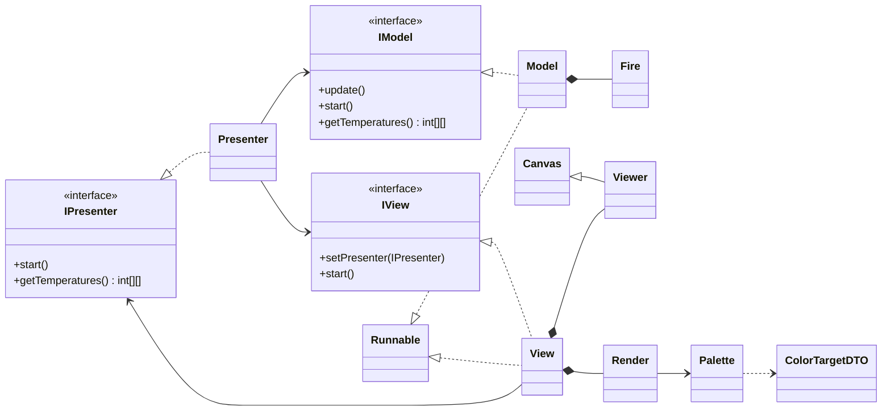
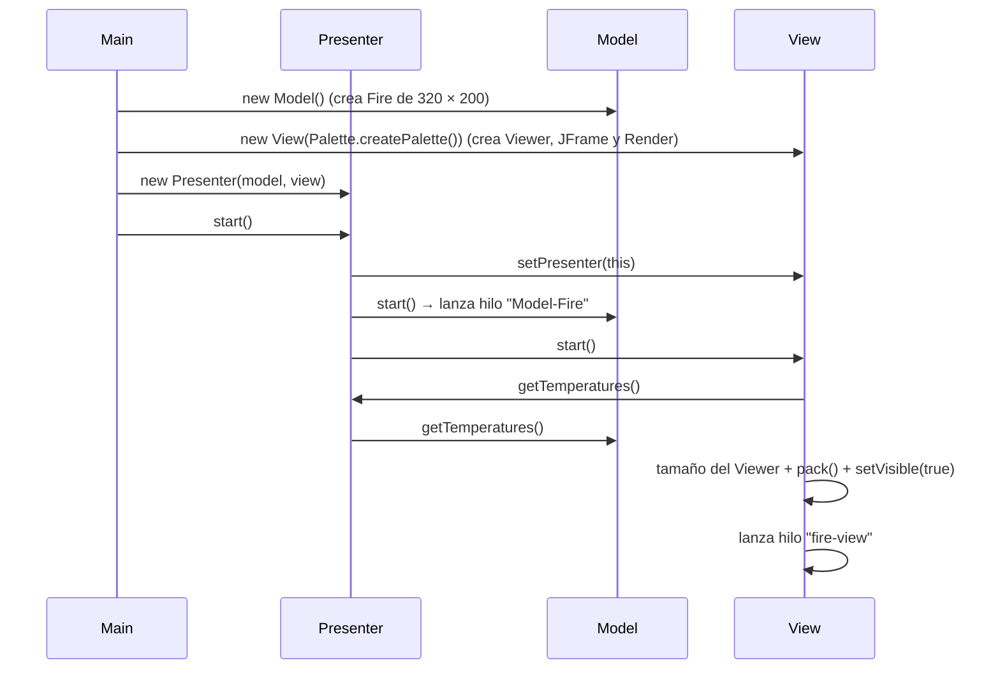

# Fuego — Animación de fuego en Java (Swing + MVP)

Programa que simula y dibuja en tiempo real un efecto de **fuego procedural** (el clásico "fire effect" de la demoscene) en una ventana de 320 × 200 píxeles. Está estructurado siguiendo el patrón **Modelo–Vista–Presentador (MVP)** y usa **dos hilos** independientes: uno que calcula el fuego y otro que lo pinta.

---

## Índice

1. [Requisitos y ejecución](#requisitos-y-ejecución)
2. [Estructura del proyecto](#estructura-del-proyecto)
3. [Arquitectura MVP](#arquitectura-mvp)
4. [Flujo de arranque](#flujo-de-arranque)
5. [El algoritmo del fuego](#el-algoritmo-del-fuego)
6. [La paleta de colores](#la-paleta-de-colores)
7. [Hilos y sincronización](#hilos-y-sincronización)
8. [Referencia de clases](#referencia-de-clases)
9. [Parámetros configurables](#parámetros-configurables)
10. [Posibles mejoras](#posibles-mejoras)

---

## Requisitos y ejecución

- **JDK 25** o superior. `Main.java` usa un *main de instancia* en una clase implícita (`void main() { ... }`, JEP 512), que no compila en versiones anteriores.
- Solo usa la librería estándar (`javax.swing`, `java.awt`).

Desde IntelliJ IDEA basta con ejecutar `Main.java`. Desde la terminal:

```bash
javac -d out src/Main.java src/model/*.java src/view/*.java src/presenter/*.java
java -cp out Main
```

Se abre una ventana titulada **"Fire Animation"** con el fuego animado. Al cerrarla termina el programa.

---

## Estructura del proyecto

```
src/
├── Main.java                 Punto de entrada: crea Modelo, Vista y Presentador y los inyecta
├── model/                    Solo estado y números
│   ├── IModel.java           Interfaz del modelo
│   ├── Model.java            Modelo: bucle de simulación en su propio hilo
│   └── Fire.java             Matriz de temperaturas y algoritmo del fuego
├── presenter/
│   ├── IPresenter.java       Interfaz del presentador
│   └── Presenter.java        Une Modelo y Vista
└── view/                     Todo lo visual
    ├── IView.java            Interfaz de la vista
    ├── View.java             Ventana (JFrame) + hilo de refresco
    ├── Viewer.java           Canvas con doble buffer donde se pinta la imagen
    ├── Render.java           Convierte temperaturas en una imagen ARGB
    ├── Palette.java          Tabla temperatura → color (256 entradas)
    └── ColorTargetDTO.java   Punto de control de la paleta (temperatura + ARGB)
```

---

## Arquitectura MVP



| Capa | Responsabilidad |
|------|-----------------|
| **Modelo** (`model`) | Simula el fuego (`Fire`) y da una **copia** de su matriz de temperaturas. Solo guarda números: no sabe nada de colores, imágenes ni Swing. |
| **Presentador** (`presenter`) | Arranca el modelo y la vista y hace de intermediario: la vista le pide las temperaturas y él se las pide al modelo. |
| **Vista** (`view`) | Convierte las temperaturas en imagen (`Render` + `Palette`) y la repinta periódicamente en el `Viewer`. No sabe nada del modelo. |

La vista y el modelo **nunca se comunican directamente**: todo pasa por el presentador y por interfaces, lo que permite cambiar una capa sin tocar las demás.

`Main` crea las piezas y se las inyecta: la `Palette` se crea en `Main` y se pasa a la `View`, que con ella crea su `Render`. Ninguna clase crea sus propias dependencias.

---

## Flujo de arranque



1. `Main` crea el modelo, la vista (con su paleta) y el presentador, y llama a `presenter.start()`.
2. `Presenter.start()` registra el presentador en la vista, arranca el hilo del modelo y luego la vista.
3. `View.start()` pide las primeras temperaturas para saber el tamaño del canvas (`temperatures[0].length` × `temperatures.length`), ajusta la ventana con `pack()`, la muestra y arranca su propio hilo de refresco.

---

## El algoritmo del fuego

El fuego se representa como una matriz `temperatures[height][width]` de enteros entre **0** (frío) y **255** (máximo calor). En cada paso del modelo (`Model.update()`) se ejecutan tres fases:

### 1. Generación de chispas — `sparksGeneration()`
En la **última fila** (la base del fuego), cada celda tiene un **40 %** de probabilidad de ponerse a 255.

### 2. Generación de puntos fríos — `coolPointsGeneration()`
En esa misma fila, cada celda tiene un **30 %** de probabilidad de ponerse a 0. Al mezclar chispas y puntos fríos la base queda irregular, y por eso las llamas tienen formas distintas.

### 3. Propagación hacia arriba — `updateFlames()`
Para cada celda que no esté en la última fila, su nueva temperatura es la media de ella misma y de las tres celdas que tiene debajo, menos un pequeño enfriamiento aleatorio:

```
            [ actual ]                fila y
[ left ]   [ center ]   [ right ]     fila y+1
```

```java
nueva = max(0, (actual + left + center + right) / 4 - random(0..1))
```

- En los bordes laterales se reutiliza la celda del borde (`Math.max(x-1, 0)` y `Math.min(x+1, width-1)`) para no salirse del array.
- Al restar un valor aleatorio, el calor se pierde poco a poco al subir, así que las llamas se apagan con la altura.
- Como se toma la media de las celdas vecinas, el calor también se reparte hacia los lados y las llamas se ven suaves.

---

## La paleta de colores

`Palette` (en la vista) precalcula un array de **256 colores ARGB**, uno por temperatura, interpolando linealmente entre varios **puntos de control** (`ColorTargetDTO`):

| Temperatura | Alpha | R | G | B | Color |
|------------:|------:|----:|----:|----:|-------|
| 0   | 0   | 0   | 0   | 0   | Transparente / negro |
| 20  | 255 | 224 | 58  | 0   | Rojo anaranjado |
| 80  | 255 | 255 | 208 | 32  | Amarillo |
| 255 | 255 | 255 | 255 | 255 | Blanco |

Entre cada par de puntos consecutivos `from → to`, para cada temperatura `t`:

```
ratio = (t - from.temperatura) / (to.temperatura - from.temperatura)   // 0..1
canal = round(from.canal + (to.canal - from.canal) * ratio)
```

Así, en cada fotograma `Render` solo tiene que consultar `colors[temperatura]`, sin hacer cálculos de color.

Para cambiar el aspecto del fuego (por ejemplo, un fuego azul) basta con modificar los puntos de `Palette.createPalette()`. El primer punto debe estar en la temperatura 0 y el último en la 255 para cubrir todo el array.

---

## Hilos y sincronización

El programa usa tres hilos:

| Hilo | Dónde se crea | Qué hace | Frecuencia |
|------|---------------|----------|------------|
| **`Model-Fire`** | `Model.start()` | Bucle `update()` → `sleep(33 ms)` | ≈ 30 actualizaciones/s |
| **`fire-view`** | `View.start()` | Bucle `presenter.getTemperatures()` → `render.getImage(...)` → `viewer.setImage(...)` → `sleep(16 ms)` | ≈ 60 refrescos/s |
| **EDT** (Swing) | Swing | Ejecuta `Viewer.paint()` cuando toca repintar | Cuando Swing repinta |

Los dos hilos propios son **daemon**, así que no impiden que la JVM termine al cerrar la ventana.

Cómo se evita que un hilo lea datos a medio escribir:

- **`synchronized (fire)` en `Model`**
  - `update()` lo toma mientras modifica las temperaturas.
  - `getTemperatures()` lo toma mientras las copia.
  - Así la vista nunca recibe un fuego a medio actualizar.
- **La copia ("foto") de las temperaturas**
  - `getTemperatures()` copia la matriz **fila a fila** (`original[i].clone()`). Clonar solo la matriz copiaría el array de filas, pero las filas seguirían siendo las mismas que modifica el modelo.
  - La vista trabaja con su copia y el modelo sigue con la original sin molestarse.
- **Una imagen nueva en cada fotograma**
  - `Render.getImage()` crea una `BufferedImage` nueva cada vez y solo la rellena el hilo `fire-view`.
  - El `Viewer` la recibe ya terminada y nadie vuelve a escribir en ella, así que no hace falta bloquearla.
  - Si nadie más escribe los datos que usas, no hay nada que proteger.
- **`volatile` en `Viewer.image`**
  - `setImage()` lo escribe el hilo `fire-view` y `paint()` lo lee el EDT.
  - `volatile` asegura que el EDT vea siempre la última imagen.

`Viewer` pinta con **doble buffer** (dibuja en una imagen en memoria y la vuelca de una vez) y sobrescribe `update(Graphics)` para llamar directamente a `paint()`. Así AWT no borra el fondo antes de cada repintado y se evita el parpadeo.

---

## Referencia de clases

### `Main`
Punto de entrada. Crea `Model()`, `View(Palette.createPalette())` y `Presenter(model, view)`, y llama a `presenter.start()`. No usa lambdas ni `SwingUtilities.invokeLater`.

### Paquete `model`

#### `IModel`
| Método | Descripción |
|--------|-------------|
| `void start()` | Arranca la simulación. |
| `void update()` | Avanza un paso la simulación. |
| `int[][] getTemperatures()` | Devuelve una copia de la matriz de temperaturas. |

#### `Model` (implementa `IModel`, `Runnable`)
- Crea un `Fire` de **320 × 200**.
- `start()` lanza el hilo daemon `Model-Fire`.
- `run()` llama a `update()` cada `frameMS = 33` ms hasta que el hilo se interrumpe.
- `update()` ejecuta chispas → puntos fríos → propagación, todo dentro de `synchronized (fire)`.
- `getTemperatures()` copia la matriz fila a fila dentro de `synchronized (fire)`.

#### `Fire`
Guarda la matriz de temperaturas e implementa el algoritmo.

| Miembro | Descripción |
|---------|-------------|
| `sparksPercentage = 40` | Probabilidad (%) de chispa en cada celda de la base. |
| `coolPontsPercentage = 30` | Probabilidad (%) de punto frío en cada celda de la base. |
| `randomizer = 1` | Enfriamiento aleatorio máximo por paso (se resta `0..randomizer`). |
| `cooling = 1` | Declarado pero **no se usa** actualmente. |
| `sparksGeneration()` | Pone chispas (255) en la última fila. |
| `coolPointsGeneration()` | Pone puntos fríos (0) en la última fila. |
| `updateFlames()` | Propaga el calor hacia arriba (ver algoritmo). |
| `getTemperatures()`, `getWidth()`, `getHeight()` | Getters. |

### Paquete `presenter`

#### `IPresenter`
| Método | Descripción |
|--------|-------------|
| `void start()` | Arranca la aplicación. |
| `int[][] getTemperatures()` | Pasa las temperaturas del modelo a la vista. |

Tiene comentados `play()`, `pause()` y `stop()`, pensados para controlar la animación más adelante.

#### `Presenter` (implementa `IPresenter`)
- `start()`: `view.setPresenter(this)` → `model.start()` → `view.start()`.
- `getTemperatures()`: delega en `model.getTemperatures()`.

### Paquete `view`

#### `IView`
| Método | Descripción |
|--------|-------------|
| `void setPresenter(IPresenter)` | Inyecta el presentador. |
| `void start()` | Muestra la ventana y arranca el refresco. |

#### `View` (implementa `IView`, `Runnable`)
- Recibe la `Palette` en el constructor y crea con ella su `Render`.
- Crea un `JFrame` ("Fire Animation", `EXIT_ON_CLOSE`) con un `Viewer` dentro.
- `start()` usa las primeras temperaturas para dimensionar el canvas, muestra la ventana y lanza el hilo `fire-view`.
- `run()` pide las temperaturas al presentador, las convierte en imagen con `render` y se la pasa al `Viewer` cada `FRAME_MS = 16` ms.

#### `Viewer` (extiende `Canvas`)
- `setImage(BufferedImage)` guarda la imagen (campo `volatile`) y llama a `repaint()`.
- `paint(Graphics)` no hace nada si aún no hay imagen o el canvas mide 0. Si no, pinta con doble buffer: fondo negro, fuego escalado al tamaño del canvas y volcado del buffer a pantalla.
- `update(Graphics)` llama directamente a `paint()` para evitar el parpadeo.

#### `Render`
- Recibe la `Palette` en el constructor.
- `getImage(int[][] temperatures)` crea una `BufferedImage` `TYPE_INT_ARGB` nueva del tamaño de la matriz y pone cada píxel a `palette.color(temperatura)`.

#### `Palette`
- `Palette(List<ColorTargetDTO> targets)` construye la tabla de 256 colores interpolando entre los puntos de control.
- `int color(int temperatura)` devuelve el color ARGB empaquetado en un `int`.
- `static Palette createPalette()` crea la paleta por defecto (negro → rojo → amarillo → blanco).
- `mix(v1, v2, ratio)` hace la interpolación lineal de un canal.

#### `ColorTargetDTO`
Objeto inmutable con `temperatura`, `alpha`, `red`, `green` y `blue`. Representa un punto de control de la paleta.

---

## Parámetros configurables

| Parámetro | Clase | Valor | Efecto al aumentarlo |
|-----------|-------|-------|----------------------|
| `width`, `height` | `Model` | 320 × 200 | Más resolución (y más coste de CPU). |
| `frameMS` | `Model` | 33 ms | Simulación más lenta. |
| `FRAME_MS` | `View` | 16 ms | Menos refrescos por segundo. |
| `sparksPercentage` | `Fire` | 40 % | Fuego más intenso y denso. |
| `coolPontsPercentage` | `Fire` | 30 % | Base más irregular y fuego más débil. |
| `randomizer` | `Fire` | 1 | Llamas más bajas (se enfrían antes). |
| Puntos de control | `Palette.createPalette()` | negro → rojo → amarillo → blanco | Cambia los colores del fuego. |

---

## Posibles mejoras

- Añadir un panel de control y un panel de datos para cambiar los parámetros y para iniciar, pausar y parar la animación (`play()`, `pause()` y `stop()` ya están esbozados en `IPresenter`).
- Pasar el ancho y el alto desde `Main` en lugar de fijarlos dentro de `Model`.
- Usar el atributo `cooling` (ahora sin uso) o eliminarlo.
- Corregir el nombre `coolPontsPercentage` → `coolPointsPercentage`.
- Hacer que la ventana se pueda redimensionar manteniendo la proporción, o escalar la imagen (por ejemplo ×2) para verla más grande.
