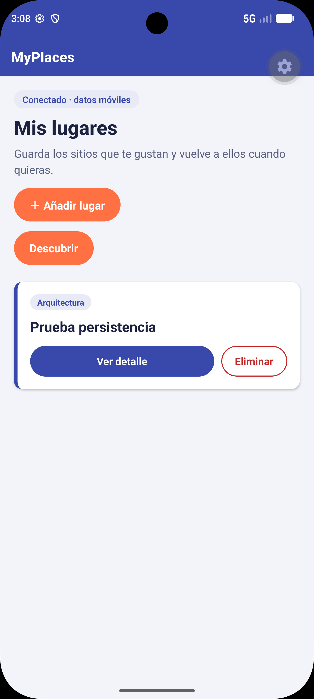
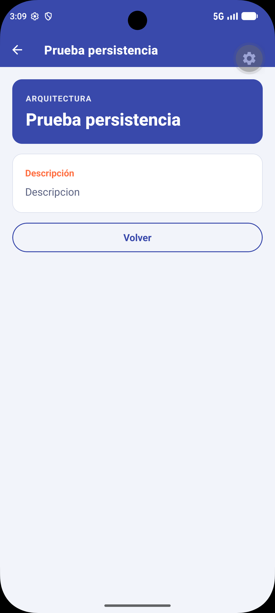
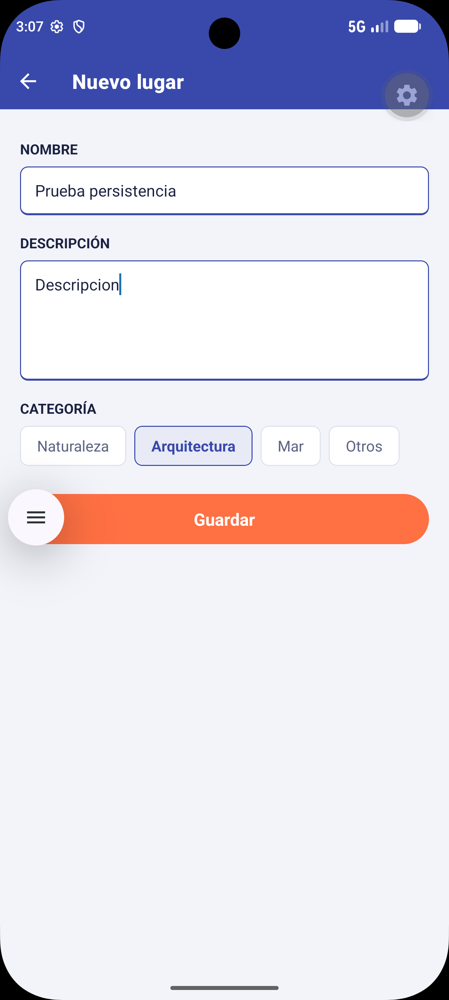
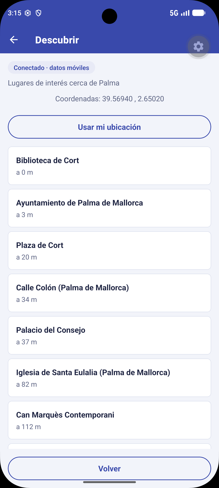
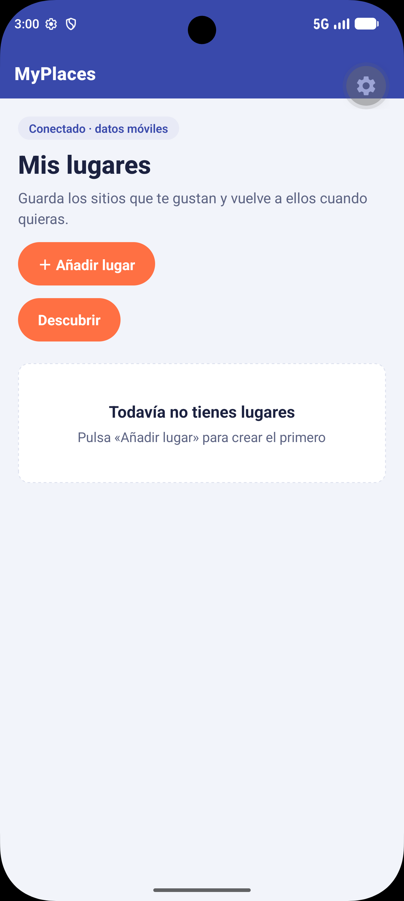
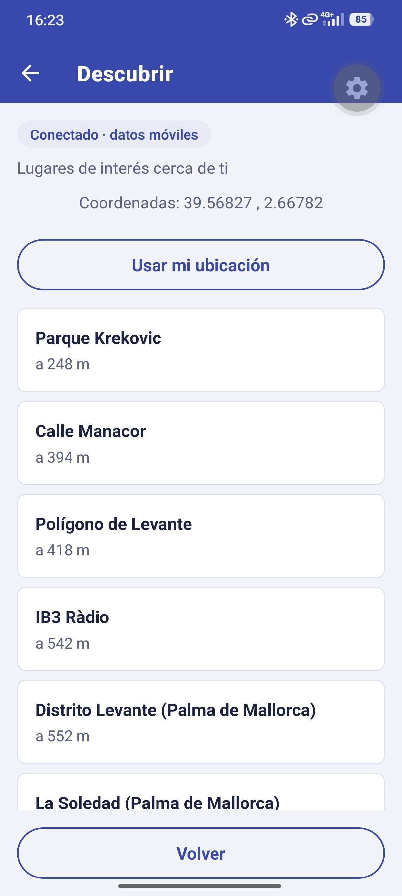
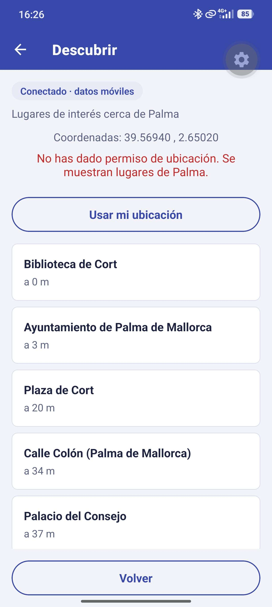

# MyPlaces

Aplicación móvil hecha con **React Native + Expo** (JavaScript) para consultar, añadir y guardar lugares de interés.

Práctica 2 · UT2 / RA2 · Programación Multimedia y Dispositivos Móviles.

## Funcionalidades

| Apartado | Qué hace la app |
|---|---|
| A · Navegación y componentes | Lista de lugares, pantalla de detalle (`/detall/[id]`) y formulario. Componentes reutilizables `TarjetaLugar` y `EstadoConexion`. |
| B · Formulario y validación | Pantalla «Nuevo lugar» con nombre, descripción y categoría. No deja guardar un nombre vacío (ni solo con espacios) y avisa del error. Vuelve a la lista al guardar. |
| C · Persistencia local | Los lugares se guardan con AsyncStorage y se recuperan al reiniciar. Se pueden eliminar. Si no hay ninguno, se muestra un mensaje de lista vacía. |
| D · Consulta HTTP/HTTPS | Pantalla «Descubrir» que consulta una API pública con `fetch`. Tiene estados de carga, error (con botón «Reintentar») y lista vacía. |
| E · Ubicación y permisos | Botón «Usar mi ubicación» en «Descubrir»: pide permiso, muestra las coordenadas y busca lugares cerca del usuario. Si se deniega, muestra un aviso y sigue mostrando los lugares de Palma. |
| F · Conectividad | Franja con el estado de la red y su tipo (wifi, datos móviles). Sin conexión, «Descubrir» no hace la consulta, avisa al usuario y vuelve a cargar sola cuando vuelve la red. |

## Requisitos

- Node.js 20 o superior (probado con Node 24).
- Expo SDK 58.
- Para probar en el móvil: la app **Expo Go** (versión para SDK 58), con el móvil y el ordenador en la misma red wifi.

## Instalación

```bash
npm install
```

## Ejecución

```bash
npx expo start
```

- **Móvil:** escanear el código QR con Expo Go (Android) o con la cámara (iOS).
- **Emulador Android:** pulsar `a` en la terminal.
- **Navegador:** pulsar `w` (sirve para ver la interfaz, pero sin GPS ni tipo de red).

Si después de cambiar dependencias la app muestra una versión antigua, arrancar limpiando la caché:

```bash
npx expo start -c
```

## Estructura del proyecto

```
src/
├── app/                      # Pantallas (Expo Router: cada archivo es una ruta)
│   ├── _layout.jsx           # Navegación Stack y proveedor de datos
│   ├── index.jsx             # Lista de lugares
│   ├── detall/[id].jsx       # Detalle de un lugar
│   ├── nuevo-lugar.jsx       # Formulario para añadir un lugar
│   └── descubrir.jsx         # Consulta a la API, ubicación y conectividad
├── components/
│   ├── TarjetaLugar.jsx      # Tarjeta de un lugar en la lista
│   └── EstadoConexion.jsx    # Franja con el estado de la red
├── context/
│   └── lugares.jsx           # Estado global de los lugares + AsyncStorage
├── constants/
│   └── colores.js            # Paleta de colores común
└── data/
    └── llocs.js              # Lugares de ejemplo
```

## Datos

- Los lugares se guardan en **AsyncStorage** con la clave `llocs`, como texto JSON (`JSON.stringify` / `JSON.parse`).
- La primera vez que se abre la app, si no hay nada guardado, se cargan 3 lugares de ejemplo de `src/data/llocs.js`.
- Si el usuario borra todos los lugares, se guarda la lista vacía y se mantiene vacía al reiniciar.

## API utilizada

**Wikipedia GeoSearch (API de MediaWiki)** — `https://es.wikipedia.org/w/api.php?action=query&list=geosearch`

- Devuelve artículos de Wikipedia (monumentos, plazas, museos…) cercanos a unas coordenadas, con la distancia a cada uno.
- Es gratuita y **no necesita clave ni registro**.
- Parámetros usados: `gscoord` (latitud|longitud), `gsradius=10000` (10 km, el máximo) y `gslimit=30`.
- Por defecto busca alrededor del centro de Palma (39.5694, 2.6502). Con «Usar mi ubicación» busca alrededor del usuario.
- Wikipedia rechaza peticiones sin identificar, por eso la app envía la cabecera `User-Agent: MyPlaces/1.0 (practica DAM)`.

## Permisos

| Permiso | Para qué | Si se deniega |
|---|---|---|
| Ubicación (en primer plano) | Mostrar las coordenadas del usuario y buscar lugares cerca de él en «Descubrir». Solo se pide al pulsar «Usar mi ubicación». | Se muestra el aviso «No has dado permiso de ubicación. Se muestran lugares de Palma.» y el resto de la app funciona igual. |

## Librerías

| Librería | Uso |
|---|---|
| `expo-router` | Navegación basada en archivos |
| `@react-native-async-storage/async-storage` | Persistencia local |
| `expo-location` | Permiso y lectura de la ubicación |
| `@react-native-community/netinfo` | Estado y tipo de conexión |

Todas se instalaron con `npx expo install` para que sus versiones sean compatibles con el SDK 58.

## Pruebas

Entornos de prueba, los dos con Expo Go:

- **Emulador Pixel 10 Pro XL (Android, API 37.2)** de Android Studio: pruebas 1, 2 y 3.
- **Móvil Xiaomi Redmi Note 14 Pro 5G** (Android): pruebas 4 y 5. La ubicación no funcionaba en el emulador (ver [Limitaciones](#limitaciones)).

| # | Caso | Pasos | Resultado esperado | Resultado obtenido | Observaciones |
|---|---|---|---|---|---|
| 1 | Creación | Pulsar «Añadir lugar», escribir nombre y descripción y guardar | El lugar aparece en la lista | El lugar aparece en la lista. Correcto. | [Formulario](capturas/prueba1-formulario.png) · [Lista](capturas/prueba1-lista.png) |
| 2 | Reinicio | Cerrar Expo Go del todo y volver a abrir la app | Los lugares siguen en la lista | Los lugares siguen en la lista. Correcto. | [Antes](capturas/prueba1-lista.png) · [Vídeo del reinicio](capturas/prueba2-reinicio.webm) |
| 3 | Ausencia de datos | Eliminar todos los lugares (y reiniciar) | Se muestra «Todavía no tienes lugares» | Se muestra «Todavía no tienes lugares». Correcto. | [Captura](capturas/prueba3-sin-datos.png) |
| 4 | Error de red | Abrir «Descubrir» con el modo avión activado y después desactivarlo | Franja «Sin conexión» y mensaje; al volver la red carga los lugares sola | Franja «Sin conexión» y mensaje; al volver la red carga los lugares sola. Correcto. | [Vídeo sin red y red recuperada](capturas/prueba4-sin-red.mp4) |
| 5 | Permiso denegado | Quitar el permiso de ubicación a Expo Go y pulsar «Usar mi ubicación» | Aviso en rojo y se siguen mostrando los lugares de Palma | Con permiso se muestran las coordenadas reales y lugares cercanos. Sin permiso, aviso en rojo y se siguen mostrando los lugares de Palma. Correcto. | [Permiso concedido](capturas/prueba5-permiso-concedido.jpg) · [Permiso denegado](capturas/prueba5-permiso-denegado.jpg) |

### Capturas

Todas están en la carpeta [`capturas/`](capturas/). Las pruebas 2 y 4 se han grabado en vídeo porque lo que se comprueba es un cambio (reiniciar la app, quitar y devolver la red).

#### Pantallas principales

| Lista | Detalle | Formulario | Descubrir |
|---|---|---|---|
|  |  |  |  |

#### Prueba de persistencia

- Antes de reiniciar: lista con «Prueba persistencia» (primera captura de «Pantallas principales»).
- Reinicio de la app: [vídeo `prueba2-reinicio.webm`](capturas/prueba2-reinicio.webm).

#### Casos de prueba

| 3 · Sin datos | 5 · Permiso concedido | 5 · Permiso denegado |
|---|---|---|
|  |  |  |

- 4 · Sin red y red recuperada: [vídeo `prueba4-sin-red.mp4`](capturas/prueba4-sin-red.mp4).

## Limitaciones

- Probado en un emulador Android y en un móvil físico (Xiaomi Redmi Note 14 Pro 5G), los dos con Expo Go. No se ha probado en iOS y no se ha generado APK.
- En el emulador la ubicación no funcionó: aunque se fijó una posición desde *Extended Controls → Location* de Android Studio, la app mostraba «No se ha podido obtener la ubicación». Por eso la prueba 5 se hizo en el móvil físico, con GPS real.
- El modo sin conexión se ha probado activando el modo avión del móvil.
- En la versión web el navegador no informa del tipo de red, así que la franja muestra «red desconocida». En el móvil muestra «wifi» o «datos móviles».
- En la versión web el aviso de nombre vacío del formulario (`Alert.alert`) no se muestra; en el móvil sí.
- La API busca en un radio máximo de 10 km. En zonas con pocos artículos en Wikipedia en español la lista puede salir vacía.
- «Conectado» indica que hay red, pero no garantiza que la API responda; en ese caso se muestra la pantalla de error con «Reintentar».
