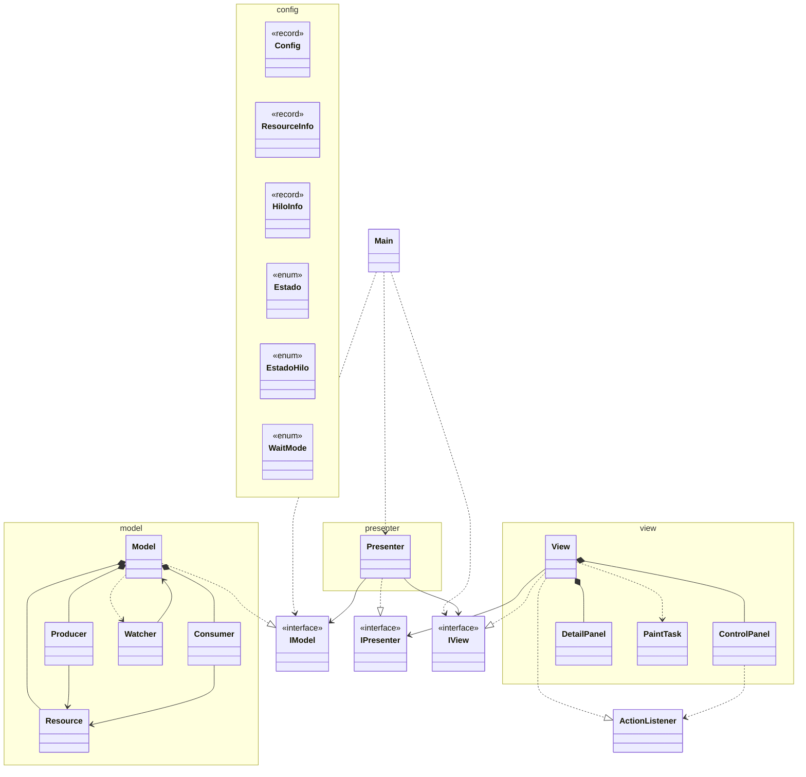

# Unidad 1: Ejercicio 2 - Productor-consumidor (Java Swing + MVP)

Esta práctica simula el problema clásico del **productor-consumidor**: varios hilos producen unidades de uno o varios recursos compartidos y otros las consumen. Una ventana Swing permite configurar todas las opciones, iniciar, pausar y detener la simulación, y observar en tiempo real el stock de cada recurso y lo que hace cada hilo.

En este documento se repasan los conceptos necesarios, el UML del programa y los hilos que intervienen. Después se recorre el programa clase por clase:

- Conceptos previos
- Productor-consumidor UML
- Hilos aplicados
- Funcionamiento
- Recorrido por clases
- Pruebas
- Comparación con otra solución

---

## Conceptos previos

### Arquitectura MVP

El programa se divide en **Model**, **View** y **Presenter**, comunicados por interfaces (`IModel`, `IView`, `IPresenter`).

**Regla principal:** la vista y el modelo nunca se hablan directamente; todo pasa por el presenter. Los datos que viajan entre ellos son `records` del paquete `config`, que ninguna de las dos capas posee.

```
MiProductorConsumidor/
└── src/
    ├── Main.java      → crea modelo, vista y presenter y los conecta
    ├── config/        → Config, enums (Estado, EstadoHilo, WaitMode) y las "fotos" ResourceInfo e HiloInfo
    ├── model/         → Resource, Producer, Consumer, Watcher, Model e IModel
    ├── presenter/     → Presenter e IPresenter
    └── view/          → View, ControlPanel, DetailPanel, PaintTask e IView
```

### Recurso compartido y condición de carrera

Un **recurso compartido** es un dato que varios hilos leen y modifican a la vez; aquí, el stock de cada recurso.

`stock++` parece una sola operación, pero son tres: **leer** el valor, **calcular** el nuevo y **escribirlo**. Si dos productores lo hacen a la vez, uno puede pisar el resultado del otro:

| Paso | Productor A | Productor B | `stock` en memoria |
| :--- | :--- | :--- | :--- |
| 1 | lee → 5 | | 5 |
| 2 | | lee → 5 | 5 |
| 3 | calcula 5 + 1 = 6 | | 5 |
| 4 | | calcula 5 + 1 = 6 | 5 |
| 5 | escribe 6 | | 6 |
| 6 | | escribe 6 | **6** (debería ser 7) |

Se han producido dos unidades, pero el stock solo ha subido una: **se ha perdido una producción**. Esto es una **condición de carrera**: el resultado depende del orden en que se intercalen los hilos.

### `synchronized`

`synchronized` convierte un bloque de código en **sección crítica**: solo un hilo puede estar dentro a la vez y el resto espera en la puerta.

Cada objeto Java tiene un **cerrojo** (*lock*). Un método `synchronized` lo coge al entrar y lo suelta al salir. Un bloque `synchronized (this) { ... }` hace lo mismo, pero solo para ese trozo de código.

### `volatile`

`volatile` garantiza **visibilidad**: cuando un hilo cambia la variable, los demás ven el valor nuevo.

**No garantiza atomicidad**: en el paso 2 de la tabla, B ya lee el valor más reciente (5), porque A todavía no ha escrito. El problema es que los tres pasos se intercalan, y eso solo lo evita `synchronized`.

En el proyecto, `volatile` se usa en variables que **escribe un solo hilo** y leen otros: `contador`, `pausado` y `estadoHilo` de cada hilo, y `estado` del modelo.

### Dos formas de esperar: `sleep` y `wait` / `notifyAll`

Cuando un productor encuentra el stock lleno (o un consumidor vacío), tiene que esperar. Hay dos formas:

| | `sleep` | `wait` / `notifyAll` |
| :--- | :--- | :--- |
| **Cómo espera** | Comprueba, duerme 50 ms y vuelve a comprobar | Se bloquea hasta que otro hilo lo avisa |
| **Gasto de CPU** | Se despierta aunque nada haya cambiado (espera activa) | Ninguno mientras espera |
| **Cerrojo** | `sleep` **no lo suelta**: hay que dormir **fuera** del bloque `synchronized` | `wait()` lo suelta solo y lo recupera al despertar |
| **Restricción** | — | `wait()` y `notifyAll()` solo se pueden llamar con el cerrojo cogido |

Si un productor durmiera con `sleep` **dentro** del método `synchronized`, se quedaría con el cerrojo: el consumidor no podría entrar a consumir y el productor nunca encontraría hueco. Es como dormirse dentro del baño con la puerta cerrada.

`wait()` siempre va dentro de un **`while`**, no de un `if`: al despertar, otro hilo puede haberse adelantado y la condición puede seguir sin cumplirse.

### Control de stock

Con el control activo, el stock se mantiene entre un **mínimo** y un **máximo**: el productor no supera el máximo y el consumidor no baja del mínimo. Desactivado, los hilos ignoran los límites y el stock puede incluso ser negativo.

### Terminar hilos: `interrupt()` y `join()`

- **`interrupt()`** no mata al hilo: le avisa. Si está en `sleep()` o en `wait()`, salta una `InterruptedException`, y el hilo la usa como señal para terminar.
- **`join()`** hace que quien lo llama **espere** a que ese hilo haya terminado.

Al detener, primero se interrumpe **a todos** y después se hace `join()` de cada uno. Si se hiciera `interrupt()` + `join()` del mismo hilo en un solo bucle, los demás seguirían trabajando mientras se espera al primero, y terminarían uno detrás de otro.

### Hilos daemon

Un hilo **daemon** no impide que el programa termine: cuando solo quedan hilos daemon, la JVM se cierra. Así, al cerrar la ventana no quedan hilos trabajando por detrás. `setDaemon(true)` tiene que llamarse **antes** de `start()`; si no, lanza `IllegalThreadStateException`.

### Swing y el EDT

Swing tiene su propio hilo, el **EDT** (*Event Dispatch Thread*), que pinta la ventana y atiende los botones. Los componentes **no son seguros entre hilos**: solo el EDT debería tocarlos.

`SwingUtilities.invokeLater(tarea)` no ejecuta la tarea: la **mete en la cola** del EDT, que la ejecutará cuando le toque.

---

## Productor-consumidor UML



Fíjate en que **ninguna flecha va de `view` a `model` ni al revés**: lo que comparten está en `config`.

---

## Hilos aplicados

| Hilo | Qué hace |
| :--- | :--- |
| **main** | Crea el modelo, la vista y el presenter, los conecta y llama a `view.start()`. Después termina. |
| **EDT** (hilo de Swing) | Pinta la ventana, atiende los botones y checkbox (`View.actionPerformed`) y ejecuta las `PaintTask`. |
| **Refresco de la vista** (uno) | Es el `run()` de `View`. Cada 100 ms pide los datos al presenter y encarga el pintado al EDT con `invokeLater`. |
| **Producer** (uno por productor) | Fabrica (duerme un tiempo aleatorio) y deja una unidad en uno de sus recursos, hasta llegar a su objetivo. |
| **Consumer** (uno por consumidor) | Igual, pero retira unidades. |
| **Watcher** (uno por simulación) | Hace `join()` de todos los productores y consumidores. Cuando terminan, pone el estado en FINALIZADO (si no lo han detenido). |

`Producer`, `Consumer`, `Watcher` y `View` **implementan `Runnable`**: son la *tarea*. El `Thread` que la ejecuta se crea aparte con `new Thread(tarea)`. Todos se marcan como **daemon**.

---

## Funcionamiento

### El viaje de una unidad

```
Producer
 → comprueba la pausa
 → sleep aleatorio (fabrica)
 → elige un recurso de su lista
 → Resource.producir() → stock + 1  (puede esperar si está lleno)

Consumer
 → igual, con Resource.consumir() → stock - 1

Hilo de refresco de View (cada 100 ms)
 → Presenter → Model.getResources() / getHilos()   (crea las "fotos")
 → invokeLater(new PaintTask(...))
 → EDT: DetailPanel.actualizar(...)                 (pinta)
```

### Fijo y variable

Cada hilo recibe una **lista de recursos**:

- **Fijo:** una lista con **un solo** recurso, repartidos en orden con `i % numRecursos`. Con 3 recursos, los productores 1, 2, 3, 4… van a R1, R2, R3, R1…
- **Variable:** la lista entera.

En cada vuelta el hilo elige uno al azar de **su** lista. Con un solo elemento siempre sale el mismo, así que `Producer` no necesita saber si es fijo o variable.

### Cómo se detecta una condición de carrera

Cada recurso guarda, además del stock, cuántas unidades se han **producido** y **consumido**. Con eso calcula el stock **esperado**:

```
esperado = mínimo + producidos - consumidos
```

Si el stock real no coincide con el esperado, alguna operación se ha perdido. La vista lo marca como **DESCUADRE**.

Los contadores `producidos` y `consumidos` se modifican **siempre con el cerrojo**, incluso en modo sin sincronización. Si no, también perderían unidades y el "esperado" no serviría para comparar.

### Los tres modos de `Resource`

| Sincronizado | Modo | Qué ocurre |
| :--- | :--- | :--- |
| Sí | `WAIT_NOTIFY` | **Correcto.** Los hilos que no pueden actuar se bloquean con `wait()` sin gastar CPU. |
| Sí | `SLEEP` | **Correcto.** Los hilos comprueban cada 50 ms, durmiendo sin el cerrojo. |
| No | (siempre sleep) | Aparecen **condiciones de carrera**: el stock real deja de coincidir con el esperado. |

Sin sincronización solo se puede esperar con `sleep`, porque `wait()` necesita el cerrojo.

### Estados

**De la simulación** (`Estado`): PARADO → EN_MARCHA ⇄ EN_PAUSA → DETENIDO o FINALIZADO.

- **DETENIDO**: el usuario ha pulsado Detener.
- **FINALIZADO**: todos los hilos han llegado a su objetivo. Lo pone el `Watcher`.

**De cada hilo** (`EstadoHilo`): TRABAJANDO (en el `sleep` que simula fabricar), ESPERANDO (dentro de `producir()`/`consumir()`), PAUSA y ACABADO.

---

## Recorrido por clases

El programa se construye **de abajo hacia arriba**: primero el recurso, luego los hilos y el modelo, y al final la vista y el presenter.

```
config:     Config → Estado, EstadoHilo, WaitMode → ResourceInfo, HiloInfo
Modelo:     Resource → Producer → Consumer → Watcher → IModel → Model
Presenter:  IPresenter → Presenter
Vista:      IView → ControlPanel → DetailPanel → PaintTask → View
Arranque:   Main
```

### `Config`

Guarda **todos los ajustes** de una simulación. Lo crea `ControlPanel.getConfig()` al pulsar Iniciar.

```java
public record Config(
        int numProductores, int numConsumidores, int numRecursos,
        boolean productoresFijos, boolean consumidoresFijos,
        int tiempoProducirMin, int tiempoProducirMax,
        int tiempoConsumirMin, int tiempoConsumirMax,
        boolean producirIlimitado, int producirMin, int producirMax,
        boolean consumirIlimitado, int consumirMin, int consumirMax,
        boolean controlStock, WaitMode modoEspera, int stockMin, int stockMax,
        boolean sincronizado
) { }
```

- `record`: Java genera el constructor y un getter por campo, sin `get` delante (`config.stockMax()`).
- **Inmutable**: varios hilos lo leen a la vez sin `volatile` ni `synchronized`, porque nadie puede modificarlo.
- Está en `config` para que la vista y el modelo lo usen sin conocerse.

### `ResourceInfo` y `HiloInfo`

Las "**fotos**" que viajan del modelo a la vista. La vista no puede recibir un `Resource` ni un `Producer` (son del modelo y además podría llamar a `producir()`), así que recibe estos `records`.

```java
public record ResourceInfo(String nombre, int stock, int stockEsperado,
                           boolean descuadre, boolean fueraDeLimites) { }

public record HiloInfo(String nombre, int unidades, int objetivo, EstadoHilo estadoHilo) { }
```

- En `HiloInfo`, `objetivo` vale **−1** si el hilo es ilimitado.

### `Resource`

Es el **recurso compartido** y contiene **toda la lógica de sincronización**.

```java
public void producir() throws InterruptedException {
    if (!sincronizado) {
        producirSinSync();
    } else if (modoEspera == WaitMode.SLEEP) {
        producirSleep();
    } else {
        producirWait();
    }
}

private synchronized void producirWait() throws InterruptedException {
    while (controlStock && stock >= maximo) {
        wait();
    }
    stock++;
    producidos++;
    notifyAll();
}

private void producirSleep() throws InterruptedException {
    while (true) {
        synchronized (this) {
            if (!controlStock || stock < maximo) {
                stock++;
                producidos++;
                return;
            }
        }
        Thread.sleep(50);
    }
}

private void producirSinSync() throws InterruptedException {
    while (controlStock && stock >= maximo) {
        Thread.sleep(50);
    }
    int leido = stock;          // 1. leer
    leido = leido + 1;          // 2. calcular
    stock = leido;              // 3. escribir
    contarProduccion();         // el contador SÍ protegido
}
```

**Atributos**

- `stock`: unidades actuales. Empieza en el mínimo. Es `volatile` para que, en modo sin sincronización, los demás hilos vean el último valor.
- `producidos` y `consumidos`: totales acumulados, para el stock esperado.
- `controlStock`, `modoEspera` y `sincronizado`: los tres interruptores de la práctica, copiados del `Config`.

**`producir()` — elige el modo**

- **No** es `synchronized`. Si lo fuera, en modo sleep el hilo dormiría con el cerrojo cogido y nadie podría consumir.

**`producirWait()` — con wait/notifyAll**

- El método es `synchronized`: comprobar y modificar es atómico.
- `while (...) wait()`: si no cabe, el hilo **suelta el cerrojo** y se duerme, para que un consumidor pueda entrar.
- `notifyAll()`: despierta a todos los hilos bloqueados en este recurso, y cada uno vuelve a comprobar su condición.

**`producirSleep()` — con sleep**

- Comprobar y sumar van dentro de un **bloque** `synchronized`, así que siguen siendo una sección crítica.
- `Thread.sleep` va **fuera** del bloque, para no dormir con el cerrojo.
- No hace falta `notifyAll()`: en este modo nadie está en `wait()`.

**`producirSinSync()` — sin sincronización**

- Los tres pasos se escriben por separado para que se vea dónde se puede colar otro hilo.
- `contarProduccion()` es un método `synchronized` que solo suma el contador: el error se provoca en el stock, pero la referencia para detectarlo es fiable.

**`consumir()`** hace lo mismo con sus tres versiones, restando y comprobando el mínimo.

**Lecturas**

- `getStock()` y `getStockEsperado()` son `synchronized`: leen con el cerrojo y, en el caso del esperado, no mezclan un `producidos` "de antes" con un `consumidos` "de después".
- `hayDescuadre()`: stock real ≠ esperado.
- `fueraDeLimites()`: stock por debajo del mínimo o por encima del máximo.

### `Producer`

Una **tarea** (`Runnable`) que produce hasta alcanzar su objetivo.

```java
@Override
public void run() {
    try {
        while (contador < objetivo) {
            while (pausado) {
                this.estadoHilo = EstadoHilo.PAUSA;
                Thread.sleep(50);
            }
            this.estadoHilo = EstadoHilo.TRABAJANDO;
            Thread.sleep(random.nextInt(tiempoMin, tiempoMax + 1));
            this.estadoHilo = EstadoHilo.ESPERANDO;

            Resource elegido = resources.get(random.nextInt(resources.size()));
            elegido.producir();
            this.contador++;
        }
        this.estadoHilo = EstadoHilo.ACABADO;
    } catch (InterruptedException e) {
        this.estadoHilo = EstadoHilo.ACABADO;
    }
}
```

- **Dos bucles**: el de trabajo dura toda la vida del hilo; el de pausa solo da vueltas mientras `pausado` sea `true`. El "cartel" de pausa se mira al principio de cada vuelta.
- **Objetivo**: un número sorteado por el modelo dentro del rango, o `Integer.MAX_VALUE` si es ilimitado.
- **Tiempo aleatorio en cada vuelta**: `nextInt(min, max + 1)` incluye los dos extremos.
- **El recurso se elige en cada producción**, de su propia lista.
- **El `catch`**: Detener hace `interrupt()`. Si el hilo está en `sleep` o `wait`, salta la excepción y el hilo termina. No es un error.
- **`volatile`** en `contador`, `pausado` y `estadoHilo`: los escribe un hilo y los leen otros.
- `getObjetivo()` devuelve −1 si es ilimitado, para que la vista no muestre 2147483647.

### `Consumer`

Igual que `Producer`, pero llama a `consumir()`.

### `Watcher`

El **vigilante**: detecta cuándo termina la simulación por sí sola.

```java
@Override
public void run() {
    try {
        model.esperar();                                 // join() de todos los hilos
        if (model.getEstado() != Estado.DETENIDO) {
            model.setEstado(Estado.FINALIZADO);
        }
    } catch (InterruptedException e) {
        // si lo interrumpen, deja de vigilar
    }
}
```

- Va en su propio hilo para que el que pulsa Iniciar (el EDT) no se quede bloqueado en los `join()` y la ventana no se congele.
- `join()` no sabe **por qué** han terminado los hilos. Por eso `detener()` pone DETENIDO **antes** de interrumpir, y el vigilante lo respeta.

### `IModel`

El contrato del modelo. No importa nada de `model`: solo usa tipos de `config`.

```java
public interface IModel {
    void iniciar(Config config);
    void reanudar();
    void detener();
    void pausar();
    int getContadorProd();
    int getContadorCon();
    int getStock();
    Estado getEstado();
    List<ResourceInfo> getResources();
    List<HiloInfo> getHilos();
}
```

### `Model`

Crea los recursos y los hilos a partir del `Config`.

**Atributos**

- Tres listas de hilos: `hilos` (los `Thread`, para `interrupt()` y `join()`), `producers` y `consumers` (los `Runnable`, para leer contadores y estados). Un `Thread` no devuelve la tarea que ejecuta, por eso se guardan las dos cosas.
- `resources`: los recursos de la simulación actual.
- `estado`: `volatile`, porque lo cambian el EDT y el vigilante y lo lee el refresco.

**`iniciar(config)`**

1. Pone EN_MARCHA y vacía las listas: cada simulación empieza limpia.
2. Crea `numRecursos` recursos, llamados R1, R2…
3. Por cada productor: sortea su objetivo, prepara su lista de recursos (fijo o variable), lo guarda, crea su `Thread` con nombre, lo marca como **daemon** y lo arranca.
4. Lo mismo con los consumidores.
5. Arranca el **vigilante**.

**`detener()`**

```java
estado = Estado.DETENIDO;
for (Thread hilo : hilos) hilo.interrupt();
for (Thread hilo : hilos) {
    try { hilo.join(); }
    catch (InterruptedException e) { Thread.currentThread().interrupt(); }
}
```

- Si `join()` se interrumpe, no se "traga" la interrupción: se vuelve a marcar el hilo actual.

**`pausar()` y `reanudar()`**: cambian el estado y ponen o quitan el "cartel" a cada hilo.

**`getResources()` y `getHilos()`**: recorren los objetos reales y devuelven una lista nueva de "fotos".

### `IPresenter`

```java
public interface IPresenter {
    void alIniciar(Config config);
    void alPausar();
    void alDetener();
    Estado getEstado();
    int getStockTotal();
    int getTotalProducido();
    int getTotalConsumido();
    List<ResourceInfo> getResources();
    List<HiloInfo> getHilos();
}
```

- Los tres primeros los llama `View.actionPerformed` al pulsar los botones.
- El resto los llama el hilo de refresco de la vista.

### `Presenter`

El intermediario. Solo conoce `IView` e `IModel`.

```java
@Override
public void alIniciar(Config config) {
    String error = validar(config);
    if (error != null) {
        view.mostrarError(error);
        return;
    }
    if (model.getEstado() == Estado.EN_PAUSA) {
        model.reanudar();
    } else if (model.getEstado() != Estado.EN_MARCHA) {
        model.iniciar(config);
        view.setAjustesEditables(false);
    }
}
```

- **Validar primero**: si hay error, se avisa y no se toca nada.
- **Iniciar o reanudar** lo decide el presenter, no la vista.
- **`alPausar()`** solo pausa si está en marcha.
- **`alDetener()`** detiene el modelo y desbloquea los ajustes.

**`validar(c)`** comprueba los rangos que se usan:

| Comprobación | Cuándo |
| :--- | :--- |
| tiempo producir y consumir: mín ≤ máx | siempre |
| unidades a producir y consumir: mín ≤ máx | solo si no son ilimitadas |
| stock: mín **<** máx | solo con control de stock (si fueran iguales, nadie podría ni producir ni consumir) |

### `IView`

```java
public interface IView {
    void start();
    void mostrarError(String mensaje);
    void setAjustesEditables(boolean editables);
    void setPresenter(IPresenter presenter);
}
```

- `setPresenter` existe porque la vista y el presenter se necesitan mutuamente: se crea la vista sin presenter y se conectan después.

### `ControlPanel`

El panel de la izquierda, montado entero con **`GridBagLayout`**.

**Componentes**

- `JSpinner` con `SpinnerNumberModel(valor, mín, máx, paso)` para los números. Los recursos empiezan en 1 (para no dividir entre 0 en el `%`) y los tiempos permiten 0.
- `JRadioButton` + `ButtonGroup` para fijo / variable. El `ButtonGroup` no es visual: solo hace que se marque uno de los dos.
- `JCheckBox` para ilimitado, control de stock y sincronización.
- `JComboBox<WaitMode>` creado con `WaitMode.values()`.

**Métodos auxiliares**

- `addFila(texto, componente)`: etiqueta en la columna 0 y componente en la 1. Cada opción es una línea.
- `crearPar(izquierda, derecha)`: un panel con dos componentes. Se anida para tener tres en una fila (ilimitado + mín + máx).
- `addBotones()`: los tres botones en una fila que ocupa las dos columnas (`gridwidth = 2`).

**Métodos públicos**

- `getConfig()`: lee todos los controles **en el momento de pulsar Iniciar** y crea un `Config`.
- `setListener(listener)`: conecta el mismo listener a los botones y a los checkbox.
- `setAjustesEditables(editables)`: bloquea o desbloquea los ajustes (los botones no). Al desbloquear vuelve a llamar a `actualizarCampos()`.
- `actualizarCampos()`: desactiva lo que no aplica:

| Si… | Se desactivan… |
| :--- | :--- |
| Ilimitado (producir) marcado | el rango de producir |
| Ilimitado (consumir) marcado | el rango de consumir |
| Control de stock desmarcado | los límites de stock y el tipo de control |

### `DetailPanel`

El panel de la derecha: cuatro `JLabel` (estado y totales) y un `JTextArea` no editable dentro de un `JScrollPane` con los recursos y los hilos.

- El `JTextArea` se lleva el espacio sobrante (`weighty = 1`, `fill = BOTH`) y las etiquetas quedan arriba.
- `actualizar(...)` construye el texto con un `StringBuilder`. Para cada hilo se escribe la línea por trozos: nombre y unidades, `/objetivo` solo si no es −1, y la actividad.

### `PaintTask`

La **tarea de pintado**. La crea el hilo de refresco y la ejecuta el EDT.

```java
@Override
public void run() {
    this.detailPanel.actualizar(estado, stockTotal, producido, consumido, resources, hilos);
    if (estado == Estado.FINALIZADO) {
        controlPanel.setAjustesEditables(true);
    }
}
```

- Es una clase y no una lambda porque el enunciado no permite lambdas.
- Recibe los datos ya leídos: solo pinta.
- Al finalizar nadie pulsa ningún botón, así que es aquí donde se desbloquean los ajustes.

### `View`

La ventana, el **hilo de refresco** y el **listener** de los botones. Implementa tres interfaces: `IView`, `Runnable` y `ActionListener`.

**El hilo de refresco**

```java
@Override
public void run() {
    try {
        while (true) {
            Thread.sleep(100);
            Estado estado = presenter.getEstado();
            SwingUtilities.invokeLater(new PaintTask(detailPanel, controlPanel, estado,
                    presenter.getStockTotal(), presenter.getTotalProducido(),
                    presenter.getTotalConsumido(), presenter.getResources(),
                    presenter.getHilos()));
        }
    } catch (InterruptedException e) {
        System.out.println("El View se ha interrumpido");
    }
}
```

- `start()` monta el `JFrame` con `GridBagLayout` (control a la izquierda con su tamaño natural, datos a la derecha con todo el espacio sobrante), lo muestra y arranca este hilo como daemon.
- El hilo **no toca** los componentes: lee los datos y encarga el pintado al EDT con `invokeLater`.
- `mostrarError` usa `JOptionPane.showMessageDialog`.

**Los botones y checkbox**

`setPresenter` guarda el presenter y hace `controlPanel.setListener(this)`: la propia vista se registra como listener. Se distingue qué se ha pulsado con el **action command**:

```java
@Override
public void actionPerformed(ActionEvent e) {
    switch (e.getActionCommand()) {
        case "INICIAR": presenter.alIniciar(controlPanel.getConfig()); break;
        case "PAUSAR":  presenter.alPausar(); break;
        case "DETENER": presenter.alDetener(); break;
        case "CAMPOS":  controlPanel.actualizarCampos();
    }
}
```

- El `Config` se lee al pulsar, con los valores actuales de los controles.
- `CAMPOS` no pasa por el presenter: desactivar un spinner es lógica de la interfaz y no afecta al modelo.
- **`run()` y `actionPerformed()` están en la misma clase, pero los ejecutan hilos distintos**: `run()` el hilo de refresco y `actionPerformed()` el EDT.

### `Main`

```java
void main() {
    IModel model = new Model();
    IView view = new View();
    Presenter presenter = new Presenter(view, model);
    view.setPresenter(presenter);
    view.start();
}
```

- No es un hilo ni implementa `Runnable`: solo crea las tres piezas, las conecta y arranca la vista.
- Los productores y consumidores no arrancan aquí, sino al pulsar Iniciar.

---

## Pruebas

| # | Configuración | Resultado esperado |
| :--- | :--- | :--- |
| 1 | 2 productores, 2 consumidores, 1 recurso, límites 0–10, todo Sí | El stock no sale de 0–10 |
| 2 | 0 consumidores | El stock llega al máximo y los productores quedan ESPERANDO |
| 3 | 0 productores | Los consumidores quedan ESPERANDO con el stock en el mínimo |
| 4 | Control de stock No, más consumidores que productores | El stock se vuelve negativo: FUERA DE LÍMITES |
| 5 | Sincronización No, tiempos a 0, 5 productores y 5 consumidores | DESCUADRE entre el stock real y el esperado |
| 6 | Unidades limitadas que cuadren (p. ej. 10–10 en los dos) | Todos terminan y el estado pasa a FINALIZADO |
| 7 | Pausar y luego Iniciar | Los contadores se congelan y después continúan |
| 8 | Detener | Todos los hilos terminan y el estado pasa a DETENIDO |
| 9 | 3 productores fijos, 3 recursos, sin consumidores ni control | Cada recurso recibe solo lo de su productor |
| 10 | Un máximo menor que el mínimo | Mensaje de error y no se inicia nada |

**Ojo con la prueba 6:** con rangos aleatorios es casi imposible que cuadre. Si en un recurso fijo se producen 17 y su consumidor quiere 18, se queda ESPERANDO para siempre y la simulación nunca llega a FINALIZADO.

---

## Comparación con otra solución

Comparación con la solución de un compañero (*U1 - E02 - Productor-consumidor*). Su versión parte de un enunciado más corto: no tiene pausa, objetivos por hilo, fijo/variable ni estado de los hilos.

### Diseño

| Aspecto | Su solución | La mía |
| :--- | :--- | :--- |
| Hilos | `Producer` y `Consumer` **heredan de `Thread`** | **Implementan `Runnable`**; el `Thread` se crea en `Model` |
| Refresco | `javax.swing.Timer` en el **presenter**, cada 200 ms en el EDT. La vista no tiene hilo | La **vista es un hilo** que refresca cada 100 ms y pinta con `invokeLater` + `PaintTask` |
| Datos compartidos | `Config` en `model`; DTO propios de la vista (`Settings`, `ResourceRow`) en `view.dto`; el presenter traduce uno a otro (`toConfig`) | `Config`, `ResourceInfo` y `HiloInfo` en `config`, compartido por las dos capas |
| Qué recibe el presenter | `List<Resource>` (copia con `List.copyOf`) | "Fotos" (`ResourceInfo`), así el presenter tampoco ve los `Resource` |
| Unidades por operación | `produceAmount` / `consumeAmount` (n por operación) | 1 por operación |
| Fin de cada hilo | `while (!isInterrupted())`: solo terminan al pulsar Stop | Objetivo por hilo (ilimitado o rango aleatorio) o interrupción |
| Detener | `interrupt()` y `threads.clear()`, **sin `join()`** | `interrupt()` a todos y después `join()` de cada uno |
| Finalizar solo | No existe | Hilo `Watcher` con `join()` y estado FINALIZADO |
| Pausa | No existe | `pausado` en cada hilo + estado EN_PAUSA |
| Daemon | No | Todos los hilos |
| Modo de espera | `boolean waitNotify` | `enum WaitMode` |
| Fijo / variable | Solo fijo (`i % size`) | Lista de recursos por hilo |
| Botones | Lambdas (`e -> presenter.onStart()`) | `View` implementa `ActionListener` y distingue con action commands (sin lambdas) |
| Ventana | `View extends JFrame`, `BorderLayout` para los dos paneles | `View` tiene un `JFrame`; todo con `GridBagLayout` |
| Datos | `JTable` con `DefaultTableModel` (columna OK) | `JLabel` + `JTextArea` (también hilos y avisos de límites) |
| `Main` | Crea todo **dentro de `invokeLater`**, en el EDT | Crea todo en el hilo `main` |

### Sincronización

| Aspecto | Su solución | La mía |
| :--- | :--- | :--- |
| Estructura de `Resource` | Igual: tres versiones de producir/consumir según el modo | Igual |
| Espera con sleep | Bloque `synchronized` y `sleep` fuera, cada 10 ms | Igual, cada 50 ms |
| Contadores sin sincronización | `produced += amount` **sin cerrojo** (solo `volatile`) | `contarProduccion()` **con cerrojo** |
| Provocar la carrera | `Thread.yield()` entre leer y escribir | Leer, calcular y escribir por separado |
| Comprobación de límites | Métodos `canProduce` / `canConsume` | Condición directa en cada método |

En su modo sin sincronización, `produced` y `consumed` también pueden perder sumas, así que su "esperado" no es una referencia del todo fiable. En la mía los contadores siempre están protegidos.

### Cosas a revisar en su documento

- El ejemplo de la condición de carrera dice "Hilo B escribe **4**". Si B es otro productor que leyó 5, escribe **6**: el +1 de A se pierde porque B **también** escribe 6.
- La tabla de `sleep` dice que no necesita `synchronized`, pero su propio `produceSleep()` usa un bloque `synchronized` para que comprobar y sumar sea atómico.

### Ideas que se podrían aprovechar

- **`Thread.yield()`** entre leer y escribir hace que el descuadre aparezca antes.
- **`ThreadLocalRandom.current()`** en vez de un `Random` por hilo.
- **`List.copyOf(...)`** para devolver listas que no se pueden modificar.
- **Crear la ventana dentro de `invokeLater`** en `Main` (en mi versión habría que hacerlo con una clase `Runnable`, porque no se permiten lambdas).
- **Desactivar el tipo de control también sin sincronización**: en mi `Resource`, sin sincronización el modo de espera se ignora, igual que sin control de stock.
