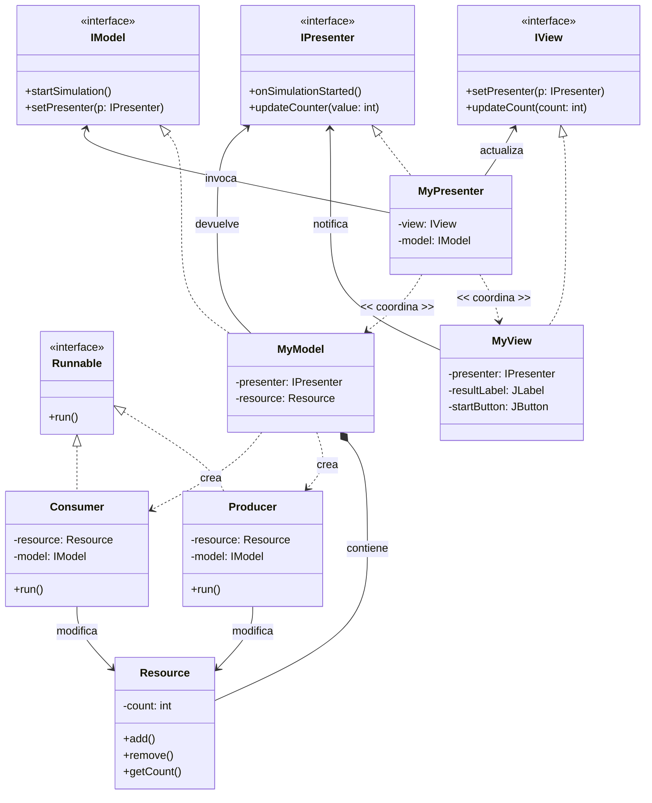

---  
tags:  
  - desarrollo-de-interfaces  
  - DAM2  
unidad: 1  
tema: Guía de referencia para crear ventanas en Swing, colocar componentes con GridBagLayout y configurar cada componente  
---  
  
# Unidad 1. Creación de ventanas en Swing  
---  
> [!info] Índice de componentes  
> **Contenedores:**   
> [[#JPanel]] · [[#JScrollPane]] · [[#JTabbedPane]] · [[#JSplitPane]]  
> **Texto:**   
> [[#JLabel]] · [[#Barra de estado]] · [[#JTextField]] · [[#JPasswordField]] · [[#JTextArea]]  
> **Botones y selección:**   
> [[#JButton]] · [[#JCheckBox]] · [[#JRadioButton y ButtonGroup|JRadioButton]] · [[#JComboBox]]  
> **Valores numéricos:**   
> [[#JSlider]] · [[#JSpinner]] · [[#JProgressBar]]  
> **Listas y tablas:**   
> [[#JList]] · [[#JTable]]  
> **Dibujo:**   
> [[#Canvas]] · [[#JPanel de dibujo]]  
> **Menús y barras:**   
> [[#JMenuBar, JMenu y JMenuItem|Menús]] · [[#JCheckBoxMenuItem y JRadioButtonMenuItem|Menús con casilla]] · [[#JToolBar]] · [[#JPopupMenu]]  
  
## 1. La ventana  
  
### 1.1. Flujo de trabajo  
  
```text  
crear o tomar el contenedor → crear el componente → configurarlo → añadirlo con add(componente, restricciones)  
```  
  
### 1.2. `JFrame`  
  
Ventana principal de la aplicación; contiene el panel de contenido y, opcionalmente, una barra de menús.  
  
**Instanciar y mostrar**  
  
```java  
JFrame frame = new JFrame("Window title");  
// ... create and add the components ...  
frame.setVisible(true);   // always last  
```  
  
**Configurar**  
  
```java  
frame.setDefaultCloseOperation(JFrame.EXIT_ON_CLOSE);   // end the program on close  
frame.setSize(1200, 720);  
frame.setMinimumSize(new Dimension(800, 500));  
frame.setLocationRelativeTo(null);                      // center on screen  
frame.setTitle("New title");  
frame.setResizable(true);  
```  
  
> [!warning]   
> Cerrar no es terminar Sin `EXIT_ON_CLOSE`, la X solo oculta la ventana y el programa sigue en ejecución.  
  
### 1.3. Hilo de eventos  
  
Swing no es seguro para hilos: la ventana se crea y se modifica siempre en el **hilo de despacho de eventos** (EDT).  
  
```java  
public static void main(String[] args) {  
    SwingUtilities.invokeLater(() -> new Window().createWindow());}  
```  
  
### 1.4. Panel de contenido  
  
Panel interior de la ventana donde se colocan todos los componentes. Se sustituye por un `JPanel` propio para elegir su gestor de diseño.  
  
```java  
JPanel contentPane = new JPanel(new GridBagLayout());  
frame.setContentPane(contentPane);  
```  
  
|Método|Devuelve o hace|  
|---|---|  
|`frame.getContentPane()`|Devuelve el panel de contenido actual como `Container` (por defecto, con `BorderLayout`)|  
|`frame.setContentPane(panel)`|Sustituye el panel de contenido por uno propio|  
|`frame.add(componente)`|Equivale a `frame.getContentPane().add(componente)`|  
  
> [!danger]   
> El gestor por defecto de `JPanel` es `FlowLayout` `new JPanel()` coloca los componentes en fila e ignora las restricciones de `add()`. El gestor se indica siempre en el constructor: `new JPanel(new BorderLayout())`.  
  
---  
  
## 2. Colocación de componentes  
  
### 2.1. Gestores de diseño  
  
|Gestor|Regla de colocación|`add()`|  
|---|---|---|  
|`FlowLayout`|En fila, a su tamaño natural; salta de línea si no cabe|`panel.add(c)`|  
|`BorderLayout`|Cinco zonas; `CENTER` recibe todo el espacio sobrante|`panel.add(c, BorderLayout.CENTER)`|  
|`GridLayout`|Cuadrícula de celdas iguales|`panel.add(c)`|  
|`BoxLayout`|Una sola fila o columna|`panel.add(c)`|  
|`GridBagLayout`|Cuadrícula de filas y columnas de distinto tamaño|`panel.add(c, constraints)`|  
|`null`|Coordenadas fijas con `setBounds()`; no se adapta, se evita|`panel.add(c)`|  
  
Zonas de `BorderLayout`: `PAGE_START` (arriba), `PAGE_END` (abajo), `LINE_START` (izquierda), `LINE_END` (derecha) y `CENTER`. Cada zona admite **un solo** componente.  
  
### 2.2. `GridBagLayout` y `GridBagConstraints`  
  
Cada componente se añade con un objeto `GridBagConstraints` que indica su celda y su comportamiento. Se crea uno nuevo por componente con un método auxiliar:  
  
```java  
private GridBagConstraints constraints(int x, int y, int width, int height, double weightX, double weightY) {  
    GridBagConstraints c = new GridBagConstraints();    c.gridx = x;                          // column    c.gridy = y;                          // row    c.gridwidth = width;                  // columns it spans    c.gridheight = height;                // rows it spans    c.weightx = weightX;                  // share of the extra width    c.weighty = weightY;                  // share of the extra height    c.fill = GridBagConstraints.BOTH;     // stretch to fill the cell    c.insets = new Insets(5, 5, 5, 5);    // outer margin: top, left, bottom, right    return c;}  
```  
  
```java  
contentPane.add(component, constraints(0, 0, 1, 1, 0.3, 0.5));  
```  
  
|Campo|Significado|Por defecto|  
|---|---|---|  
|`gridx`, `gridy`|Columna y fila de la celda|`RELATIVE`|  
|`gridwidth`, `gridheight`|Celdas que ocupa|1|  
|`weightx`, `weighty`|Reparto del espacio sobrante|0|  
|`fill`|`NONE`, `HORIZONTAL`, `VERTICAL`, `BOTH`|`NONE`|  
|`anchor`|Posición dentro de la celda si no la llena (`LINE_START`, `CENTER`…)|`CENTER`|  
|`insets`|Margen exterior|0|  
|`ipadx`, `ipady`|Relleno interior que agranda el componente|0|  
  
> [!danger] Pesos a 0   
> Si todos los pesos valen 0, los componentes se agrupan en el centro y la ventana no se adapta.  
  
> [!important] Reparto exacto por porcentajes   
> Los pesos reparten solo el espacio **sobrante**: cada componente conserva antes su tamaño preferido. Para que 0.3 y 0.7 sean exactamente el 30 % y el 70 %, todos los componentes de esas columnas deben tener tamaño preferido 0 × 0:  
>   
> ```java  
> component.setPreferredSize(new Dimension(0, 0));   // size decided by the weights  
> ```  
>   
> Con tamaño preferido 0 × 0, `pack()` no sirve: la ventana se dimensiona con `setSize()`.  
  
---  
  
## 3. Estructura de la ventana  
  
Dos paneles a la izquierda (opciones y controles) y un visor a la derecha que ocupa toda la altura:  
  
```text  
┌──────────────┬─────────────────────────────┐  
│ optionsPanel               │                                                                          │  
│ (0,0) 30 %                   │                        viewerPanel                               │  
├──────────────┤                          (1,0) 70 %                                │  
│ controlsPanel              │                       gridheight = 2                             │  
│ (0,1) 30 %                   │                                                                          │  
└──────────────┴─────────────────────────────┘  
```  
  
```java  
JPanel optionsPanel = new JPanel(new BorderLayout());     // top left  
JPanel controlsPanel = new JPanel();                      // bottom left (FlowLayout)  
JPanel viewerPanel = new JPanel(new BorderLayout());      // right  
optionsPanel.setPreferredSize(new Dimension(0, 0));       // size decided by the weights  
controlsPanel.setPreferredSize(new Dimension(0, 0));  
viewerPanel.setPreferredSize(new Dimension(0, 0));  
contentPane.add(optionsPanel, constraints(0, 0, 1, 1, 0.3, 0.5));  
contentPane.add(controlsPanel, constraints(0, 1, 1, 1, 0.3, 0.5));  
contentPane.add(viewerPanel, constraints(1, 0, 1, 2, 0.7, 1.0));  
```  
  
|Tipo de visor|Componente|Motivo|  
|---|---|---|  
|Juego|`Canvas` (AWT)|Permite el pintado activo con un bucle propio|  
|Visualizador de datos|`JPanel` (Swing)|Doble búfer automático, bordes y componentes hijos|  
  
---  
  
## 4. Componentes  
  
> [!info] Convenciones de los fragmentos   
> `panel` representa cualquier `JPanel` con `FlowLayout`, y `contentPane`, el panel de contenido con `GridBagLayout`. Cuando la zona importa, se indica con `BorderLayout`.  
  
### 4.1. Contenedores  
  
#### `JPanel`  
  
Contenedor genérico que agrupa componentes con su propio gestor de diseño.  
  
**Instanciar y colocar**  
  
```java  
JPanel groupPanel = new JPanel(new GridLayout(0, 2, 5, 5));   // layout in the constructor  
panel.add(groupPanel);  
```  
  
**Configurar**  
  
```java  
groupPanel.setBorder(BorderFactory.createTitledBorder("Group"));                 // titled border  
groupPanel.setBorder(BorderFactory.createLineBorder(Color.GRAY));                // line border  
groupPanel.setBorder(BorderFactory.createEmptyBorder(10, 10, 10, 10));           // inner margin  
groupPanel.setBackground(Color.WHITE);  
groupPanel.setPreferredSize(new Dimension(0, 0));                                // size decided by the weights  
groupPanel.setLayout(new BorderLayout());                                        // change the layout later  
```  
  
#### `JScrollPane`  
  
Añade barras de desplazamiento a un componente más grande que su espacio (`JTextArea`, `JList`, `JTable`).  
  
**Instanciar y colocar**  
  
```java  
JScrollPane anyScroll = new JScrollPane(component);   // the component goes inside  
panel.add(anyScroll);                                  // add the scroll pane, not the component  
```  
  
**Configurar**  
  
```java  
anyScroll.setVerticalScrollBarPolicy(ScrollPaneConstants.VERTICAL_SCROLLBAR_ALWAYS);  
anyScroll.setHorizontalScrollBarPolicy(ScrollPaneConstants.HORIZONTAL_SCROLLBAR_NEVER);  
```  
  
#### `JTabbedPane`  
  
Muestra varios paneles en el mismo espacio, seleccionables mediante pestañas.  
  
**Instanciar y colocar**  
  
```java  
JTabbedPane tabs = new JTabbedPane();  
viewerPanel.add(tabs, BorderLayout.CENTER);  
tabs.addTab("Data", dataPanel);  
tabs.addTab("Chart", chartPanel);  
```  
  
**Configurar**  
  
```java  
tabs.setSelectedIndex(0);  
tabs.setTabPlacement(JTabbedPane.TOP);                   // TOP, BOTTOM, LEFT, RIGHT  
tabs.setTabLayoutPolicy(JTabbedPane.SCROLL_TAB_LAYOUT);  // one row with arrows  
```  
  
#### `JSplitPane`  
  
Divide un área en dos componentes separados por una barra que el usuario puede arrastrar.  
  
**Instanciar y colocar**  
  
```java  
JSplitPane splitPane = new JSplitPane(JSplitPane.HORIZONTAL_SPLIT, leftComponent, rightComponent);  
viewerPanel.add(splitPane, BorderLayout.CENTER);  
```  
  
**Configurar**  
  
```java  
splitPane.setResizeWeight(0.3);          // 0: the right side grows, 1: the left side grows  
splitPane.setDividerLocation(150);       // in pixels (the proportional version needs a visible window)  
splitPane.setContinuousLayout(true);     // repaint while dragging  
splitPane.setOneTouchExpandable(true);   // arrows to collapse one side  
```  
  
### 4.2. Texto  
  
#### `JLabel`  
  
Texto o imagen que el usuario no puede modificar.  
  
**Instanciar y colocar**  
  
```java  
JLabel nameLabel = new JLabel("Name:");  
groupPanel.add(nameLabel);  
```  
  
**Configurar**  
  
```java  
nameLabel.setText("Full name:");  
nameLabel.setHorizontalAlignment(SwingConstants.LEFT);   // LEFT, CENTER, RIGHT  
nameLabel.setFont(new Font(Font.SANS_SERIF, Font.BOLD, 12));  
nameLabel.setForeground(Color.DARK_GRAY);  
nameLabel.setToolTipText("Full name");  
nameLabel.setOpaque(true);                               // needed for setBackground() to show  
nameLabel.setBackground(Color.YELLOW);  
```  
  
#### Barra de estado  
  
`JLabel` situado en la parte inferior que muestra el estado de la aplicación.  
  
**Instanciar y colocar**  
  
```java  
JLabel statusBar = new JLabel("Ready");  
viewerPanel.add(statusBar, BorderLayout.PAGE_END);  
```  
  
**Configurar**  
  
```java  
statusBar.setBorder(BorderFactory.createCompoundBorder(  
        BorderFactory.createMatteBorder(1, 0, 0, 0, Color.GRAY),   // line on top        BorderFactory.createEmptyBorder(3, 6, 3, 6)));             // inner marginstatusBar.setText("Saved");  
```  
  
#### `JTextField`  
  
Campo de texto de una sola línea.  
  
**Instanciar y colocar**  
  
```java  
JTextField nameField = new JTextField(15);   // 15 columns: preferred width, not a character limit  
groupPanel.add(nameField);  
```  
  
**Configurar**  
  
```java  
nameField.setText("Ada");  
nameField.setEditable(true);  
nameField.setHorizontalAlignment(JTextField.LEFT);  
String name = nameField.getText();          // read  
```  
  
#### `JPasswordField`  
  
Campo de texto que oculta los caracteres escritos.  
  
**Instanciar y colocar**  
  
```java  
JPasswordField passwordField = new JPasswordField(15);  
groupPanel.add(passwordField);  
```  
  
**Configurar**  
  
```java  
passwordField.setEchoChar('*');  
char[] password = passwordField.getPassword();   // read with getPassword(), never getText()  
Arrays.fill(password, '0');                      // wipe after use  
```  
  
#### `JTextArea`  
  
Área de texto de varias líneas; se coloca dentro de un `JScrollPane`.  
  
**Instanciar y colocar**  
  
```java  
JTextArea notesArea = new JTextArea(4, 20);            // rows, columns  
JScrollPane notesScroll = new JScrollPane(notesArea);  
panel.add(notesScroll);  
```  
  
**Configurar**  
  
```java  
notesArea.setLineWrap(true);          // wrap long lines  
notesArea.setWrapStyleWord(true);     // ...between words  
notesArea.setText("First line");  
notesArea.append("\nSecond line");  
notesArea.setEditable(false);  
```  
  
### 4.3. Botones y selección  
  
#### `JButton`  
  
Botón que ejecuta una acción al pulsarlo.  
  
**Instanciar y colocar**  
  
```java  
JButton saveButton = new JButton("Save");  
panel.add(saveButton);  
```  
  
**Configurar**  
  
```java  
saveButton.setEnabled(true);  
saveButton.setMnemonic(KeyEvent.VK_S);              // Alt+S  
saveButton.setToolTipText("Save the data");  
frame.getRootPane().setDefaultButton(saveButton);   // Enter presses it  
```  
  
#### `JCheckBox`  
  
Casilla para una opción independiente de sí o no.  
  
**Instanciar y colocar**  
  
```java  
JCheckBox activeCheck = new JCheckBox("Active");  
panel.add(activeCheck);  
```  
  
**Configurar**  
  
```java  
activeCheck.setSelected(true);  
boolean active = activeCheck.isSelected();   // read  
```  
  
#### `JRadioButton` y `ButtonGroup`  
  
Botones de opción excluyentes: el `ButtonGroup` hace que solo uno esté seleccionado.  
  
**Instanciar y colocar**  
  
```java  
JRadioButton slowRadio = new JRadioButton("Slow");  
JRadioButton fastRadio = new JRadioButton("Fast");  
ButtonGroup speedGroup = new ButtonGroup();   // not a component: it is not added to the panel  
speedGroup.add(slowRadio);  
speedGroup.add(fastRadio);  
panel.add(slowRadio);                          // the buttons are added one by one  
panel.add(fastRadio);  
```  
  
**Configurar**  
  
```java  
slowRadio.setSelected(true);                                    // initial option  
slowRadio.setActionCommand("slow");  
fastRadio.setActionCommand("fast");  
String speed = speedGroup.getSelection().getActionCommand();   // read the selected option  
```  
  
#### `JComboBox`  
  
Lista desplegable para elegir una opción entre varias.  
  
**Instanciar y colocar**  
  
```java  
JComboBox<String> colorCombo = new JComboBox<>(new String[] {"Red", "Green", "Blue"});  
panel.add(colorCombo);  
```  
  
**Configurar**  
  
```java  
colorCombo.setSelectedIndex(1);  
colorCombo.addItem("Yellow");  
colorCombo.setEditable(false);                           // true: the user can type a value  
String color = (String) colorCombo.getSelectedItem();    // read: returns Object  
```  
  
### 4.4. Valores numéricos  
  
#### `JSlider`  
  
Deslizador para elegir un entero dentro de un rango.  
  
**Instanciar y colocar**  
  
```java  
JSlider speedSlider = new JSlider(0, 100, 50);   // min, max, initial value  
panel.add(speedSlider);  
```  
  
**Configurar**  
  
```java  
speedSlider.setMajorTickSpacing(25);  
speedSlider.setMinorTickSpacing(5);  
speedSlider.setPaintTicks(true);  
speedSlider.setPaintLabels(true);  
int speed = speedSlider.getValue();   // read  
```  
  
#### `JSpinner`  
  
Campo numérico con flechas para subir o bajar el valor.  
  
**Instanciar y colocar**  
  
```java  
JSpinner amountSpinner = new JSpinner(new SpinnerNumberModel(5, 0, 10, 1));   // value, min, max, step  
panel.add(amountSpinner);  
```  
  
**Configurar**  
  
```java  
amountSpinner.setValue(7);                       // from code, the limits are not checked  
int amount = (Integer) amountSpinner.getValue(); // read: returns Object  
```  
  
#### `JProgressBar`  
  
Barra que muestra el avance de una tarea.  
  
**Instanciar y colocar**  
  
```java  
JProgressBar progressBar = new JProgressBar(0, 100);   // min, max  
panel.add(progressBar);  
```  
  
**Configurar**  
  
```java  
progressBar.setValue(40);  
progressBar.setStringPainted(true);    // show the percentage  
progressBar.setIndeterminate(true);    // animation when the duration is unknown  
```  
  
### 4.5. Listas y tablas  
  
#### `JList`  
  
Lista de elementos seleccionables; con un `DefaultListModel` se pueden añadir y quitar elementos.  
  
**Instanciar y colocar**  
  
```java  
DefaultListModel<String> listModel = new DefaultListModel<>();  
JList<String> list = new JList<>(listModel);  
JScrollPane listScroll = new JScrollPane(list);  
optionsPanel.add(listScroll, BorderLayout.LINE_START);  
```  
  
**Configurar**  
  
```java  
listModel.addElement("First");                                  // the data goes in the model  
listModel.addElement("Second");  
listModel.remove(0);  
list.setSelectionMode(ListSelectionModel.SINGLE_SELECTION);  
list.setVisibleRowCount(5);  
String selected = list.getSelectedValue();                      // read  
```  
  
#### `JTable`  
  
Tabla de filas y columnas; los datos se guardan en un `DefaultTableModel`.  
  
**Instanciar y colocar**  
  
```java  
String[] columns = {"Thread", "State", "Iterations"};  
DefaultTableModel tableModel = new DefaultTableModel(columns, 0);   // 0 initial rows  
JTable table = new JTable(tableModel);  
JScrollPane tableScroll = new JScrollPane(table);                   // needed to show the headers  
optionsPanel.add(tableScroll, BorderLayout.CENTER);  
```  
  
**Configurar**  
  
```java  
tableModel.addRow(new Object[] {"Thread-1", "Running", 120});   // the data goes in the model  
tableModel.setValueAt("Paused", 0, 1);                          // row, column  
tableModel.removeRow(0);  
tableModel.setRowCount(0);                                      // empty the table  
table.setFillsViewportHeight(true);                             // white background fills the area  
table.setSelectionMode(ListSelectionModel.SINGLE_SELECTION);  
int row = table.getSelectedRow();                               // read: -1 if none  
```  
  
### 4.6. Dibujo  
  
#### `Canvas`  
  
Superficie de dibujo de AWT para juegos con pintado activo.  
  
**Instanciar y colocar**  
  
```java  
Canvas gameCanvas = new Canvas();  
contentPane.add(gameCanvas, constraints(1, 0, 1, 2, 0.7, 1.0));  
```  
  
**Configurar**  
  
```java  
gameCanvas.setBackground(Color.BLACK);  
gameCanvas.setPreferredSize(new Dimension(0, 0));   // size decided by the weights  
```  
  
> [!warning] `Canvas` es un componente pesado No admite componentes hijos ni bordes, y no usa doble búfer. Se dibuja redefiniendo `paint(Graphics)` o con `createBufferStrategy()`.  
  
#### `JPanel` de dibujo  
  
Panel Swing que se dibuja a sí mismo; es el visor adecuado para gráficos y visualización de datos.  
  
**Instanciar y colocar**  
  
```java  
JPanel chartPanel = new JPanel() {  
    @Override    protected void paintComponent(Graphics g) {        super.paintComponent(g);                          // clear the background        g.setColor(Color.ORANGE);        g.fillRect(10, 10, getWidth() / 2, getHeight() / 2);   // sizes from getWidth()/getHeight()    }};  
viewerPanel.add(chartPanel, BorderLayout.CENTER);  
```  
  
**Configurar**  
  
```java  
chartPanel.setBackground(Color.WHITE);  
chartPanel.repaint();   // ask Swing to repaint after changing the data  
```  
  
### 4.7. Menús y barras  
  
#### `JMenuBar`, `JMenu` y `JMenuItem`  
  
Barra de menús de la ventana, con menús desplegables y sus opciones.  
  
**Instanciar y colocar**  
  
```java  
JMenuBar menuBar = new JMenuBar();  
JMenu fileMenu = new JMenu("File");  
JMenuItem openItem = new JMenuItem("Open...");  
JMenuItem exitItem = new JMenuItem("Exit");  
fileMenu.add(openItem);  
fileMenu.addSeparator();  
fileMenu.add(exitItem);  
menuBar.add(fileMenu);  
frame.setJMenuBar(menuBar);   // not add(): it has its own place above the content pane  
```  
  
**Configurar**  
  
```java  
fileMenu.setMnemonic(KeyEvent.VK_F);                                       // Alt+F  
int shortcut = Toolkit.getDefaultToolkit().getMenuShortcutKeyMaskEx();     // Ctrl, or Cmd on macOS  
openItem.setAccelerator(KeyStroke.getKeyStroke(KeyEvent.VK_O, shortcut));  // Ctrl+O  
exitItem.setEnabled(true);  
```  
  
#### `JCheckBoxMenuItem` y `JRadioButtonMenuItem`  
  
Opciones de menú con casilla o excluyentes, equivalentes a `JCheckBox` y `JRadioButton`.  
  
**Instanciar y colocar**  
  
```java  
JMenu viewMenu = new JMenu("View");  
JCheckBoxMenuItem gridItem = new JCheckBoxMenuItem("Show grid", true);  
viewMenu.add(gridItem);  
menuBar.add(viewMenu);  
```  
  
**Configurar**  
  
```java  
gridItem.setSelected(false);  
boolean showGrid = gridItem.isSelected();   // read  
// JRadioButtonMenuItem: grouped with a ButtonGroup, like JRadioButton  
```  
  
#### `JToolBar`  
  
Barra de botones de acceso rápido, normalmente bajo el menú.  
  
**Instanciar y colocar**  
  
```java  
JToolBar toolBar = new JToolBar();  
JButton newButton = new JButton("New");  
toolBar.add(newButton);  
toolBar.addSeparator();  
viewerPanel.add(toolBar, BorderLayout.PAGE_START);  
```  
  
**Configurar**  
  
```java  
toolBar.setFloatable(false);   // cannot be dragged out  
toolBar.setRollover(true);     // highlight the button under the mouse  
```  
  
#### `JPopupMenu`  
  
Menú contextual que aparece al pulsar el botón derecho sobre un componente.  
  
**Instanciar y colocar**  
  
```java  
JPopupMenu popup = new JPopupMenu();  
JMenuItem copyItem = new JMenuItem("Copy");  
popup.add(copyItem);  
notesArea.setComponentPopupMenu(popup);   // right click on notesArea shows it  
```  
  
**Configurar**  
  
```java  
copyItem.setEnabled(false);  
popup.addSeparator();  
```  
  
---  
  
## 5. Errores típicos  
  
| Error                                                 | Consecuencia                                    | Solución                                               |
| ----------------------------------------------------- | ----------------------------------------------- | ------------------------------------------------------ |
| Crear la ventana en `main()` sin `invokeLater()`      | Fallos esporádicos difíciles de reproducir      | `SwingUtilities.invokeLater(...)`                      |
| No llamar a `setDefaultCloseOperation(EXIT_ON_CLOSE)` | El programa sigue vivo tras cerrar              | Indicar `EXIT_ON_CLOSE`                                |
| `setVisible(true)` antes de añadir los componentes    | Los componentes no aparecen hasta redimensionar | `setVisible(true)` al final, o `revalidate()`          |
| `new JPanel()` con restricciones en `add()`           | `FlowLayout` las ignora                         | `new JPanel(new GridBagLayout())` o el gestor adecuado |
| Varios `add()` a la misma zona de `BorderLayout`      | Solo se ve el último                            | Un panel por zona                                      |
| Componente con tamaño preferido 0 × 0 en `FlowLayout` | Mide 0 × 0 y no se ve                           | Usar ese truco solo con `GridBagLayout` y pesos        |
| Todos los pesos a 0                                   | Los componentes se agrupan en el centro         | Dar peso a la columna o fila que debe crecer           |
| Reutilizar el mismo `GridBagConstraints`              | Valores arrastrados al siguiente componente     | Un objeto nuevo por componente                         |
| Añadir un componente a dos contenedores               | Desaparece del primero                          | Crear un componente para cada sitio                    |
| `JTable` sin `JScrollPane`                            | No se ven los encabezados                       | `new JScrollPane(table)`                               |
| Añadir el `ButtonGroup` al panel                      | No compila                                      | Añadir los botones, no el grupo                        |
| Barra de menús con `add()`                            | Queda dentro del contenido                      | `frame.setJMenuBar(menuBar)`                           |
