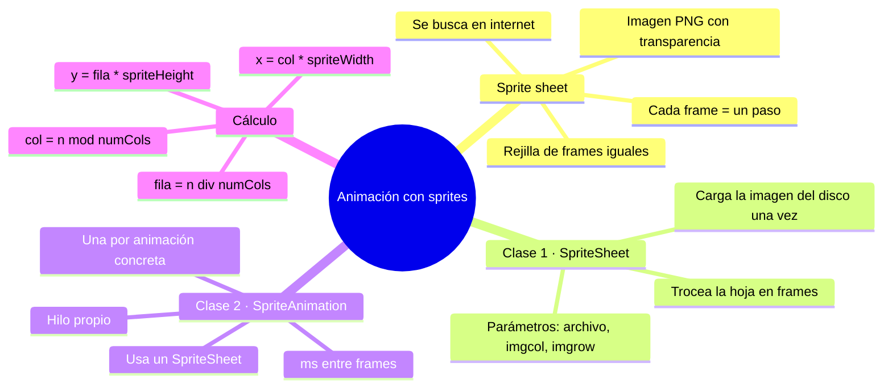
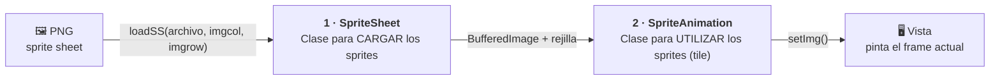
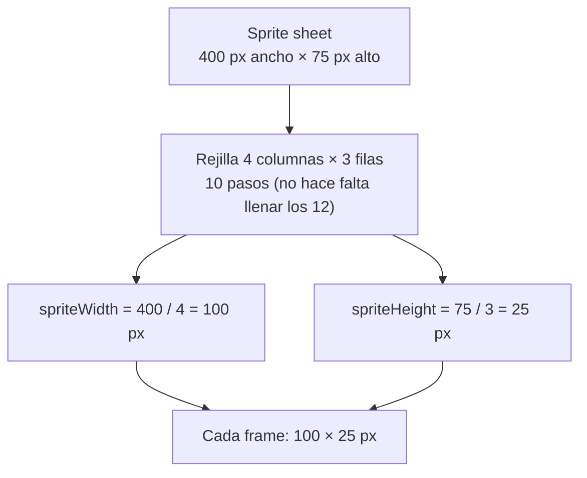
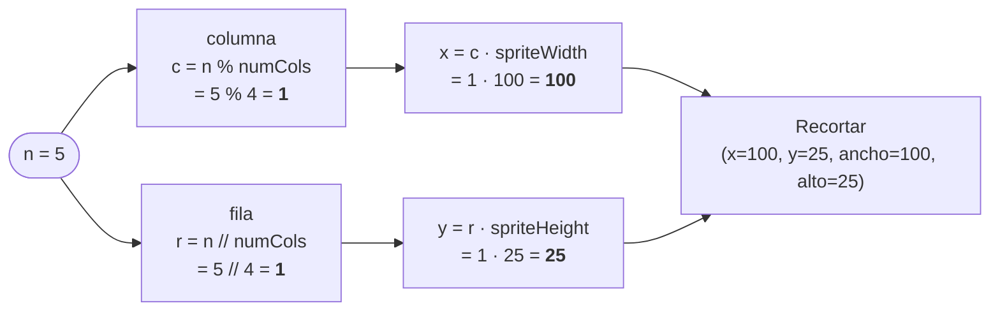
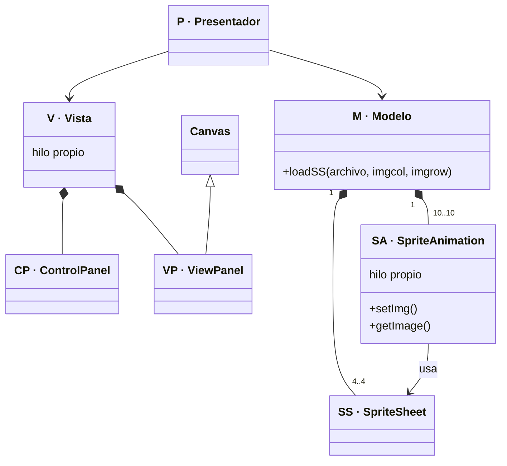
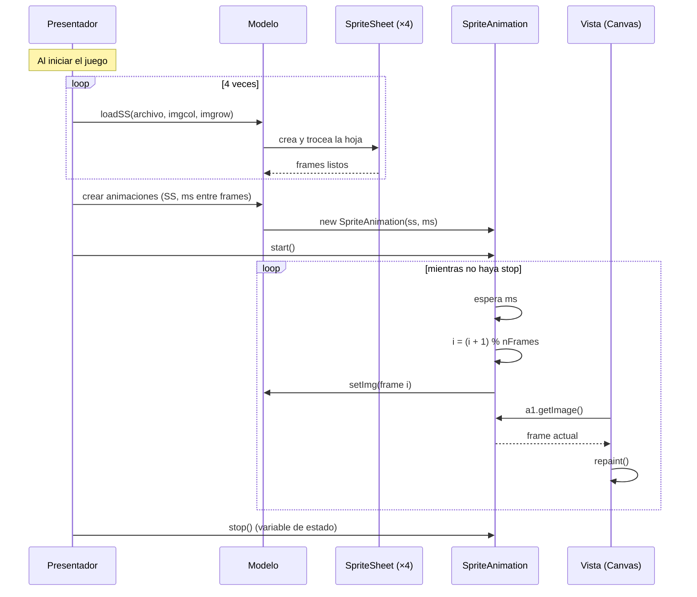
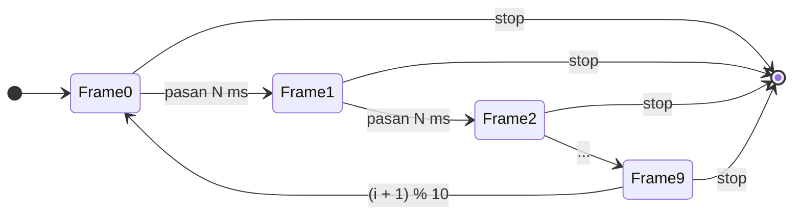

# T02 · SpriteSheet y SpriteAnimation

> [!info] Fuentes
> Apuntes de pizarra + audio de la clase (1 h 27 min). La transcripción automática tiene bastante ruido, así que lo dudoso está marcado en [[#⚠️ Dudas por revisar]].

## 🧭 Idea general

## 1️⃣ Qué es una sprite sheet

- Una **imagen** (casi siempre **PNG**, porque tiene **transparencia** de fondo; un JPG no) con varios dibujos en una **rejilla**.
- Cada dibujo es un **frame / paso** de la animación. Si dibujas los frames en orden y rápido, se ve movimiento.
- Cada hoja suele ser **una animación** (explosión 1, explosión 2, personaje caminando, saltando…).
- Para que la clase sea **genérica** hay que indicarle la configuración de la hoja: **columnas, filas y nº de pasos**.
- **Condición clave:** todos los frames tienen **el mismo tamaño** → el ancho y el alto de la imagen deben ser divisibles entre columnas y filas. Si no, el cálculo no funciona.

## 2️⃣ Las dos clases

| Clase | Responsabilidad | Recibe |
|---|---|---|
| **SpriteSheet** | Cargar la imagen del disco, comprobar que cuadra y trocear en frames | archivo, columnas, filas (y pasos) |
| **SpriteAnimation** | Reproducir una animación concreta en bucle | un `SpriteSheet` + ms entre frames |

- La imagen se **carga una sola vez** del disco y se reutiliza.
- Un mismo `SpriteSheet` puede alimentar **varias** `SpriteAnimation` (p. ej. el mismo monigote 10 veces).
- Cada `SpriteAnimation` es **una animación concreta en ejecución** con su propio estado (frame actual, posición…).

## 3️⃣ Medidas del ejemplo de la pizarra

Numeración de los frames (índice `n`):

|  fila \ col | 0 | 1 | 2 | 3 |
|:-:|:-:|:-:|:-:|:-:|
| **0** | 0 | 1 | 2 | 3 |
| **1** | 4 | **5** | 6 | 7 |
| **2** | 8 | 9 | – | – |

## 4️⃣ De número de frame a píxeles

Pregunta de la clase: *¿dónde está el frame 5 en la rejilla?* → fila 1, columna 1.

Fórmulas de la pizarra:

- `r = n // numCols` → **división entera** (la fila)
- `c = n % numCols` → **módulo / resto** (la columna)
- `x = f_x(c) = c · spriteWidth`
- `y = f_y(r) = r · spriteHeight`
- Comprobaciones: `f(5) = 1` (fila) y `f(9) = 2`.

> [!tip] El módulo es "mágico"
> `%` sirve para **ciclos continuos**: `0,1,2,3,0,1,2,3…`. Aquí lo usaremos para la columna y también para que la animación vuelva al frame 0 tras el último.

## 5️⃣ Arquitectura (diagrama de la pizarra)

- El **Presentador (P)** coordina todo: al arrancar le pide al modelo cargar **4 sprite sheets** (`loadSS` × 4) y crear las animaciones.
- **`CP` (Control Panel)**: panel con los **botones**. **`VP` (View Panel)**: donde se **ven las animaciones**; extiende `Canvas`.
- Las **marcas azules** de `V` y `SA` son **hilos**: la vista y cada animación tienen el suyo.
- El **Modelo (M)** contiene los **4** `SS` y las **10** `SA` (los números `4..4` y `10..10` de la pizarra).
- **`a1.getImage()`** (`a1` = una animación, `SpriteAnimation`) devuelve el frame actual que la vista debe pintar.

## 6️⃣ Flujo de ejecución

## 7️⃣ Ciclo de la animación

- Cada **N milisegundos** (configurable) se pasa al siguiente frame; al llegar al último se vuelve al 0 con el **módulo**.
- El **hilo** de la animación corre en paralelo mientras la vista pinta.
- Para pararlo: una **variable de estado** (`running`); se pone a `false` y el bucle termina. Cuando acaba, **el hilo muere**, pero la imagen cargada se puede reutilizar.
- Cuántas veces se repite cada frame depende del tiempo que le des (p. ej. 100 ms por frame).

## 💡 Ideas sueltas de la clase

- **No reutilizamos objetos todavía.** Crear objetos cuesta; los motores de juego reutilizan con un **pool** (piscina de objetos sin usar) para ahorrar memoria e inicializaciones. Se verá más adelante, igual que el **grid espacial** para optimizar colisiones.
- Los **assets** (imágenes) se cargan todos **al principio** del juego; en un motor real habría un **catálogo de assets**. De momento lo hace el presentador al crear el juego.
- Si cargas 4 hojas distintas y quieres 10 monigotes, no necesitas 10 hojas: necesitas **1 hoja y 10 `SpriteAnimation`** que la compartan.
- El tamaño de cada frame se obtiene de **imagen / nº de columnas (o filas)**; luego solo hay que calcular `x` e `y` del recorte.
- Para sacar sprites: buscar en internet hojas en PNG o recortar/generar con un editor de GIF.

## ✅ Qué hay que hacer (según el audio)

- [x] Clase **`SpriteSheet`**: carga la imagen y la trocea (parámetros archivo, columnas, filas).
- [ ] Clase **`SpriteAnimation`**: recibe un `SpriteSheet` y los ms entre frames, con hilo propio.
- [ ] Cargar **4** sprites desde el presentador para probar.
- [x] Función **n → fila** (división entera) y **n → columna** (módulo).
- [x] Calcular **x e y** del recorte con `spriteWidth` / `spriteHeight`.
- [ ] Método para **parar** la animación (variable de estado).

## ⚠️ Dudas por revisar

- Las notas `f(5)=1` y `f(9)=2` las leí como "fila del frame". Revisa si la segunda era `f(9)`.
- `4..4` y `10..10` los interpreto como 4 sprite sheets y 10 animaciones (por el audio).