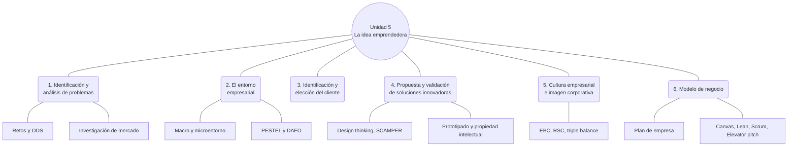
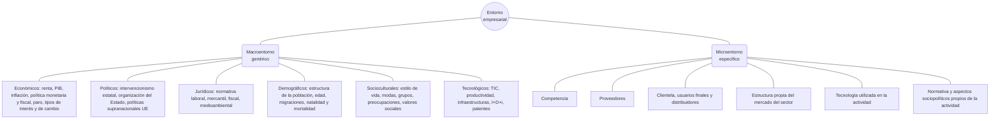
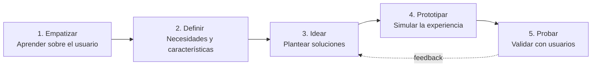
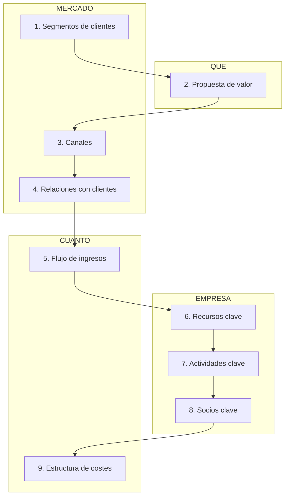
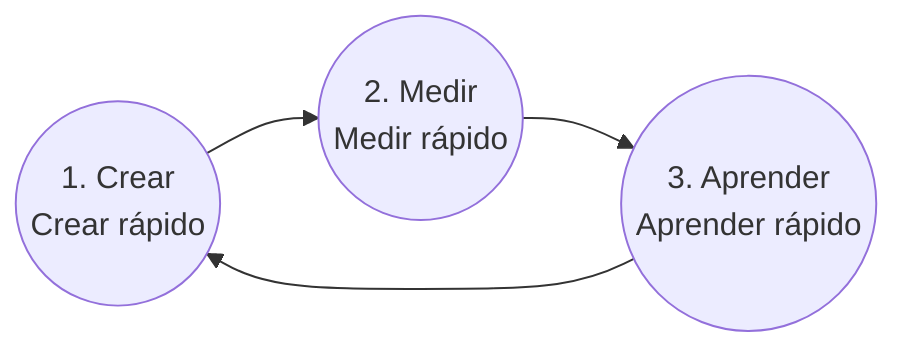
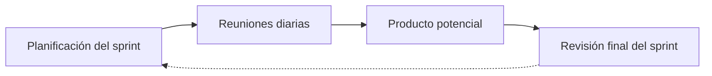
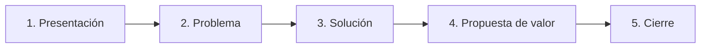

# Unidad 5: La idea emprendedora. Cultura empresarial
## Índice
- [[#1. Identificación y análisis de problemas]]
	- [[#1.1. Problemas del sector profesional o sociales relacionados con los ODS]]
	- [[#1.2. Definición y selección del reto a resolver]]
	- [[#1.3. Técnicas de investigación]]
- [[#2. El entorno empresarial]]
	- [[#2.1. Tipos de entorno]]
	- [[#2.2. Análisis PESTEL]]
	- [[#2.3. Análisis DAFO]]
- [[#3. Identificación y elección del cliente]]
- [[#4. Propuesta y validación de soluciones innovadoras]]
	- [[#4.1. Ideas de emprendimiento generadoras de nuevas oportunidades]]
	- [[#4.2. Técnicas para fomentar ideas creativas e innovadoras]]
		- [[#4.2.1. Design thinking]]
		- [[#4.2.2. SCAMPER]]
		- [[#4.2.3. Lienzo de propuesta de valor]]
		- [[#4.2.4. Mapas mentales]]
	- [[#4.3. Proceso de prototipado]]
	- [[#4.4. Propiedad intelectual e industrial]]
	- [[#4.5. Sistemas de inteligencia artificial aplicada al producto o servicio]]
- [[#5. Cultura empresarial e imagen corporativa]]
	- [[#5.1. Cultura empresarial e imagen corporativa]]
	- [[#5.2. Economía del bien común]]
	- [[#5.3. Responsabilidad social corporativa (RSC)]]
	- [[#5.4. Triple balance]]
- [[#6. Creación y desarrollo del modelo de negocio]]
	- [[#6.1. El plan de empresa]]
	- [[#6.2. Metodologías ágiles y herramientas]]
		- [[#6.2.1. Business Model Canvas (BMC)]]
		- [[#6.2.2. Lean startup y Lean canvas]]
		- [[#6.2.3. Scrum]]
		- [[#6.2.4. Elevator pitch]]

## Mapa de la unidad

## 1. Identificación y análisis de problemas

- Identificar problemas del mercado y crear soluciones creativas y viables es clave en el emprendimiento para asegurar que los productos satisfagan necesidades reales y sean innovadores o competitivos en precio frente a la competencia.

### 1.1. Problemas del sector profesional o sociales relacionados con los ODS

- Todo proyecto emprendedor debe proponer soluciones conectadas a las necesidades reales del mercado, que mejoren la productividad y el bienestar social, y que sean útiles y sostenibles, alineadas con los **ODS de la Agenda 2030** (ver [[Unidad 4]]).

| ODS | Relación con el emprendimiento |
|---|---|
| **ODS 1:** Fin de la pobreza | Innovación empresarial que busca avances tecnológicos al alcance de todos (sector productivo y comunidades vulnerables) para reducir desigualdades. |
| **ODS 4:** Educación de calidad | Proyectos innovadores que garantizan formación y conocimientos tecnológicos en el sector productivo. |
| **ODS 9:** Industria, innovación e infraestructura | Soluciones innovadoras ante la falta de infraestructuras, la baja eficiencia y la desigualdad tecnológica; impulsa el crecimiento económico. |
| **ODS 10:** Reducción de las desigualdades | Soluciones inclusivas con acceso igualitario a innovaciones y oportunidades; productos y servicios accesibles. |
| **ODS 12:** Producción y consumo responsables | Sostenibilidad; las empresas deben hacer entender a los consumidores el valor de las innovaciones responsables. |

**Ejemplos reales:**
- **Programa Incorpora (Fundación "la Caixa"):** fomenta el emprendimiento y el autoempleo en personas vulnerables con formación, asesoramiento y microcréditos (ODS 1).
- **Formación Profesional:** da a los estudiantes las competencias para incorporarse al mundo productivo (ODS 4).
- **Solar Marketplace (Sevilla):** facilita el acceso a energía solar y genera empleo local (ODS 9).
- **Koiki (Madrid):** logística inclusiva; reparto sostenible y empleo para personas en riesgo de exclusión (ODS 10).
- **Ecoalf:** moda sostenible hecha con materiales reciclados como redes de pesca, botellas de plástico y residuos textiles (ODS 12).

### 1.2. Definición y selección del reto a resolver

Definir un reto de innovación es esencial para encontrar soluciones que generen valor. Tiene tres pasos:

1. **Explorar:** analizar la organización para identificar oportunidades, fortalezas y áreas de mejora; observar clientes y proveedores para entender sus necesidades; explorar tendencias y prácticas innovadoras en otros sectores; hacer un estudio de mercado, un DAFO o un lienzo de propuesta de valor.
2. **Sintetizar:** organizar las ideas en grupos mediante **mapas mentales** y reducir la lista de retos a los más relevantes, asegurando que estén alineados con las necesidades del mercado y el valor para la organización.
3. **Definir y priorizar:** redactar retos específicos, accionables, verificables y claros. Priorizar los alineados con las necesidades de los clientes, la estrategia organizacional y el impacto potencial.

### 1.3. Técnicas de investigación

> [!info] Estudio de mercado
> Investigación de todas las variables y agentes que aportan información útil para decidir sobre la estrategia que hay que seguir para que una idea, producto o servicio sea viable.

El estudio debe analizar el entorno del negocio, las características y hábitos u opiniones de los clientes, y la calidad, precios, estrategias y productos de la competencia y los proveedores.

**Técnicas de recogida de información:**
- **Conocimientos previos:** reflexionar sobre lo adquirido por la experiencia en el sector y otros datos sobre factores económicos, sociales y culturales.
- **Encuestas:** telefónicas, presenciales o telemáticas; preguntan directamente al cliente.
- **Entrevistas:** con clientes potenciales, empleados del sector, expertos o consultores; permiten identificar necesidades, expectativas y frustraciones.
- **Observación directa:** da datos reales sobre el funcionamiento de un mercado concreto.
- **Búsqueda en la red:** fuentes fiables (búsquedas populares, redes sociales, blogs, artículos, foros) para datos actualizados y tendencias de consumo.
- **Reuniones y paneles de consumo:** personas de distintos perfiles; los paneles permiten conocer el tamaño del mercado potencial. También asistir a ferias o eventos sectoriales.

> [!tip] Combinar métodos
> La combinación de métodos da una visión clara del problema y ayuda a crear soluciones innovadoras alineadas con los ODS y los objetivos.

| Tipos de estudios | |
|---|---|
| **Cuantitativos** | Proporcionan solo datos a partir de la información de la empresa. |
| **Cualitativos** | Valoran la calidad o la intención de compra, las oportunidades y amenazas, etc. |

| Fuentes de información | |
|---|---|
| **Primarias** | Recogen información nueva del mercado (encuestas, entrevistas, reuniones de grupos). |
| **Secundarias** | Información ya recogida en otros estudios (publicaciones o informes internos y externos). |

**Cuota de mercado:** porcentaje de participación de la empresa en el mercado de un producto específico durante un periodo determinado, para evaluar el crecimiento de la empresa.

$$\text{Cuota por ingresos} = \frac{\text{Importe de las ventas de la empresa}}{\text{Importe de las ventas totales del mercado}} \times 100$$

$$\text{Cuota por unidades} = \frac{\text{Unidades vendidas de la empresa}}{\text{Unidades totales vendidas del mercado}} \times 100$$

## 2. El entorno empresarial

- El **entorno** es el medio externo, generalmente cambiante y dinámico, que condiciona la actividad de una empresa. La empresa interactúa con él y le influye, **pero no lo controla**.

### 2.1. Tipos de entorno

- **Entorno genérico o macroentorno:** variables externas que influyen en todas las empresas por igual, con independencia del sector y de la actividad.
- **Entorno específico o microentorno:** factores y agentes propios de un grupo de empresas de un sector o rama de actividad concreta.

### 2.2. Análisis PESTEL

- Herramienta que evalúa los **factores externos** que impactan en una empresa para dar una visión completa del entorno, identificando oportunidades y amenazas, anticipándose a los cambios y definiendo estrategias más efectivas.
- Es fundamental para que las empresas se adapten al entorno cambiante, gestionen los riesgos y mejoren su competitividad a largo plazo.
- Se complementa con el DAFO: el PESTEL examina factores **externos**; el DAFO evalúa aspectos **internos y externos**.
- Es útil en las etapas iniciales de un proyecto, en la expansión a nuevos mercados, ante cambios significativos o para evaluar riesgos.

| Letra | Factor | Qué se analiza |
|---|---|---|
| **P** | Políticos | Políticas gubernamentales, estabilidad política y acuerdos internacionales, incluyendo políticas fiscales y regulación del comercio exterior. |
| **E** | Económicos | Fiscalidad, inflación, tipos de cambio, interés y empleo (afectan a los costes), poder adquisitivo y crecimiento. |
| **S** | Sociales | Aspectos culturales, movimientos demográficos y tendencias sociales que impactan en la demanda. |
| **T** | Tecnológicos | Inversión en I+D y nuevas tecnologías que impulsan la competitividad y la adaptación a un mercado cambiante. |
| **E** | Ecológicos | Sostenibilidad, uso de recursos naturales, regulaciones ambientales e impacto de la empresa en el entorno. |
| **L** | Legales | Leyes laborales, de seguridad, propiedad intelectual y consumo de energía; su cumplimiento es crucial para evitar riesgos legales. |

### 2.3. Análisis DAFO

- El **DAFO** (Debilidades, Amenazas, Fortalezas y Oportunidades) representa gráficamente en una matriz los puntos débiles y fuertes de una empresa junto con las oportunidades y amenazas del entorno, para decidir las estrategias que seguir para lograr sus objetivos.

|  | **Factores negativos** | **Factores positivos** |
|---|---|---|
| **Análisis interno** | **D**ebilidades: situación desfavorable frente a la competencia (falta de capacitación, pocos recursos, imposibilidad de atender la demanda...) | **F**ortalezas: capacidades o recursos con los que cuenta la empresa y que le aseguran el éxito (conocimiento del sector, disposición de tecnología...) |
| **Análisis externo** | **A**menazas: situaciones del entorno que afectan a la estabilidad de la empresa (crisis económica, caída de ventas, aumento de la competencia...) | **O**portunidades: factores del entorno favorables para la empresa (nuevos mercados, poca competencia, mercado mal atendido...) |

**Matriz CAME:** a partir de los datos recogidos se elaboran estrategias para **C**orregir las debilidades, **A**frontar las amenazas, **M**antener las fortalezas y **E**xplotar las oportunidades.

**DAFO cruzado:**

| | **Amenazas** | **Oportunidades** |
|---|---|---|
| **Debilidades** | **Estrategias de supervivencia** (D + A): buscar una salida a una situación complicada minimizando los daños. | **Estrategias de reorientación** (D + O): corregir una debilidad aprovechando una oportunidad. |
| **Fortalezas** | **Estrategias defensivas** (F + A): protegerse de posibles amenazas usando las fortalezas propias. | **Estrategias ofensivas** (F + O): obtener el máximo beneficio de una oportunidad usando una fortaleza. |

## 3. Identificación y elección del cliente

Se utiliza el **mapa de empatía** para conocer al cliente. Se divide en seis partes:

| Parte | Qué recoge |
|---|---|
| **¿Qué ve?** | Entorno, amigos, ambiente de trabajo e influencias externas. |
| **¿Qué dice y qué hace?** | Actitud en público, aspecto y comportamiento hacia los demás. |
| **¿Qué oye?** | Lo que dicen sus amigos y afines, su jefe y sus *influencers*. |
| **¿Qué piensa y siente?** | Lo que realmente le preocupa, sus preocupaciones principales, sus sueños y aspiraciones. |
| **Esfuerzos** | Miedos, frustraciones y obstáculos. |
| **Resultados** | Deseos, necesidades, medida del éxito y superación de los obstáculos. |

**Pasos:**
1. **Representar el gráfico** del mapa de empatía dividido en seis partes (papel grande, pizarra...).
2. **Definir un cliente ideal** de manera real: nombre, edad, sexo, profesión, situación económica y características personales y sociales.
3. **Responder las preguntas clave** con notas adhesivas para completar cada sección.
4. **Analizar la información:** observar el mapa completo y ver cómo ajustar el producto o servicio a las necesidades, intereses y problemas del cliente.
5. **Aplicar lo aprendido en equipo** para tomar decisiones estratégicas sobre el producto, servicio y relación con el cliente.

## 4. Propuesta y validación de soluciones innovadoras

### 4.1. Ideas de emprendimiento generadoras de nuevas oportunidades

| Fuente de ideas de negocio | Descripción | Ejemplos |
|---|---|---|
| **Modelos de negocio existentes** | Negocios basados en modelos probados o ya en marcha. | Apertura de franquicias, traspasos de negocios consolidados. |
| **Tendencias sociales y mercados** | Responder a nuevas necesidades sociales o nichos de mercado específicos. | Servicios de ocio y vida cotidiana, alimentos para veganos. |
| **Innovación social y ambiental** | Resolver problemas sociales o ambientales con innovación. | Telemedicina, reciclaje, energías renovables, agricultura ecológica. |
| **Economía colaborativa** | Modelos basados en compartir recursos o servicios. | Alquiler de coches eléctricos urbanos, bicicletas o patinetes. |
| **Tecnología y digitalización** | Incorporar avances tecnológicos o digitalizar servicios tradicionales. | Comercio electrónico, aplicaciones móviles, clases en línea. |
| **Adaptación a cambios** | Identificar oportunidades derivadas de legislaciones o crisis. | Instalación de placas solares en viviendas. |
| **Sostenibilidad e innovación** | Negocios que reducen el impacto ambiental o responden a tendencias emergentes. | Productos DIY, segunda mano, embalajes biodegradables, reparación de ropa o calzado. |
| **Personalización** | Productos o servicios adaptados a necesidades individuales. | Decoración de carcasas de móviles, diseño de camisetas personalizadas, pasteles decorativos, impresión 3D bajo demanda. |
| **Pasiones y hobbies** | Negocios creados a partir de una afición personal. | Reparación de bicicletas, organización de viajes, productos para deportes o colecciones. |

### 4.2. Técnicas para fomentar ideas creativas e innovadoras

Ver también [[Unidad 4#6. Metodologías para fomentar la creatividad, el emprendimiento y la innovación]].

#### 4.2.1. Design thinking

- Metodología para crear soluciones **centradas en las personas**: se enfoca en comprender a fondo sus necesidades y deseos para crear productos, servicios o experiencias que resuelvan sus problemas reales.
- Entiende las necesidades del usuario, fomenta la colaboración y valida ideas rápidamente con prototipos, mejorándolas con retroalimentación.

| Etapa | Qué se hace | Técnicas |
|---|---|---|
| **1. Empatizar** | Investigar a fondo los problemas y necesidades de los usuarios para entender su perspectiva y los retos a los que se enfrentan. | Perfiles ficticios de usuarios, mapas de empatía, entrevistas y observación. |
| **2. Definir** | Identificar, a partir de la información recopilada, las necesidades clave y los principales problemas que hay que resolver. | Perfiles, propuestas de valor o mapas de empatía. |
| **3. Idear** | Generar gran cantidad de ideas sin restricciones, pensando de manera creativa y explorando soluciones distintas. | Lluvia de ideas, mapas mentales, mapas de afinidad, business model canvas. |
| **4. Prototipar** | Crear prototipos simples de las ideas más prometedoras; no han de ser perfectos pero sí funcionales para probar los conceptos. | Prototipos en papel, *wireframes* funcionales, prototipos interactivos y diseños Hi-Fi. |
| **5. Probar** | Probar los prototipos con usuarios para obtener *feedback* y ajustar lo que no funciona, volviendo a etapas anteriores para mejorar. | Tests de usabilidad, A/B testing, *eye tracking*. |

#### 4.2.2. SCAMPER

- Técnica que utiliza **preguntas** para mejorar o innovar un producto o proceso. Los datos se analizan para identificar áreas de mejora o posibles innovaciones.

| Letra | Acción | Pregunta clave |
|---|---|---|
| **S** | **S**ustituir | ¿Qué se puede reemplazar para mejorar o reducir costes? |
| **C** | **C**ombinar | Unir elementos o ideas para crear algo nuevo o más eficiente. |
| **A** | **A**daptar | Ajustar el producto o el proceso a nuevas necesidades o contextos. |
| **M** | **M**odificar | Cambiar atributos para mejorar o diferenciar el producto. |
| **P** | **P**oner en otros usos | Encontrar nuevas formas de usar el producto o proceso. |
| **E** | **E**liminar | Eliminar partes o pasos innecesarios para simplificar o reducir costes. |
| **R** | **R**eorganizar | Reorganizar pasos o invertir procesos para mejorar la eficiencia. |

> [!note] Nota
> Las diapositivas lo resumen como: *sustituir, combinar, adaptar, modificar, potenciar, eliminar y reorganizar*. La **P** aparece en el esquema como "Posar" (poner en otros usos).

#### 4.2.3. Lienzo de propuesta de valor

- Herramienta visual, esencial en innovación y diseño, para **alinear las necesidades de los clientes** con los productos o servicios de una empresa. Complementa el business model canvas.

| Mapa de valor (parte izquierda) | Segmento de clientes (parte derecha) |
|---|---|
| **Productos y servicios:** lo que se ofrece al cliente. | **Tareas:** actividades que el cliente hace en su día a día. |
| **Generador de ganancias:** beneficios aportados al cliente. | **Ganancias:** beneficios deseados por el cliente. |
| **Aliviador de frustraciones:** soluciones a los problemas del cliente. | **Frustraciones:** problemas del cliente en su vida o trabajo. |

**Pasos:**
1. Identificar el segmento de clientes con datos del estudio de mercado.
2. Diseñar el mapa de valor con soluciones generadas mediante un brainstorming o en la fase de ideación del design thinking.
3. Evaluar el **encaje** entre el segmento de cliente y la propuesta de valor para asegurar que satisface sus necesidades.

#### 4.2.4. Mapas mentales

- Herramientas visuales que organizan ideas y muestran cómo se relacionan entre sí, facilitando la comprensión y el proceso creativo.
- Empiezan con una **idea central** y se expanden con ramas conectando conceptos clave. Usan texto, imágenes, colores y símbolos, lo que mejora la retención de información y favorece la creatividad y la memoria a largo plazo.
- **Cómo hacerlo:** definir el tema central → identificar las ideas clave (principales y secundarias) → organizar las ideas → añadir detalles y ramificaciones → usar colores y símbolos → incluir imágenes y gráficos → revisar y ajustar.
- Se puede usar como herramienta de estudio.

### 4.3. Proceso de prototipado

- Un **prototipo** es una versión inicial de un producto para evaluar su viabilidad, la demanda y la capacidad de satisfacer necesidades reales.
- Permite recoger *feedback*, corregir errores y ajustar el diseño **antes de invertir** más recursos.

### 4.4. Propiedad intelectual e industrial

| Tipo | Qué protege |
|---|---|
| **Propiedad intelectual** | Las creaciones de las personas (libros, canciones, películas, programas de ordenador o pinturas); permite al autor decidir cómo se utiliza o se distribuye la obra. |
| **Propiedad industrial** | Invenciones, marcas, patentes y diseños industriales. |

### 4.5. Sistemas de inteligencia artificial aplicada al producto o servicio

- La IA, aplicada a productos y servicios, **mejora la experiencia del cliente, optimiza procesos** y es clave para impulsar la innovación y mantener la competitividad en la era digital.

## 5. Cultura empresarial e imagen corporativa

### 5.1. Cultura empresarial e imagen corporativa

- La **cultura corporativa** es el conjunto de creencias, valores, expectativas y estrategias compartidas por los miembros de la organización, que orienta y afecta a su comportamiento. Sus elementos son:

| Elemento | Definición |
|---|---|
| **Misión** | Breve presentación escrita sobre qué es la empresa y qué justifica su existencia. Se expresa en primera persona del plural. |
| **Visión** | Objetivo futuro de la empresa, resultado de sus esfuerzos. Ha de ser clara, alcanzable y compartida, y ha de inspirar a sus miembros a actuar. |
| **Valores** | Principios éticos que los miembros de una organización consideran válidos y que guían el comportamiento y las decisiones. |
| **Estrategia** | Plan de acciones para alcanzar los objetivos de la empresa en un periodo definido, alineándose con su misión. Incluye metas generales para el negocio y específicas para cada departamento y empleado. |

- La **imagen corporativa** es la percepción que tienen los agentes externos de una empresa (accionistas, clientes, proveedores, etc.) influida por la información recibida.

### 5.2. Economía del bien común

- Modelo económico que pone el **bienestar social y ambiental por encima de las ganancias individuales**, fomentando valores como la dignidad humana, la solidaridad, la sostenibilidad, la justicia social, la transparencia y la participación democrática.

### 5.3. Responsabilidad social corporativa (RSC)

- Compromiso ético de una empresa para contribuir al desarrollo económico, social y ambiental, generando valor para la sociedad y beneficios para el negocio si se aplica de manera coherente.

### 5.4. Triple balance

- El **balance** es un instrumento de gestión para planificar, organizar, dirigir, registrar, controlar y evaluar cuantitativa y cualitativamente la gestión de la RSC de la empresa, en un periodo concreto respecto a unas metas establecidas con anterioridad.
- Se mide en tres dimensiones: **económica, social y medioambiental** (ver [[Unidad 4#5.2. Los emprendedores sociales. Sostenibilidad y cuidado del medioambiente]]).

## 6. Creación y desarrollo del modelo de negocio

- El **modelo de negocio** define qué ofrece la empresa al mercado, a quién se dirige (público objetivo) y cómo lo venderá; es decir, cómo una organización **crea, entrega y captura valor**.
- Suele desarrollarse con un **plan de empresa**, pero elaborarlo lleva mucho tiempo y los cambios rápidos del mercado pueden volverlo obsoleto enseguida. Por eso hoy se opta por **metodologías más ágiles**.

### 6.1. El plan de empresa

- Es una **carta de presentación del negocio**, útil para obtener financiación, ayudas públicas o inversión, o para negociar con proveedores.
- No hay un único modelo, pero debe abarcar todas las áreas del negocio. Suele incluir:

| | |
|---|---|
| Resumen ejecutivo del modelo de negocio | Plan de márketing |
| Presentación de la idea emprendedora y del proyecto | Plan operativo |
| Presentación de los promotores | Plan de recursos humanos |
| Cultura empresarial (misión, visión, valores y estrategia) y RSC | Plan de inversiones y plan de financiación |
| Estudio de mercado | Forma jurídica de la empresa |
| | Protección legal de la idea |
| | Trámites de constitución |

**Aspectos formales del proyecto emprendedor:**
- Contenido completo, breve, conciso y convincente, con una extensión máxima de **50 páginas**.
- Documento ordenado con portada, índice paginado y epígrafes bien definidos.
- Márgenes adecuados, páginas numeradas y elementos tipográficos usados con moderación (negritas, cursivas, distintos tipos y tamaños de letra).
- Ortografía, redacción y estilo impecables.
- Uso de esquemas y gráficos para resumir la información.
- Si se presenta físicamente: papel, impresión y encuadernación de alta calidad.

### 6.2. Metodologías ágiles y herramientas

- Las **metodologías ágiles** ayudan a los equipos emprendedores a adaptarse rápidamente a los cambios, integrando novedades sin afectar a lo ya hecho.
- Funcionan en **ciclos cortos** y priorizan: la entrega rápida de valor al cliente, la adaptación a las condiciones del entorno, el trabajo en equipo y la mejora continua, asegurando resultados eficientes y de calidad.
- Herramientas de la unidad: **Business model canvas**, **Lean startup**, **Lean canvas**, **Scrum** y **Elevator pitch**.

#### 6.2.1. Business Model Canvas (BMC)

- Creado por **Alexander Osterwalder**. Herramienta para analizar en un lienzo, de forma sencilla, ágil y visual, **nueve bloques** que representan las áreas clave de una empresa y que influyen en su viabilidad.

**Pasos:**
1. **Dibujar o imprimir el lienzo** en un papel tamaño XXL y colgarlo en la pared para trabajar de forma muy interactiva (rotuladores y *post-its* de colores).
2. **Rellenar los nueve módulos** siguiendo un orden: primero la parte derecha (mercado y entorno), después la izquierda (actividades o estrategias para llevar la propuesta de valor al mercado).
3. **Tomar decisiones** cuando el lienzo está acabado. Conviene dejarlo expuesto para tener una visión global de la empresa de un vistazo.

**Los nueve bloques** (el número indica el orden):

| Nº | Bloque | Grupo | Qué hay que responder |
|---|---|---|---|
| 1 | **Segmentos de clientes** | ¿Para quién? (mercado) | Quiénes son los segmentos de clientes más destacados y para quién creamos valor. |
| 2 | **Propuesta de valor** | ¿Qué? | Qué valor entregamos a la clientela, qué necesidades satisfacemos y qué problemas queremos resolver. |
| 3 | **Canales** | ¿Para quién? (mercado) | Medio o canal para llevar la propuesta de valor al segmento objetivo. |
| 4 | **Relaciones con clientes** | ¿Para quién? (mercado) | Qué relación se mantendrá con la clientela y qué inspirará la marca. |
| 5 | **Flujo de ingresos** | ¿Cuánto? | Principales estrategias para conseguir ingresos (venta, suscripción, publicidad, *freemium*...) y por qué y cuánto están dispuestos a pagar los clientes. |
| 6 | **Recursos clave** | ¿Con qué? (empresa) | Qué recursos clave (físicos, económicos, humanos o intelectuales) necesita la actividad. |
| 7 | **Actividades clave** | ¿Con qué? (empresa) | Actividades clave internas que permiten llevar la propuesta de valor (producción, venta, márketing...). |
| 8 | **Socios clave** | ¿Con qué? (empresa) | Alianzas clave del modelo de negocio (socios, alianzas y proveedores clave). |
| 9 | **Estructura de costes** | ¿Cuánto? | Costes más importantes y recursos y actividades clave más costosos; conocer y optimizar costes fijos y variables para diseñar un modelo escalable. |

#### 6.2.2. Lean startup y Lean canvas

> [!info] Startup
> - «La startup es una organización temporal en búsqueda de un modelo de negocio escalable y replicable» (Steve Blank).
> - «Una startup se diseña para crear un nuevo producto o servicio bajo condiciones de incertidumbre extrema» (Eric Ries).

- El método **Lean startup** se basa en un **ciclo continuo de crear, medir y aprender**, que permite a las startups reducir riesgos y costes al validar rápidamente su modelo de negocio con un producto mínimo viable.

1. **Crear.** Una vez definida la idea de negocio, se desarrolla el **producto mínimo viable (PMV)**: un prototipo con las características esenciales del producto o servicio. Se lanza al mercado lo más rápido posible para probarlo con clientes reales y obtener información sobre el negocio, el producto y el mercado. Se plantean hipótesis sobre cómo el PMV crea valor para los clientes y cómo estos lo descubren, las cuales se prueban en el mercado.
2. **Medir.** Las hipótesis deben ser verificadas en el mercado mediante **indicadores accionables** que muestren la relación causa-efecto entre las acciones y los resultados, lo que permite aprender rápidamente y adaptar el modelo de negocio a las necesidades reales de los clientes. Algunas herramientas para medir el impacto del PMV, como Google Analytics, son propuestas por la contabilidad de la innovación. El objetivo es aprender de manera económica, por eso se utilizan lotes pequeños del PMV para reducir costes si se detectan fallos.
3. **Aprender.** La información obtenida del producto, la idea o el modelo de negocio permite tomar tres decisiones: **pivotar** (cambiar totalmente), **optimizar** (modificar parcialmente) o **perseverar** (mantener la idea tal y como está). El emprendedor aprende de los ciclos repetitivos y ajusta su enfoque según las necesidades detectadas, siempre con el objetivo de llegar a un modelo de negocio escalable y rentable.

- Conceptos asociados al ciclo: hipótesis de creación de valor y de crecimiento, contabilidad de la innovación, indicadores accionables vs. indicadores vanidosos, experimentación propia, aprendizaje validado, optimización, lotes pequeños, coraje.

**Lean canvas:** en lugar del *business model canvas*, el lean startup utiliza el lean canvas. Su lado derecho se enfoca en el **mercado** y el izquierdo en el **producto**, adaptándose mejor a las startups. También cambia el orden y algunos conceptos.

- Variante del lienzo orientada a **startups**, dividida en **Producto** y **Mercado**.

| Nº | Bloque | Contenido |
|---|---|---|
| 1 | **Segmentos de cliente** | Identificar y conocer los segmentos sobre los que trabajar y esforzarse en averiguar quiénes podrían ser los *early adopters* o usuarios visionarios con los que empezar a trabajar. |
| 2 | **Problema** | Esbozar cuáles son los tres problemas principales de los clientes. |
| 3 | **Propuesta de valor única** | Indicar de manera clara, simple y sencilla, en una sola frase (un *mini pitch*), qué te hace especial y cómo ayudarás a tus clientes a resolver su problema. |
| 4 | **Solución** | Definir tres características importantes del producto o servicio que ayuden a resolver los problemas. |
| 5 | **Canales** | Indicar cómo se hará llegar la solución a los segmentos de clientes. |
| 6 | **Flujos de ingresos** | Reflexionar sobre las estrategias para obtener ingresos en la startup, los márgenes, el valor del cliente, el modelo de recurrencia, etc. |
| 7 | **Estructura de costes** | Detallar todos los elementos que cuestan dinero a la empresa; al principio este gasto será el mínimo posible. |
| 8 | **Métricas clave** | Definir tres o cuatro indicadores que medirán el modelo de negocio: qué actividades medir y cómo. |
| 9 | **Ventaja especial** | Recoger lo que nos hace especiales y diferentes, algo que favorezca que los clientes sigan viniendo a buscar más. |

#### 6.2.3. Scrum

- Metodología ágil para gestionar proyectos mediante tareas llamadas **sprints**, que duran de **dos a cuatro semanas**, con entregas parciales del producto al final de cada ciclo.

**Roles en Scrum:**
- **Product owner:** define las prioridades y características del producto.
- **Scrum master:** facilita el proceso y elimina obstáculos.
- **Equipo de desarrollo:** equipo multidisciplinar que ejecuta las tareas.

**Artefactos principales:**
- **Backlog de producto:** lista priorizada de todas las funcionalidades, mejoras, correcciones y requisitos necesarios para el desarrollo del producto.
- **Sprint backlog:** conjunto de elementos y tareas seleccionados del backlog de producto que el equipo planifica y desarrolla en el sprint.
- **Incremento:** la entrega al final de un producto en cada sprint.

**Eventos clave:**
- **Planificación del sprint:** reunión inicial para planificar tareas.
- **Reuniones diarias:** de 15 minutos, para que cada miembro informe de lo que hizo, de lo que hará y de los obstáculos encontrados.
- **Producto potencial:** el objetivo de cada sprint, asegurando que se entregue un incremento de valor al cliente en cada iteración.
- **Revisión final del sprint:** sesión para analizar los resultados, identificar áreas de mejora y optimizar los procesos para el siguiente ciclo.

**Beneficios del Scrum:** mejora continua, adaptabilidad, flexibilidad y entregas constantes que aseguran la alineación con las necesidades del cliente.

#### 6.2.4. Elevator pitch

- Discurso breve y claro para presentar un proyecto empresarial en **menos de dos minutos**, captando la atención de inversores, clientes o colaboradores.
- Toma su nombre de una supuesta situación: «Imagina que tienes que despertar el interés de tu interlocutor en el tiempo que dura un viaje en ascensor: ¡2 minutos!».

1. **Presentación.** Inicia con tu nombre, puesto y empresa. Usa un lenguaje adecuado y genera confianza con contacto visual y escucha activa.
2. **Problema.** Expón un problema relevante para tu audiencia, utilizando ejemplos reales o visuales.
3. **Solución.** Describe cómo resuelves el problema con tus habilidades, productos o servicios únicos.
4. **Propuesta de valor.** Destaca lo que te diferencia de la competencia y cómo aportas valor único.
5. **Cierre.** Finaliza con una pregunta o comentario que fomente diálogo e intercambiar información de contacto.

- El objetivo es generar interés y abrir oportunidades futuras, empleando un discurso sencillo, atractivo y bien preparado.
- En la «Situación de partida resuelta» se ha incluido el elevator pitch para Teresa, CEO de Moda Responsable, SL.
