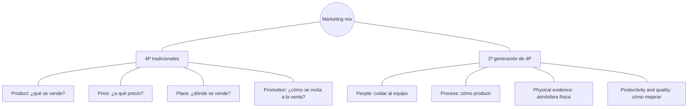
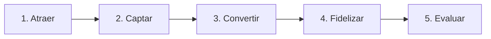

# Unidad 6: El márketing
## Índice
- [[#1. Introducción al márketing]]
- [[#2. Fundamentos del márketing]]
	- [[#2.1. El márketing mix clásico]]
	- [[#2.2. Adaptaciones del márketing mix en entornos digitales]]
- [[#3. Márketing digital: herramientas y tendencias]]
	- [[#3.1. Herramientas digitales]]
	- [[#3.2. Estrategias digitales]]
	- [[#3.3. Tecnologías emergentes en márketing]]
	- [[#3.4. Big data y analítica avanzada en márketing]]
	- [[#3.5. Impacto positivo en el entorno]]

## 1. Introducción al márketing

- El **márketing** es un proceso que busca **identificar, anticipar y satisfacer** las necesidades y deseos de los consumidores, con el objetivo de generar beneficios para la empresa y conseguir que ambas partes obtengan algo valioso y útil.
- El **márketing mix** es un conjunto de herramientas que analiza el comportamiento de los mercados para generar acciones que buscan retener y fidelizar a la clientela mediante la satisfacción de sus necesidades.
- El márketing actúa como **herramienta comercial y de validación**: es el proceso de detectar y satisfacer necesidades para crear valor tanto para el cliente como para la empresa (plan de márketing → márketing mix).

### Del márketing tradicional al digital

| Tipo | Canales |
|---|---|
| **Márketing tradicional** | Canales *offline*. |
| **Márketing digital** | Canales en línea, a través de internet y redes sociales. |

- Ambos se combinan en una **estrategia omnicanal** (offline + online).

### Márketing ético, sostenible e inclusivo

- Busca promover productos y servicios que satisfagan las necesidades de los consumidores **generando un impacto positivo en la sociedad y el medio ambiente**. Principales enfoques:

| Enfoque | Qué es |
|---|---|
| **Márketing ético y sostenible** | Se centra en ser honesto, transparente y responsable, usando prácticas que cuidan el medio ambiente y ayudan a las empresas a destacar y atraer clientes comprometidos. |
| **RSC** (responsabilidad social corporativa) | Acciones que benefician a la sociedad y al medio ambiente, de manera que refuerzan la reputación de la empresa y aumentan la lealtad de los clientes (ver [[Unidad 5#5.3. Responsabilidad social corporativa (RSC)]]). |
| **Márketing inclusivo** | Reconoce la diversidad y muestra compromiso con la equidad. Adapta estrategias y lenguaje a diferentes públicos, ampliando así su mercado. |

## 2. Fundamentos del márketing

### 2.1. El márketing mix clásico

- En el márketing tradicional, las estrategias se agrupan en las **4P**, completadas con una **segunda generación de 4P** que da solución a las nuevas demandas del mercado.

#### 2.1.1. Producto (*Product*)

- Conjunto de atributos **tangibles** (forma, tamaño, color...) e **intangibles** (marca, imagen, servicio...) que el consumidor valora de un bien o servicio por los beneficios asociados a su consumo.

**Niveles del producto** (hay que definir tres):
- **Producto básico:** la necesidad básica que satisface.
- **Producto forma o aumentado (real):** diseño, envase, marca, calidad.
- **Producto ampliado o total:** servicios añadidos como posventa, garantía, financiación, entrega... (ver [[Unidad 4#Niveles del producto en la innovación]]).

**Ciclo de vida del producto:** 

- Se representa con una curva de ventas y beneficios a lo largo del tiempo.

**Marca:** nombre, término, símbolo o diseño, o una combinación de ellos, que identifica los bienes o servicios de un vendedor para diferenciarlos de la competencia.

| Estrategia de marca | Características | Ejemplos de las diapositivas |
|---|---|---|
| **Marca única** | Ampara todos los productos si la imagen de empresa es positiva. Ahorra en promoción y publicidad. | Ducati, Yamaha |
| **Marcas múltiples** | Fusión de empresas manteniendo el nombre de sus productos. Se llega a segmentos de consumidores y a estar en más zonas geográficas. Mayores costes. | Grupo Volkswagen (SEAT, Audi, VW) |
| **Segundas marcas** | Marcas creadas por una empresa que ya dispone de marcas reconocidas. Segmenta y amplía el mercado para dirigirse a un *target* diferente del habitual. | Toyota / Lexus |
| **Marca distribuidor** | Conjunto de las marcas comerciales propiedad del distribuidor y las marcas de productos genéricos, también llamadas marcas blancas. | Marcas blancas de supermercados |

#### 2.1.2. Precio (*Price*)

- Cantidad que paga el cliente por comprar un producto o servicio, que ha de ser **razonable según el beneficio que percibe**.
- Es una **decisión estratégica** que debe equilibrar la generación de beneficios para la empresa y su aceptación en el mercado.

**Criterios para fijar los precios:**
- Basado en los **costes**.
- Basado en la **percepción del comprador**.
- Basado en los precios fijados por la **competencia**.

**Estrategias de precios:**

| Estrategia | Variantes |
|---|---|
| **Descuentos y promociones** | Por pago inmediato; por volumen de compra (rápel); descuentos periódicos o rebajas; descuentos aleatorios u ofertas; descuentos estacionales. |
| **Precios psicológicos** | Precio impar o no redondeado; precio par o redondeado; precio de prestigio; precios de referencia. |
| **Para diversas líneas de productos** | Líder en pérdidas; precio paquete; precios cautivos. |
| **Para productos nuevos** | Penetración; descremación. |

#### 2.1.3. Distribución (*Place*)

- Actividades necesarias para decidir **dónde, cuándo y cómo** entregar el producto al consumidor. Engloba canales, puntos de venta, logística, transporte y métodos de pago, entre otros. Hoy se han transformado para adaptarse al comercio digital y sostenible.

**Tipos de distribución:** intensiva, selectiva y exclusiva.

**Canal de distribución:**
- **Longitud del canal:** directos o indirectos.
- **Intermediarios:** mayorista y minorista.
- **Tipos de canales:** *offline* y *online*.

#### 2.1.4. Promoción (*Promotion*)

- Acciones para dar a conocer el producto, su marca y beneficios, adaptándose a las demandas actuales del consumidor mediante estrategias creativas y tecnológicas.

**Herramientas de la promoción actual:**
- Publicidad
- Relaciones públicas
- Merchandising
- Promoción de ventas
- Fidelización
- Servicio posventa
- Mensajes SMS o correo electrónico
- Publicidad viral
- Banners

#### 2.1.5. Personas (*People*)

- El equipo de colaboradores de la empresa; de su comportamiento con la clientela depende el éxito comercial y empresarial.

#### 2.1.6. Proceso (*Process*)

- Conjunto de metodologías y procedimientos de trabajo utilizados por la empresa desde la idea hasta la comercialización de un producto o servicio.

#### 2.1.7. Presencia (*Physical evidence*)

- Elementos corporativos que hacen el ambiente agradable para el cliente y lo atraen desde el primer momento.

#### 2.1.8. Productividad y calidad (*Productivity & Quality*)

- **Productividad:** busca optimizar recursos, reducir costes y mejorar la eficiencia del equipo sin comprometer la calidad del servicio.
- **Calidad:** grado en que un producto o servicio cumple con las expectativas del cliente, garantizando su satisfacción.

### 2.2. Adaptaciones del márketing mix en entornos digitales

- Internet y la tecnología han transformado por completo los negocios, impulsando el desarrollo de estrategias de márketing que se adaptan al entorno digital.
- Los hábitos de consumo actuales y el uso intensivo de la tecnología han permitido el *e-commerce*, mediante la comercialización en línea de productos y servicios que ofrecen un acceso global.
- Son las **4P digitales** (márketing digital, canal online):

| P digital | Qué es | Herramientas / ejemplos |
|---|---|---|
| **Personalización** | Anuncios, notificaciones o publicidad adaptados al cliente. | Recogida online de datos: Google Trends, *native advertising*, *programmatic advertising*, *marketing automation*. |
| **Participación** | Información útil para adaptarse a las necesidades reales de los clientes. | Community manager, página web corporativa, SEM / SEO / Google Trends / Google AdWords, perfiles corporativos en las redes sociales, comunidades de clientes. |
| **Peer to peer** | Opiniones, recomendaciones o sugerencias que se encuentran en las redes sociales. Los clientes confían más en las opiniones y sugerencias de personas cercanas sobre un producto que en la propia publicidad. | Opiniones en redes. |
| **Predicciones modeladas** | Análisis del comportamiento de los usuarios virtuales a partir de datos cuantitativos de sus acciones en internet. | Herramientas de pago y gratuitas de monitorización: Google Analytics, *brand awareness*. |

## 3. Márketing digital: herramientas y tendencias

### 3.1. Herramientas digitales

- **SEO** (*search engine optimization*): conjunto de técnicas para mejorar la visibilidad y posición de un sitio web en los motores de búsqueda para atraer tráfico de calidad mediante la optimización de palabras clave, contenido relevante y enlaces.
	- **SEO On-Page**
	- **SEO Off-Page**
- **SEM** (*search engine marketing*): estrategia de márketing digital que utiliza **campañas pagadas** en motores de búsqueda para atraer tráfico a sitios web.
- **Email marketing**
- **Redes sociales**
- **Analítica web**

> [!tip] SEO vs SEM
> SEO = posicionamiento **orgánico** (optimizar). SEM = posicionamiento **de pago** (campañas pagadas).

### 3.2. Estrategias digitales

- **Inbound marketing o márketing de atracción:** estrategia que busca captar clientes ofreciendo **contenido útil y relevante**. Fases:

| Fase | Descripción |
|---|---|
| **1. Atraer** | La empresa cobra visibilidad al captar la atención del público objetivo que busca soluciones a sus necesidades y encuentra contenido útil y relevante (blogs, redes sociales, SEO...). |
| **2. Captar** | Convierte a los visitantes en contactos o *leads* ofreciendo recursos útiles gratuitos (ebooks, cursos o webinars) a cambio de que la persona facilite sus datos de contacto mediante formularios, llamadas a la acción (CTA) o *landing pages*. |
| **3. Convertir** | Para convertir los *leads* en clientes, la empresa se comunica de manera individualizada por SMS o correos personalizados, ofertas adaptadas a sus intereses y herramientas de CRM (gestión de relaciones con clientes). |
| **4. Fidelizar** | Gestión integral de la relación con el cliente: refuerza los lazos de unión con soporte continuo, ofertas y ventajas exclusivas, y programas de fidelización. |
| **5. Evaluar** | Se evalúan las fases anteriores para detectar puntos fuertes y débiles y optimizar la estrategia según la satisfacción del cliente. |

- **Márketing de contenidos:** crear y compartir contenido útil y relevante para atraer y mantener un público objetivo.
- **Automatización del márketing (*marketing automation*):** uso de *software* para llevar a cabo procesos y acciones automáticas dirigidas a la segmentación de audiencias, la administración de campañas publicitarias y la generación de flujos de trabajo para mejorar su efectividad.
	- Permite estrategias como el ***lead nurturing***: enviar correos electrónicos personalizados con información relevante para el usuario.

### 3.3. Tecnologías emergentes en márketing

Tecnologías que optimizan la interacción con los clientes y mejoran la eficacia de las estrategias:

| Tecnología | Qué aporta |
|---|---|
| **Inteligencia artificial** | Utiliza algoritmos y aprendizaje automático para analizar grandes volúmenes de datos del comportamiento de los usuarios (productos visitados, compras previas, actividad en redes sociales) y crear perfiles detallados de clientes que ayudan a predecir comportamientos y optimizar campañas publicitarias para hacerlas más efectivas y relevantes. |
| **Chatbots** | Usan algoritmos y aprendizaje automático para analizar los mismos datos de comportamiento de los usuarios y crear perfiles detallados de clientes que ayudan a predecir comportamientos y optimizar campañas (la diapositiva repite la descripción de la IA). |
| **Blockchain** | Mejora la transparencia y la seguridad en las transacciones digitales. Protege los datos compartidos entre empresas y consumidores, y se usa para verificar la autenticidad de productos, transacciones financieras y anuncios en línea. |
| **Realidad virtual (RV) y realidad aumentada (RA)** | Integran elementos virtuales en el entorno físico del usuario para ofrecer experiencias inmersivas e interactivas. |

### 3.4. Big data y analítica avanzada en márketing

- El **big data** y la **analítica avanzada** son tecnologías que recopilan datos masivos de fuentes como redes sociales, búsquedas y compras, y los analizan para **personalizar experiencias y anticipar necesidades futuras**. Esto permite a las empresas crear estrategias adaptadas al público objetivo.
- El **internet de las cosas (IoT)** complementa el big data al recopilar datos en tiempo real de dispositivos conectados (sensores, *wearables*, electrodomésticos inteligentes). Permite identificar tendencias y patrones del consumidor y ajustar estrategias para ofrecer servicios y productos más alineados con las preferencias de los usuarios.
- Gracias a la **analítica predictiva**, las empresas pueden prever comportamientos, lo que ayuda a desarrollar campañas más precisas y adaptarse rápidamente a los cambios del mercado. En redes sociales permite medir la efectividad de campañas, evaluar la recepción de nuevos productos y analizar las estrategias de la competencia para ganar ventaja.
- La integración de big data, analítica avanzada e IoT no solo mejora la personalización, sino que permite tomar **decisiones basadas en datos reales**. Esto incrementa la efectividad de las estrategias, fomenta una relación más sólida con los clientes y posiciona a las empresas como líderes en su sector.

**Herramientas de IA:**
- Google AI e IBM Watson analizan datos avanzados.
- Recombee y ChatGPT hacen recomendaciones respetando la privacidad, adaptándose al Reglamento General de Protección de Datos (RGPD).

**Realidad virtual y aumentada (aplicaciones):**
- La **RA** permite, por ejemplo, que una tienda de muebles muestre cómo quedarían sus productos en la casa del cliente.
- La **RV** puede crear simulaciones completas, como explorar destinos turísticos o probar vehículos, dando una forma innovadora de interactuar con productos o servicios.

### 3.5. Impacto positivo en el entorno

> [!summary] Idea clave
> El márketing digital ha mejorado la **eficiencia, el alcance y la participación** en la promoción de productos y servicios, fortaleciendo la comunicación entre empresas y consumidores, e impulsando la innovación y el crecimiento económico en la era digital.

- Se eliminan **barreras geográficas**: permite llegar a clientes de todo el mundo mediante redes sociales y motores de búsqueda.
- Con herramientas de análisis, se hace una **segmentación más precisa** del mercado, según intereses y comportamientos.
- Proporciona **métricas en tiempo real** para evaluar y ajustar estrategias basadas en datos concretos.
- Facilita la **comunicación bidireccional** entre marcas y consumidores, reforzando la confianza y la fidelización.
- Ofrece **campañas adaptadas a diversos presupuestos** y es más económico que los medios tradicionales.
- Permite **ajustar rápidamente las estrategias** según las tendencias y demandas del mercado.
- Crea **experiencias adaptadas** a cada usuario, ofreciendo contenido y ofertas basadas en sus intereses.
- Impulsa la **generación de contenidos** útiles para las marcas y los usuarios.
- **Recopila y analiza información** sobre el comportamiento del consumidor, facilitando las decisiones empresariales.
- Ofrece oportunidades para desarrollar **campañas innovadoras** y enfoques únicos que atraen y retienen a la audiencia.
- Brinda **acceso a información** que permite a los consumidores tomar decisiones de compra.
- Ha sido clave en el crecimiento del **comercio electrónico** (*e-commerce*).
