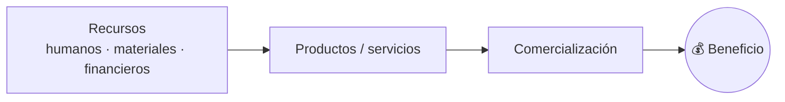
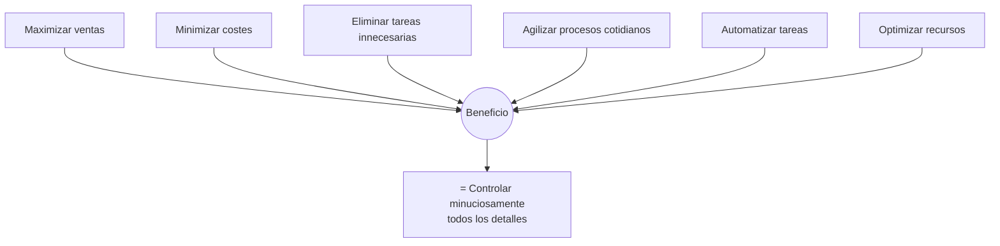
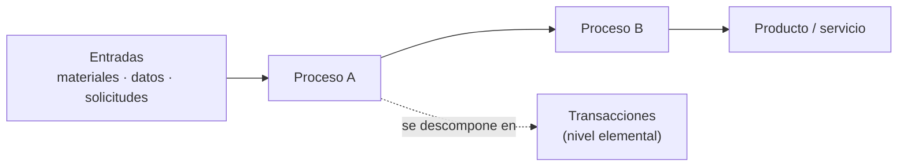

# 1 · Gestión empresarial y objetivos

↩️ [[SGE-T1]]

> [!note] Definición — Gestión empresarial
> Conjunto de acciones y estrategias que persigue **mejorar el funcionamiento general de una empresa**: aumentar la productividad, la competitividad y la rentabilidad.

> [!quote] Toma nota (libro)
> La finalidad de la gestión empresarial es que la empresa sea **viable** mediante una correcta planificación y control de los aspectos productivos, comerciales, financieros, logísticos, etc.

## Objetivo de la empresa

Con recursos **humanos, materiales y financieros** genera productos/servicios que, comercializados, producen **beneficios** (su razón de existir).

## Las 6 vías para aumentar el beneficio

> [!important] Idea clave
> La mejor forma de crecer en beneficio es una **acción combinada** sobre los seis aspectos; no son incompatibles.
> Además hoy la empresa debe ser **competitiva**, **sostenible** y cumplir la normativa (**compliance**). La **eficiencia** y la **efectividad** influyen en el beneficio.

## Ejemplos aplicados (Actividad N01)

| Objetivo | 🥖 Panadería «Forn de Sa Plaça» | 👕 Tienda online «Moda Circular» | 🩺 Fisio «Moviment» |
|---|---|---|---|
| Maximizar ventas | Encargos semanales para cafeterías, lotes de desayuno | Descuentos a recurrentes y recomendaciones | Bonos de sesiones (sin vender sesiones innecesarias) |
| Minimizar costes | Comparar proveedores de harina, evitar excedentes | Unificar envíos y negociar tarifas | Consumibles ajustados al uso real |
| Eliminar tareas innecesarias | Registrar pedidos una sola vez | Quitar revisión manual del pago | No volver a pedir datos vigentes |
| Agilizar procesos | Preparar hornadas la tarde antes | Pedidos ordenados por ubicación | Reserva online |
| Automatizar tareas | TPV descuenta stock | Email de confirmación y seguimiento | Recordatorios automáticos |
| Optimizar recursos | Hornadas seguidas aprovechando el calor | Reponer primero lo de más rotación | Repartir salas y profesionales |

> [!warning] No confundir
> | Concepto | Significa | ¿Necesita software? |
> |---|---|---|
> | **Agilizar** | Reducir el tiempo de un proceso | No siempre |
> | **Automatizar** | Un sistema ejecuta la tarea con poca intervención humana | Sí |
> | **Eliminar tareas** | Quitar pasos duplicados o sin valor (no hacerlos más rápido) | No |
> | **Optimizar recursos** | Usar mejor máquinas, personas, dinero, locales, stock | No es solo recortar |

## Procesos de negocio, datos y flujo de trabajo

> [!info] Los 3 pilares de una gestión eficiente
> 1. **Procesos de negocio** → conjunto de tareas relacionadas y ordenadas que proporcionan un producto o servicio, **interno** (para otro departamento) o **externo** (cliente final).
> 2. **Datos** → volumen enorme (máquinas, transacciones, clientes, proveedores, almacén, web, redes...) que debe convertirse en **información**.
> 3. **Flujo de trabajo (workflow)** → intercambio ordenado y eficiente de información entre departamentos.

- Los procesos suelen ser **secuenciales**: la salida de uno es la entrada del siguiente.
- Descompuestos hasta el nivel elemental reciben el nombre de **transacciones**.

> [!question]- Actividad 1.1 del libro (reflexión)
> - **Empresa pública vs privada**: la pública pertenece al Estado y busca el interés general; la privada pertenece a particulares y busca beneficio.
> - **¿Deben obtener beneficios las públicas?** No es su fin principal, pero deben ser **eficientes** y sostenibles; un beneficio puede reinvertirse en el servicio.
> - **Objetivos vs propósito**: el propósito es la razón de ser (el «para qué»); los objetivos son metas concretas y medibles para cumplirlo.
