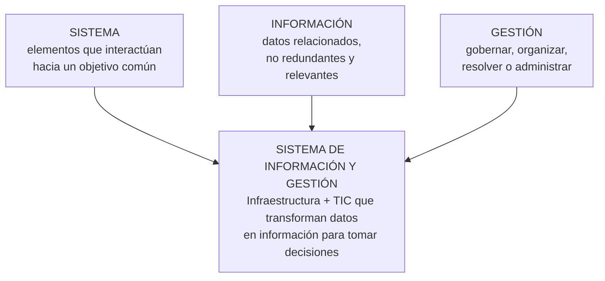
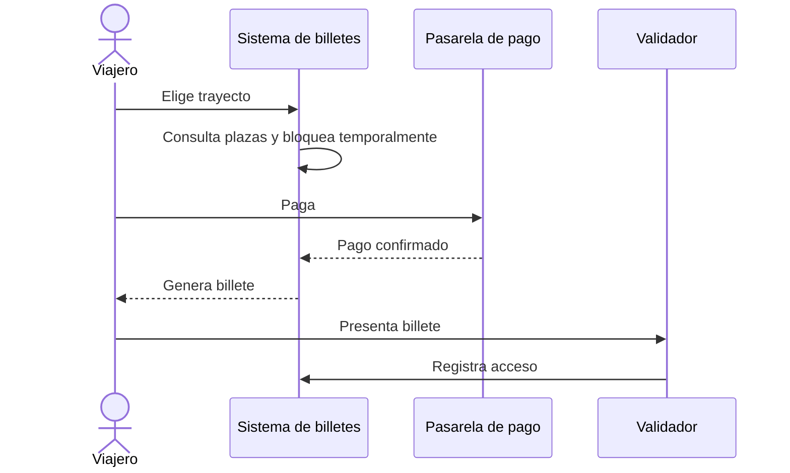

# 2 · Sistemas de información

↩️ [[SGE-T1]]

> [!note] Sistema de información
> Conjunto de datos convertidos en información mediante procesos y mecanismos automatizados e interrelacionados.

> [!important] Ten en cuenta
> Un sistema de información **no es solo la tecnología** que lo soporta: también es la **organización** de esos recursos y los **métodos** para obtener la información.

## SIG / SIE / MIS

> [!note] Definición
> **SIE** (sistema de información empresarial) o **SIG** (sistema de información gerencial): conjunto de aplicaciones que cubren el tratamiento **simultáneo** de la información necesaria para el funcionamiento de la empresa por parte de un grupo de usuarios → **gestión automatizada del negocio en sentido amplio**.

> [!info] MIS (Management Information System)
> Se alimentan de los datos de los procesos de la empresa, los procesan y elaboran información «cocinada»: **estadísticas, informes, gráficos, simulaciones, tendencias**.
> A veces «MIS» se usa en sentido general para todos estos sistemas.

> [!warning] Sopa de letras
> El marketing de los fabricantes usa las siglas **en sentido laxo**: las herramientas reales no encajan estrictamente en las definiciones. Lista completa en [[08 - Glosario y acrónimos]].

## Sistemas NO gerenciales (Actividad N02)

> [!note] Definición
> También recogen y procesan datos, pero su finalidad es **prestar un servicio o resolver una operación concreta**, no dirigir la empresa con informes de gestión.

| Sistema | Procesos | Datos almacenados | Cliente externo | Cliente interno |
|---|---|---|---|---|
| 📚 Biblioteca | Buscar, prestar, devolver, reservar, controlar retrasos | Usuarios, catálogo, ejemplares, fechas, reservas, sanciones | Lector | Bibliotecario |
| 🎓 Moodle | Publicar materiales, matricular, entregar, corregir, calificar | Cursos, alumnos, roles, archivos, fechas, notas | Alumno / familia | Profesor / secretaría |
| 🎫 Venta de billetes | Consultar horarios, plazas, reservar, cobrar, emitir, validar | Rutas, horarios, plazas, pagos, billetes, validaciones | Viajero | Revisor / taquilla |

### Flujo de información — ejemplo billetes

## Clientes internos y externos

> [!tip] Cliente = quien recibe el resultado de una actividad
> - **Interno**: trabaja en la misma organización y recibe trabajo/información de otro departamento.
> - **Externo**: persona u organización ajena que usa, compra o recibe el servicio.
> Vale tanto para sistemas gerenciales como no gerenciales.

## Gerencial vs no gerencial

| | No gerencial | Gerencial |
|---|---|---|
| Finalidad | **Realizar y registrar** la operación | **Relacionar y analizar** datos para controlar y decidir |
| Ejemplo | Emitir un billete | Detectar líneas deficitarias con miles de ventas |
| Ejemplos de software | Biblioteca, Moodle, venta de billetes | Odoo, SAP S/4HANA, Power BI |

> [!caution] Trampa de examen
> «No gerencial» **no** significa «sin tecnología» ni «sin datos». Y los límites no son absolutos: un producto puede tener funciones operativas y analíticas.
