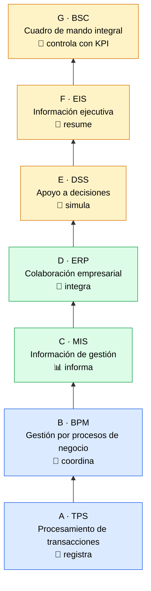
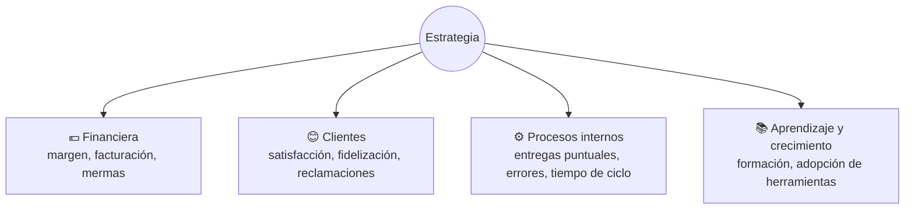

# 3 · Clasificación de los sistemas de gestión empresarial

↩️ [[SGE-T1]]

> [!abstract] Clasificación del libro (de nivel inferior a superior)
> TPS → BPM → MIS → ERP → DSS → EIS → BSC. Algunos se solapan.
> Todos Buscamos Mejores Empleos, Después Escalamos a Boss

> [!note]+ A) TPS — Transaction Processing System
> - **Nivel operacional más bajo.** Soporta la rutina diaria: ventas, pagos, existencias.
> - Clave: **consistencia e integridad** de las transacciones.
> - Es la **base** de los sistemas superiores.
> - *Ejemplo:* el TPV crea la venta, descuenta stock y registra el cobro.
> - *Software:* Shopify POS, Square POS, Odoo Punto de Venta.

> [!note]+ B) BPM — Business Process Management
> - Gestiona los **procesos**: acciones ordenadas de personas y máquinas para un objetivo.
> - Incluye procesos físicos de producción, a menudo con **sensores**.
> - *Ejemplo:* factura > 1.000 € pasa automáticamente por aprobación del responsable.
> - *Software:* Camunda, Bizagi, Bonita.

> [!note]+ C) MIS — Management Information System
> - Recoge información de fuentes **internas** y la convierte en **informes, estadísticas y proyecciones**.
> - Visión fidedigna de **una parte** de la empresa.
> - *Software:* Power BI, SAP BusinessObjects BI, Oracle Analytics.

> [!note]+ D) ERP — Enterprise Resource Planning
> - **Es un MIS integrado.** Una **única base de datos** con datos de todos los estamentos: producción, ventas, logística, RR. HH., proyectos, contabilidad.
> - Acceso según el **rol** del usuario.
> - *Ejemplo:* pedido confirmado → reserva de stock + albarán + factura sin reteclear.
> - *Software:* SAP S/4HANA, Odoo, Dynamics 365 Business Central.

> [!note]+ E) DSS — Decision Support System
> - Interactivos; añaden **simulación y modelado** («¿qué pasaría si...?»).
> - Tipo especial de **BI**: usa **OLAP, DataWarehouse y DataMining**.
> - *Usos:* tráfico, aprobación de créditos, diagnósticos médicos.
> - *Software:* IBM Planning Analytics, SAS Viya, Oracle Crystal Ball.

> [!note]+ F) EIS — Executive Information System
> - Formato **gráfico e intuitivo**, distintos niveles de detalle.
> - Usa información interna **y fuentes externas**.
> - Para **decisiones estratégicas** que afectan a toda la organización.
> - *Software:* SAP Analytics Cloud, Tableau, Power BI (paneles ejecutivos).

> [!note]+ G) BSC — Balanced Scorecard / Cuadro de mando integral
> - Monitoriza el grado de consecución de **objetivos** mediante **KPI**.
> - Más orientado a **monitorizar** que a analizar a fondo.
> - *Software:* ClearPoint Strategy, Corporater, Spider Strategies QuickScore.

> [!info] Para saber más
> También existen **sistemas expertos** basados en IA y **GDSS** (ayuda a decisiones de grupo).

## Tabla resumen

| Sistema | Verbo | Nivel | Usuario típico | Pregunta que responde |
|---|---|---|---|---|
| TPS | Registra | Operativo | Cajero, almacén | ¿Qué ha pasado? |
| BPM | Coordina | Operativo | Equipos | ¿Quién hace qué y en qué orden? |
| MIS | Informa | Táctico | Mandos intermedios | ¿Cómo va mi área? |
| ERP | Integra | Táctico/global | Toda la empresa | ¿Cómo va la empresa con datos únicos? |
| DSS | Simula | Estratégico | Responsables | ¿Qué pasaría si...? |
| EIS | Resume | Estratégico | Dirección | ¿Visión global, interna y externa? |
| BSC | Controla | Estratégico | Dirección | ¿Cumplimos la estrategia? |

## KPI y las 4 perspectivas del BSC

> [!note] KPI (Key Performance Indicator)
> Indicador numérico que mide la evolución de un objetivo. Debe tener **fórmula, unidad, periodo y meta**.

| Empresa · proceso | KPI | Fórmula | Periodo | Meta |
|---|---|---|---|---|
| Panadería · fabricación | Merma (%) | desechadas / producidas × 100 | Semanal | < 3 % |
| Hotel · reservas | Ocupación (%) | noches vendidas / noches disponibles × 100 | Mensual | ≥ 75 % |
| Tienda online · envíos | Entregas puntuales (%) | en plazo / total entregados × 100 | Semanal | ≥ 95 % |

> [!example] Cálculo
> 1.000 barras fabricadas, 25 descartadas → 25 / 1.000 × 100 = **2,5 %** → cumple la meta (< 3 %).
