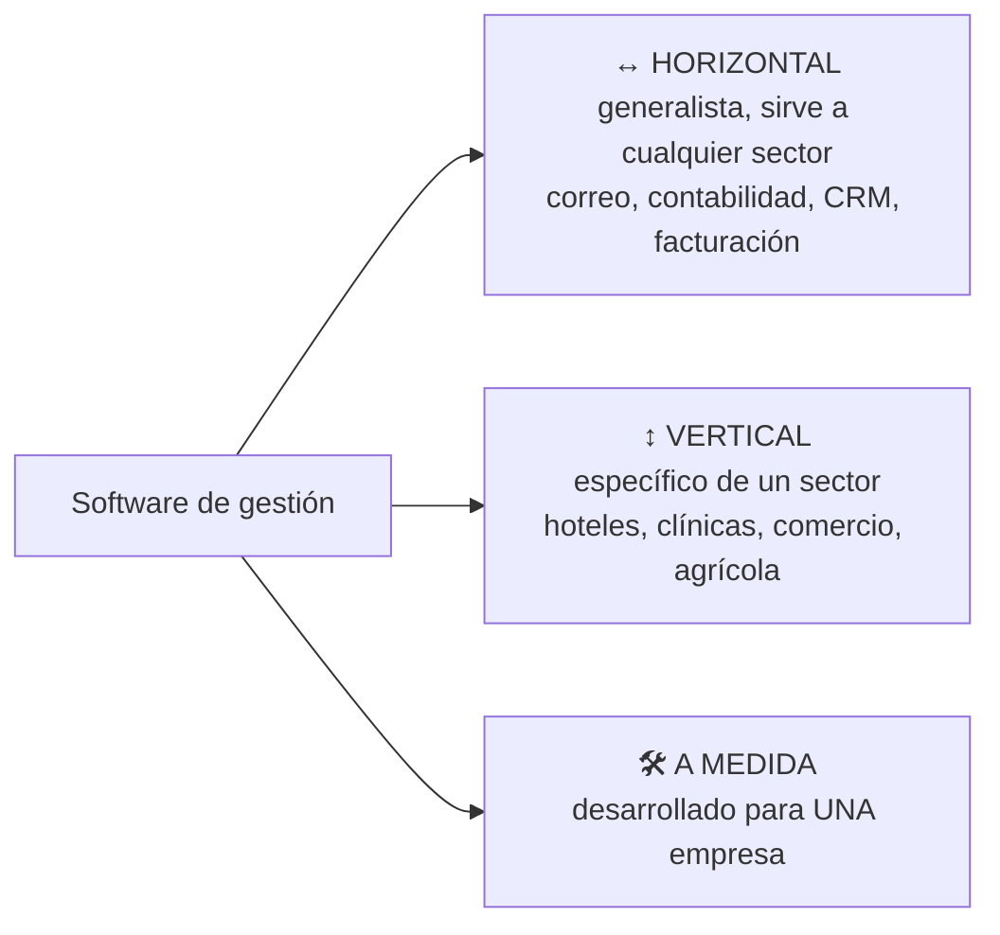

# 4 · Software horizontal y vertical

↩️ [[SGE-T1]]

> [!note] Soluciones verticales (libro)
> Desarrolladas para un tipo de negocio o mercado concreto, **sin llegar a ser software a medida**. Nacen de la experiencia en el sector (a veces con asociaciones sectoriales), por eso incluyen las **mejores prácticas e indicadores propios** del negocio.

> [!caution] Trampa
> «Vertical» **≠** «hecho a medida». Suele ser un producto comercial especializado.

## Ejemplos (Actividad N04)

| Tipo | Software | Para qué | ROI tangible | ROI intangible |
|---|---|---|---|---|
| Horizontal | Microsoft 365 | Correo, ofimática, Teams | Menos horas buscando versiones | Colaboración |
| Horizontal | Odoo | ERP modular | Sin registros duplicados | Info común entre departamentos |
| Horizontal | HubSpot CRM | Contactos y oportunidades | Menos seguimientos olvidados | Trato comercial coherente |
| Vertical | Cloudbeds | Hoteles | Menos sobreventas | Coordinación recepción-reservas |
| Vertical | Cliniko | Clínicas | Menos ausencias y llamadas | Experiencia del paciente |
| Vertical | Shopify POS | Comercio minorista | Stock al cobrar, menos errores | Servicio ágil |

> [!question]- Actividad 1.3 · ¿Cuándo es mejor un software vertical?
> Cuando el negocio depende de **reglas propias del sector** (ocupación hotelera, historiales clínicos, ventas de mostrador), cuando el horizontal requeriría mucha personalización, o cuando se necesitan **indicadores y normativa sectorial** ya incorporados. Para necesidades comunes a todos los sectores, mejor horizontal.

## ROI — Retorno de la inversión

> [!note] Fórmula
> $$ROI\ (\%) = \frac{\text{beneficio anual estimado} - \text{coste total año 1}}{\text{coste total año 1}} \times 100$$
> Coste año 1 = implantación + 12 × cuota mensual.

> [!info] Definición del libro
> Cálculo del **tiempo** necesario para recuperar lo invertido en un sistema con los beneficios que genera.

> [!example] Ejemplo · Microsoft 365 en oficina de 10 personas
> - Ahorro: 12 h/mes × 18 €/h = 216 €/mes → **2.592 €/año**
> - Coste: licencias 1.455,60 € + puesta en marcha 500 € = **1.955,60 €**
> - ROI = (2.592 − 1.955,60) / 1.955,60 × 100 = **32,5 %**

> [!tip] Tangible vs intangible
> - **Tangible**: medible en dinero o tiempo (horas ahorradas, errores evitados).
> - **Intangible**: imagen, coordinación, satisfacción… hasta que se cuantifica.
