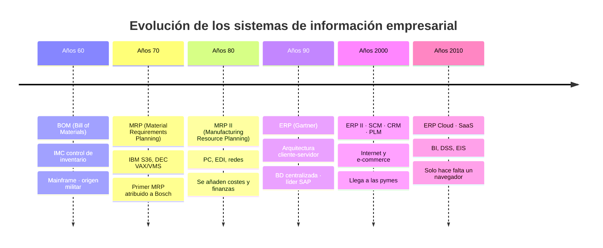
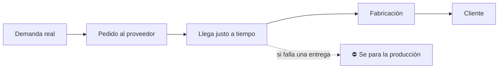

# 5 · Historia de los sistemas de gestión y JIT

↩️ [[SGE-T1]]

> [!info] Desfase
> Las fechas varían según el autor por el desfase entre la expansión en **EE. UU.** y su llegada a **Europa/España**.

| Década | Hito | Qué aporta |
|---|---|---|
| 60 | BOM, IMC | Listas de materiales y control de inventario; primeras áreas: contabilidad, finanzas, almacén |
| 70 | MRP | Calcular material necesario vs almacén → cuándo abastecer |
| 80 | MRP II | + costes de materia prima, mano de obra, logística (componente financiero) |
| 90 | ERP | Módulos + **una única BD** centralizada; los datos se introducen una sola vez |
| 2000 | ERP II, SCM | Intercambio con proveedores vía **EDI**; aparecen CRM y PLM |
| 2010 | ERP Cloud, SaaS | Universalización; rol **estratégico** (BI, DSS, EIS) |

> [!note] ERP (definición del libro)
> Aplicación de software **estructurada en módulos** que se complementan y usan una **base de datos centralizada**, capaz de gestionar todo el negocio.

> [!info] ¿Sabías que...?
> Los 2000 son la década del **e-commerce**: **B2B** (entre empresas) y **B2C** (al cliente final).

## JIT — Just in Time (Actividad 1.4)

> [!note] Definición
> **Justo a tiempo**: producir o aprovisionar **lo necesario, en la cantidad y el momento adecuados**. Es un **método de gestión**, no un tipo de software.

> [!example] Origen
> **Toyota (Japón)**. Kiichiro Toyoda planteó el principio, desarrollado dentro del **Toyota Production System**.

| ✅ Ventajas | ⚠️ Inconvenientes |
|---|---|
| Menos inventario y espacio | Fuerte dependencia de proveedores |
| Menos dinero inmovilizado | Una interrupción para la producción |
| Menos desperdicio | Requiere coordinación muy fiable |

> [!example] Ejemplos
> Piezas en una línea de automóviles · ingredientes diarios de un restaurante · componentes para montar bicicletas.
