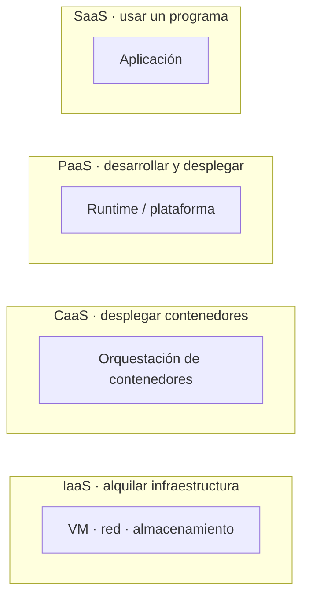
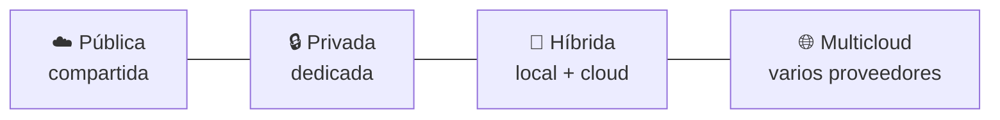

# 6 · Servicios cloud

↩️ [[SGE-T1]]

> [!note] Cloud
> Usar por internet recursos informáticos que opera un proveedor (almacenamiento, servidores, BD, plataformas, aplicaciones), normalmente por **suscripción o consumo**.

## Modelos de servicio

| Modelo | Qué pone el proveedor | Qué gestiona el cliente | Ejemplos |
|---|---|---|---|
| **IaaS** | Máquinas, red, almacenamiento | SO, apps, parches, datos | Amazon EC2, Azure VMs, Google Compute Engine |
| **CaaS** | Plataforma de contenedores | Imágenes, despliegues, config | Amazon ECS, GKE, AKS |
| **PaaS** | Plataforma de ejecución y despliegue | Código, config, datos | Google App Engine, Azure App Service, Heroku |
| **SaaS** | Aplicación lista para usar | Usuarios, permisos, datos | Google Workspace, Salesforce, Microsoft 365 |

> [!tip] Regla rápida
> **IaaS** = alquilar infraestructura · **PaaS** = desarrollar y desplegar · **SaaS** = usar un programa · **CaaS** = desplegar contenedores.

> [!caution] No mezclar categorías
> **ERP, DSS, EIS** describen una **función empresarial**. **IaaS, PaaS, SaaS, CaaS** describen **cómo se ofrece** la tecnología. **JIT** es un **método de gestión**.

> [!info] CaaS ambiguo
> También puede significar *Communications as a Service*; en este tema se usa **Containers as a Service**.

## Servicios complementarios

| Servicio | Qué es | Ejemplo |
|---|---|---|
| DBaaS | BD administrada | Supabase Postgres |
| FaaS / serverless | Funciones por evento, pago por ejecución | AWS Lambda |
| Backup / DRaaS | Copias y recuperación ante desastres | — |

## Tipos de despliegue

## Ventajas y riesgos

| ✅ Ventajas | ⚠️ Desventajas |
|---|---|
| Poca inversión inicial, escalabilidad | Dependencia de conexión y proveedor |
| Mantenimiento delegado | Costes recurrentes y extras |
| Trabajo compartido, acceso remoto | Migración, salida de datos, RGPD |

> [!warning] La nube no te libra de...
> Configurar permisos, copias, contratos de tratamiento de datos y planes de recuperación.

## Propuestas al comité (Actividad N07)

| Propuesta | Solución | Coste año 1 | Beneficio | ROI |
|---|---|---|---|---|
| 🏖️ Tienda Costera | Shopify Basic + Google Workspace | 978,80 € | 1.600 € | 63,5 % |
| 🩺 Clínica Tramuntana | Cliniko | 1.740 USD | 3.000 USD | 72,4 % |
| 💻 Pixel Nord | Vercel Pro + Supabase Pro | 890 USD | 1.700 USD | 91,0 % |

> [!success] Argumento final
> No se aprueba porque «la nube sea moderna», sino porque un proceso concreto **mejora de forma medible**. Piloto de 30 días → evaluar resultados reales.
