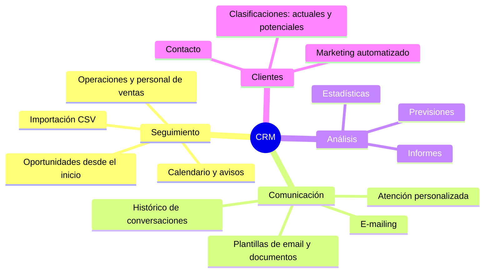
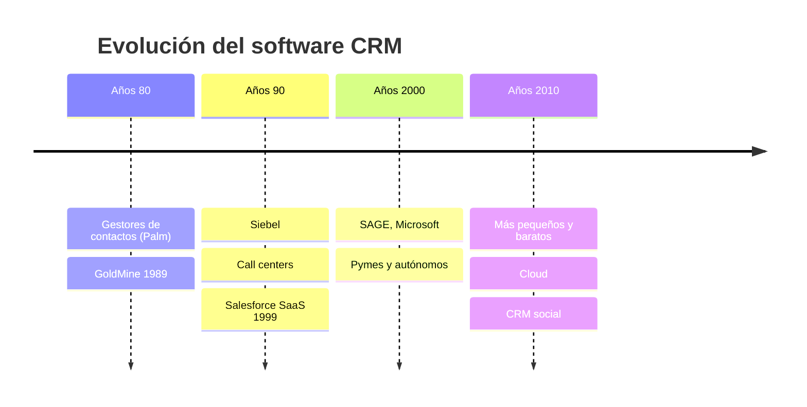
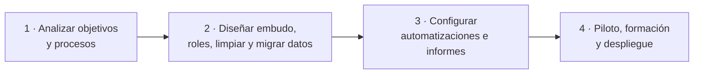

# 7 · CRM — Gestión de relaciones con clientes

↩️ [[SGE-T1]]

> [!note] Fidelizar
> Conseguir una **venta recurrente** en el tiempo. Mantener un cliente es **mucho menos costoso** que conseguir uno nuevo.

> [!important] Cambio de enfoque
> Del **producto** (siglo pasado) al **cliente**: conocer sus necesidades incluso antes de que las sepa. Del comercial con libreta → **automatización de la fuerza de ventas** con movilidad.

> [!note] CRM (Customer Relationship Management)
> Software **colaborativo orientado al cliente** que registra su información de contacto y, sobre todo, **todas las transacciones** con él, dando una visión global. Es la «evolución inteligente de las hojas de cálculo».

> [!tip] Un CRM es una herramienta de **seguimiento, comunicación y análisis** (pregunta típica de test).

## Funcionalidades

## Evolución del CRM

> [!info] Recuerda · ROI de un CRM
> Se mide con: **tasa de retención**, **nuevos clientes referenciados**, **evolución del gasto** por cliente y **repetición de compras**.

> [!question]- ¿Solo para grandes empresas?
> **No.** Pymes y autónomos también se benefician; incluso hay soluciones **monousuario**. Lo importante es calcular el ROI para elegir la adecuada al tamaño y actividad.

## Fabricantes

| Tipo | Ejemplos |
|---|---|
| Grandes | Salesforce, Microsoft Dynamics 365, SAP Sales Cloud, Oracle CX |
| Pymes | Zoho CRM, HubSpot, Pipedrive, Freshsales, Odoo CRM |
| Open Source (libro) | **SuiteCRM, vTiger CRM, OroCRM, Zurmo** |
| Históricos | GoldMine, ACT! |

> [!info] Open source vs comercial
> La diferencia se ha reducido: muchos pasaron a **modelo mixto** (gratis hasta X usuarios o funciones) y algunos, como **OpenBravo**, son ya totalmente comerciales.

> [!info] Recursos web
> SoftwareReviews · Capterra (parte de Gartner) · Technology Evaluation Centers (TEC).

## Comparativa (Actividad N06)

| Criterio | Salesforce Sales Cloud Pro | Zoho CRM Professional |
|---|---|---|
| Perfil | Gran empresa, 25 comerciales | Pyme, 5 usuarios |
| Arquitectura | SaaS multitenant, web y móvil | SaaS web y móvil |
| Licencia | 100 €/usuario/mes → 30.000 €/año | 23 USD/usuario/mes → 1.380 USD/año |
| Coste año 1 | 40.000 € | 2.280 USD |
| Implantación | 6–12 semanas | 1–3 semanas |
| ROI supuesto | 50 % | 75,4 % |

> [!success] Recomendación
> No elegir por fama o precio: pyme con embudo sencillo → Zoho; gran empresa con mucha personalización → Salesforce con presupuesto real. Medir el retorno **tras el despliegue**.
