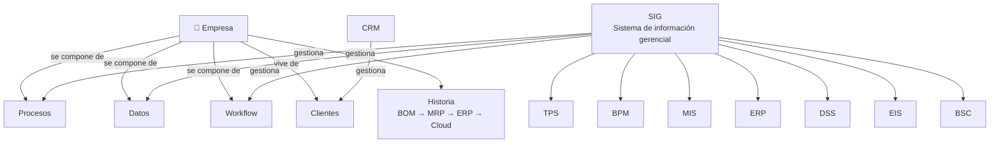
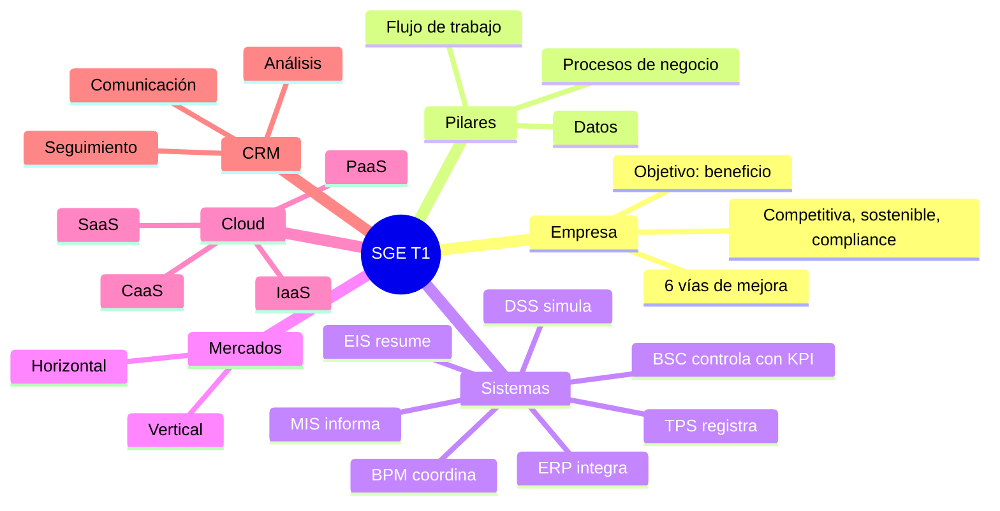

# 🗺️ SGE · Tema 1 — Índice

> [!abstract] Qué cubre este tema
> Función de la empresa y su gestión, sistemas de información (SIG/MIS), clasificación de sistemas (TPS → BSC), software horizontal y vertical, historia (BOM → ERP Cloud), servicios cloud y CRM.

## Notas del tema

| Nº | Nota | Actividad relacionada |
|---|---|---|
| 1 | [[01 - Gestión empresarial y objetivos]] | N01 · Objetivos de empresa |
| 2 | [[02 - Sistemas de información]] | N02 · Sistemas no gerenciales |
| 3 | [[03 - Clasificación de sistemas y KPI]] | N03 · TPS, BPM, MIS, ERP, DSS, EIS, BSC |
| 4 | [[04 - Software horizontal y vertical]] | N04 · Mercados verticales |
| 5 | [[05 - Historia y JIT]] | N05 · JIT |
| 6 | [[06 - Servicios cloud]] | N05 / N07 · IaaS, PaaS, SaaS, CaaS |
| 7 | [[07 - CRM]] | N06 · Salesforce vs Zoho |
| 8 | [[08 - Glosario y acrónimos]] | — |
| 9 | [[09 - Autoevaluación]] | Test del libro |

## Mapa conceptual

## Mindmap rápido

> [!tip] Frase para el examen
> **TPS registra, BPM coordina, MIS informa, ERP integra, DSS simula, EIS resume para directivos y BSC controla la estrategia con KPI.**
