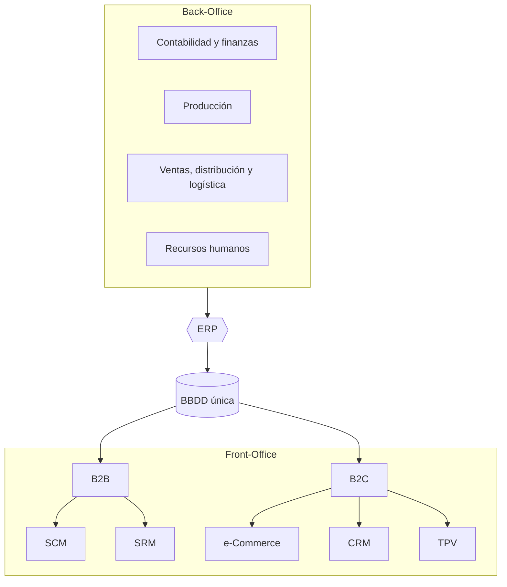

# 02 · Características, componentes y módulos

Anterior: [[01 - Qué es un ERP]] · Siguiente: [[03 - Infraestructura, instalación y licencias]]

## Características principales
> [!important] Las dos clave: modularidad e integración
> - **Modularidad**: cada módulo = un área funcional. Comparte información con el resto aunque suela ser un paquete de software distinto.
> - **Integración**: los datos se introducen **una única vez** en una **BD central** accesible desde todos los módulos. Lo generado en un módulo se **reutiliza** en otro.

Otras características generales:
- Orientados a los **procesos** empresariales.
- Normalmente **multiplataforma**.
- Acceso desde múltiples localizaciones y dispositivos.
- **Estandarización**: diseñados para el funcionamiento básico estándar → válidos para cualquier sector.
- **Adaptabilidad**: cierta personalización a la empresa.
- **Integrables** con cuadros de mando (*Dashboard*, *ScoreCard*) y sistemas [[06 - Inteligencia de negocio (BI)|BI]].
- Información en **tiempo real**, de forma selectiva y jerárquica.
- **Escalables**: crecen (módulos, usuarios, tamaño BBDD, peticiones) sin comprometer el funcionamiento.

## Componentes: Front-Office vs Back-Office

| | Back-Office | Front-Office |
|---|---|---|
| Qué gestiona | Procesos **internos** | Relación con el **exterior** (clientes, proveedores) |
| Ejemplos | RRHH, almacén, contabilidad y finanzas, producción | CRM, SCM, SRM, e-business, e-commerce, TPV |

> [!note] CRM vs ERP
> Todos los ERP ofrecen módulo CRM. El **CRM** se enfoca al cliente y a **aumentar ventas**; el **ERP** al negocio, a **optimizar recursos y procesos** y reducir costes.

> [!tip] Sabías que…
> Según el fabricante y su especialización existen módulos o **plugins** para casi cualquier proceso de negocio.

## Funciones empresariales que cubren los módulos
Contabilidad y finanzas · Comercial y marketing · RRHH · CRM · Compras y proveedores · Almacén · Producción · Proyectos · Comercio electrónico (B2B y B2C) · **SCM** (cadena de suministros) · **SRM** (relaciones con proveedores) · **PLM** (vida del producto) · **KMS** (gestión del conocimiento) · **TPV/POS**.

## Detalle de los principales módulos
- **Contabilidad y finanzas**: automatiza operaciones contables; se alimenta de ventas y compras (facturar a clientes, pagar a proveedores). Gestiona impuestos, cuentas bancarias, contabilidad analítica, informes. Debe seguir el **plan contable local**.
- **Comercial (y marketing)**: "ventas y facturación". Desde la oportunidad → presupuestos → actividades comerciales (visitas, llamadas) → cierre y facturación. Listas de precios, descuentos, campañas.
- **RRHH**: selección y contratación, remuneraciones y beneficios, **nóminas**, control de asistencia, permisos y vacaciones; visión global del rendimiento y costes por departamento.
- **CRM**: todos los contactos con clientes. Puede solaparse con facturación, ventas y marketing.
- **Compras y proveedores**: proveedores, listas de precios, órdenes de compra, contratos, negociación, seguimiento de pedidos y control de entrega. (A veces incluye el almacén.)
- **Almacén y logística**: entregas de proveedores, existencias, reabastecimiento, rotación, **stock**, traspasos entre almacenes; logística propia o subcontratada.
- **Otras aplicaciones**: sitio web, parte de horas, fabricación, MRP II, PLM, calidad, comercio electrónico, eLearning…

## Infraestructura técnica
Basada en **cliente-servidor** sobre **bases de datos relacionales**. Tres componentes:
1. **Módulo cliente**: hoy normalmente un **navegador web** (*cliente ligero*). Ya no se usan los *clientes pesados*.
2. **Infraestructura distribuida de comunicaciones**: acceso desde cualquier dispositivo y ubicación.
3. **Módulo servidor**: la "inteligencia" del ERP. Incluye lenguaje de programación, BD y SGBD.

Capas:
- Navegador web ⇄ Aplicación en servidor.
- Navegador web ⇄ Web intermedia ⇄ Aplicación en servidor/es (**multicapa**, mayor distribución).

**Esquema general:** uno o varios servidores (físicos/virtuales) con el ERP + comunicaciones protegidas por **cortafuegos** que permiten acceso de usuarios internos, de usuarios externos a la intranet y de clientes al módulo de e-commerce (zona **DMZ**).
