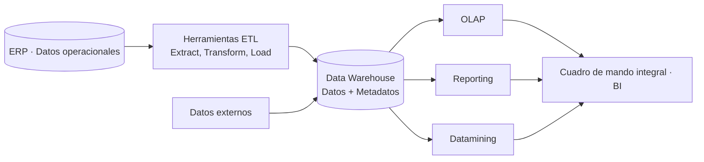

# 06 · Inteligencia de negocio (BI)

Anterior: [[05 - Mercado actual y soluciones]] · Siguiente: [[07 - Glosario]]

> [!info] Business Intelligence
> **Análisis de la información disponible** para obtener conocimiento sobre la organización, su actividad y su ecosistema. Conjunto de herramientas que se basan en la información recogida a través del ERP → información precisa que facilita decisiones **operativas, tácticas y estratégicas**. Es una solución **complementaria al ERP**.

Relación estrecha con **Big Data**: combinados permiten obtener cantidades inmensas de datos **en tiempo real** y transformarlos en conocimiento → ventaja competitiva.

## Arquitectura tradicional

1. **ETL**: recoge datos estructurados de fuentes internas y los reorganiza en tablas añadiendo **metadatos**.
2. Los datos transformados se almacenan en un **Data Warehouse (DWH)** = base de datos relacional.
3. Las **BD OLAP** se alimentan de los sistemas operacionales y, con la definición de **KPI**, permiten **cuadros de mando (Dashboard)** fiables.

## Conceptos
| Concepto | Significado |
|---|---|
| **ETL** | *Extract, Transform and Load*. Herramientas que reúnen datos de distintas fuentes, les dan formato común y los depuran para cargarlos en un Data Warehouse. Al evaluarlas: flexibilidad (software libre, no depender de un proveedor), nº de conectores, compatibilidad con Cloud, portabilidad, usabilidad. |
| **OLAP** | *On-Line Analytical Processing*. Procesamiento analítico, relacionado con **tablas multidimensionales (cubos)**. Va un paso más allá de la tabla bidimensional y se nutre de los sistemas operacionales vía ETL. Acceso normalmente **solo lectura**, usa **3 o más dimensiones** y permite presentar todas las combinaciones. |
| **Data Warehouse** | "Almacén de datos": enorme almacén **altamente estructurado**. Definido por **William H. Inmon** (padre del Data Warehousing): *colección de datos orientada a un tema, integrada, variante en el tiempo y no volátil, que soporta la toma de decisiones*. Contiene todas las transacciones de las aplicaciones del negocio. |
| **Data Mining** | "Minería de datos": procesos **estadísticos** que buscan **patrones ocultos** y relaciones causa-efecto para describir e incluso **predecir comportamientos**. |
| **KPI** | *Key Performance Indicator* = **indicador clave de desempeño**. Para administrar hay que medir: se definen magnitudes a evaluar en periodos determinados. |
| **BSC** | *Balanced ScoreCard* = **cuadro de mando integral**. Representación gráfica de los KPI, con visión concreta o global del negocio. |

> [!example] Ejemplos de KPI
> Total de ventas en un periodo estacional · % de proyectos aceptados · rentabilidad media por tipo de venta · ratio de clientes nuevos y perdidos · productividad del personal.
> Los **responsables** de la organización definen los KPI (operacionales, de gestión, estratégicos…).

## Relación ERP ↔ BI (Fig. 2.8)
| Nivel | Datos | Herramientas | Personal |
|---|---|---|---|
| **Estratégico** (BI) | Decisión, conocimiento | ScoreCard, KPI | Consejo de administración, gerentes |
| **Gestión y administración** | Análisis de patrones, transformación en información | Data Mining, OLAP | Directores de área |
| **Operativo** (ERP) | Obtención | Data Warehouse, ETL | Personal de base |
