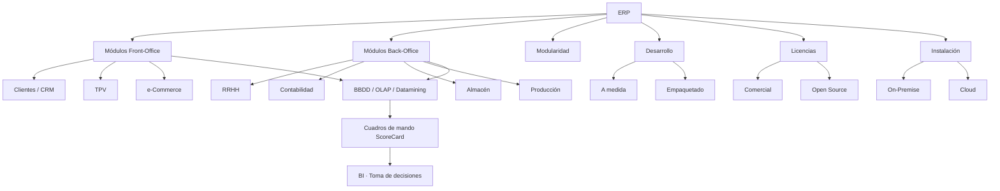

# 🗂️ Tema 2 · ERP (Enterprise Resource Planning)

> [!abstract] Objetivos del capítulo
> - Comprender el concepto de ERP, sus módulos y su adaptación a los departamentos.
> - Estudiar opciones de implementación: **empaquetado** vs **a medida**.
> - Ventajas e inconvenientes de implantar un ERP.
> - Tendencias del mercado y tipos de licencias.
> - Diferenciar **On-Premise** y **Cloud**.
> - Relacionar ERP, ETL, OLAP, DataWarehouse, DataMining, ScoreCard, BI.
> - Conocer soluciones propietarias y Open Source.

## Notas del tema
1. [[01 - Qué es un ERP]]
2. [[02 - Características, componentes y módulos]]
3. [[03 - Infraestructura, instalación y licencias]]
4. [[04 - Ventajas, inconvenientes y fracaso]]
5. [[05 - Mercado actual y soluciones]]
6. [[06 - Inteligencia de negocio (BI)]]
7. [[07 - Glosario]]
8. [[08 - Actividades y supuestos prácticos]]

## Mapa conceptual

